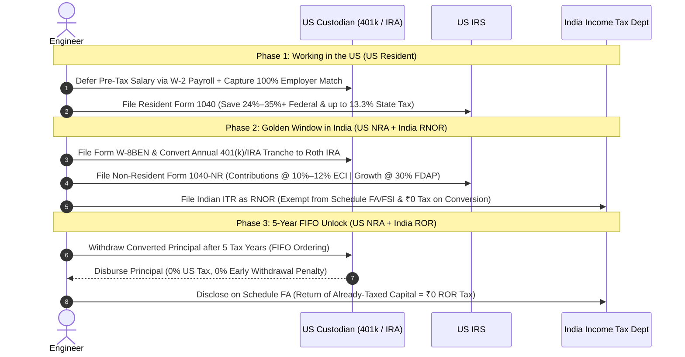

# US ➔ India 401(k) Tax Arbitrage & Retirement Blueprint

> An open-source, peer-reviewed technical architecture and execution blueprint for Indian software engineers returning from the United States (H-1B / L-1) to India. Models a cross-border legal pipeline to arbitrage peak US marginal taxes down to 10%–12%, capture 100% employer match, bypass the 40% US Estate Tax cliff, and unlock principal decades before age 59½.

📖 **[Read the Full Technical Design Document (TDD)](TECHNICAL_DESIGN_DOCUMENT.md)** | 🌐 **[Interactive Web Version](https://mradityagoyal.github.io/us-india-401k-blueprint/)**

---

> [!CAUTION]
> **Legal & Tax Disclaimer**: This repository and architectural blueprint are created strictly for educational, informational, and systems-engineering analysis. It does **not** constitute formal tax, legal, or investment advice. Cross-border tax execution involves individualized facts (including state domicile severance, trailing equity sourcing, and custodian compliance). You should consult a licensed US Certified Public Accountant (CPA) and Indian Chartered Accountant (CA) specializing in cross-border taxation before executing any rollovers, conversions, or distributions.

---

## The Core Dilemma

Every Indian engineer working in the United States on an H-1B or L-1 visa faces a major financial dilemma:

> *"Should I contribute to a US pre-tax 401(k) if I plan to return to India in a few years? Or will my money be trapped until age 59½, double-taxed, and hit with a 40% US estate tax cliff?"*

Because of fear and conflicting online advice, many returnees choose the default path: **they skip the 401(k) entirely**.
- **The True Cost of Skipping**: Forfeiting **100% of employer matching compensation** (often \$5,000–\$15,000+/year) and paying peak upfront income taxes (**32%–35%+ Federal** and **9.3%–13.3% CA/NY State**).

This blueprint demonstrates that skipping the 401(k) is almost always mathematically suboptimal. Instead, by chaining together existing provisions in the **US Internal Revenue Code (`IRC`)**, the **Indian Income-tax Act, 2025**, and the **India–US Double Taxation Avoidance Agreement (DTAA)**, returning engineers can extract their retirement capital at rock-bottom tax rates.

---

## The 3-Phase Architecture

1. **Phase 1: Accumulate & Defer (US Working Years `≤ T_0`)**
   - Maximize pre-tax 401(k) contributions to bank 32%–35% federal and 9%–13% state tax deductions.
   - Capture 100% of the employer match (instant 50%–100% risk-free return).
   - Pre-open destination Traditional and Roth IRA shells at Charles Schwab before departing the US.

2. **Phase 2: Paced RNOR Conversions (`Years T_1 to T_3` — US NRA + India RNOR)**
   - Relocate to India and establish **US Non-Resident Alien (`NRA`)** status on January 1 (`< 31 physical days` in the US).
   - Qualify for India's 2- to 3-year **Resident but Not Ordinarily Resident (`RNOR`)** status (`≤ 729 days` in India over 7 preceding tax years).
   - Convert ~\$48k–\$50.4k/year from the pre-tax 401(k) to a Roth IRA:
     - **Contribution Principal (`ECI`)**: Taxed on `Form 1040-NR` at empty bottom slabs (**10% and 12%** under `IRC § 864(c)(6)` and `IRS Pub 519`).
     - **Pre-Conversion Growth (`FDAP`)**: Taxed on `Schedule NEC` at flat **30%**.
     - **US State Tax**: **0%** under federal preemption (**`4 U.S.C. § 114`**).
     - **Indian Tax**: **₹0** (foreign income received outside India is exempt during RNOR under `Income-tax Act, 2025 § 5(1)`).

3. **Phase 3: 5-Year FIFO Principal Unlock & Estate Tax Exit (`Year T+5+` — India ROR)**
   - Under **`IRC § 408A(d)(3)(F)`**, converted principal is permanently exempt from the 10% early withdrawal penalty after 5 tax years.
   - Under **Roth `FIFO` ordering (`IRC § 408A(d)(4)`)**, you can withdraw **100% of converted principal tax- and penalty-free at any age**.
   - Under **`FEMA § 6(4)`**, redeploy the USD offshore into **Irish-domiciled UCITS ETFs**, eliminating the catastrophic **40% US Estate Tax cliff** above \$60,000 (`IRC § 2102(b)(1)`).

---

## Strategy Comparison (On $30,000 Gross Salary)

Modeled on a high-tax state baseline (`41.3%` combined CA/NY marginal tax, a `$10,000` employer match, and `25%` growth prior to conversion):

| Strategy | Invested at `T_0` | Value After `25%` Growth | Tax + Penalty Paid at Exit | **Net After-Tax USD Capital** | Liquidity Timeline | Operational Friction |
| :--- | :--- | :--- | :--- | :--- | :--- | :--- |
| **1. Proposed: Pre-Tax 401(k) ➔ RNOR Roth Pipeline** | **\$40,000** (`\$30k` + `\$10k` match) | **\$50,000** | **\$7,552** (`\$4,552` ECI + `\$3,000` FDAP; `\$0` penalty; `₹0` India) | **\$42,448** *(+ post-conversion Roth gains)* | **5 tax years** (`T+5` principal; `59½` gains) | **Moderate** (`1040-NR` filing, `Form 8606`, `Schedule FA` in ROR) |
| **2. Alt A: Pre-Tax 401(k) ➔ Direct Cash-Out in RNOR** *(Skip Roth, pay 10% penalty)* | **\$40,000** (`\$30k` + `\$10k` match) | **\$50,000** | **\$12,552** (`\$4,552` ECI + `\$3,000` FDAP + **\$5,000 penalty**; `₹0` India) | **\$37,448** | **Immediate in RNOR** (`Year T_1..T_3`) | **Low** (One-time `1040-NR`; zero Roth blocks, zero 5-yr lock) |
| **3. Alt B: Hybrid Split** *(401k to Match + Excess in Taxable Brokerage)* | **\$25,000** in 401k + **\$8,805** in Brokerage | **\$31,250** (401k) + **\$11,006** (Brokerage) | **\$4,627** on 401k + **\$0 tax on Brokerage gain in RNOR** | **\$37,629** (`\$26,623` Roth + `\$11,006` Brokerage) | **\$11,006 Immediate**; **\$26,623 at `T+5`** | **Moderate** (Captures 100% match, leaves half liquid) |
| **4. Alt C: Leave in 401(k) Until Age 59½** *(File India Form 40)* | **\$40,000** (`\$30k` + `\$10k` match) | **\$50,000** | **~31.2%–39% Indian ROR slab tax** on 100% of withdrawals at 59½ | **~\$30,500–\$34,400** *(present value)* | **20–30+ years** (Locked until `59½`) | **High long-term** (25 yrs of `Schedule FA` + **40% US Estate Tax** risk) |
| **5. Alt D: Skip 401(k) Completely** *(Taxable Brokerage)* | **\$17,610** (`\$0` match; `\$12,390` upfront tax) | **\$22,013** | **\$0 US tax & ₹0 Indian tax** during RNOR | **\$22,013** | **Immediate** (`T_0 / T_1`) | **Trivial** (Standard brokerage; **-\$20,435 net deficit**) |

*Detailed step-by-step arithmetic and failure modes are analyzed in [Section: Alternatives Considered](TECHNICAL_DESIGN_DOCUMENT.md#alternatives-considered).*

---

## Statutory Certainty Matrix

| Tier | Pipeline Mechanism | Governing Law | Practical Reality & Friction |
| :--- | :--- | :--- | :--- |
| **Tier 1: Settled Law** *(100% codified)* | • **0% State Tax** on non-resident retirement payouts • **₹0 Indian Tax in RNOR** on foreign payouts • **5-Tax-Year FIFO Unlock** (`Tier 2` principal out first) • **Direct 401k ➔ Roth IRA rollover mandate** • **\$60,000 Estate Tax Cliff** on US-situs assets | • `4 U.S.C. § 114` • `Income-tax Act, 2025 § 5(1)` • `IRC § 408A(d)(3)(F) & (d)(4)` • `IRC § 401(a)(31)`, `Notice 2008-30` • `IRC § 2102(b)(1) & § 2105` | **Unambiguous statute.** Only procedural error (e.g. wiring funds directly into an Indian INR bank account instead of US account first) can break these. |
| **Tier 2: Chained Interpretation** *(Manual reporting)* | • **Splitting Roth conversion into `ECI` (10%–12%) and `FDAP` (flat 30%)** | • `IRC § 408A(d)(3)(A)` • `IRC § 864(c)(6)` & `IRS Pub 519 (Pensions)` | **Law is explicit, but custodians are blind.** US custodians issue `Form 1042-S` with flat 30% withholding on IRAs. Your CPA must manually split `ECI` vs. `FDAP` on `Form 1040-NR` to claim refunds. |
| **Tier 3: Gray Areas** *(Defensive posture)* | • **Indian ROR Return-of-Capital at `Year T+5`** • **Post-conversion Roth growth in ROR** (`Tier 3`) | • `India IT Act § 2(24)` (capital is not income) • `Section 158` / `Form 40` does not cover Roths | **No Roth statute in India.** Defending `Year T+5` tax-free return of capital during an Indian scrutiny audit requires retaining your 5-year archive of US `Form 1040-NR` and `Form 8606` cost basis. |

---

## Table of Contents (Full TDD)

1. [Executive Summary & Background](TECHNICAL_DESIGN_DOCUMENT.md#executive-summary)
2. [Context & Scope](TECHNICAL_DESIGN_DOCUMENT.md#context-and-scope)
3. [System Architecture & Roles](TECHNICAL_DESIGN_DOCUMENT.md#system-architecture)
4. [System Preconditions, Statutory Certainty & Assumptions](TECHNICAL_DESIGN_DOCUMENT.md#system-preconditions-statutory-certainty--assumptions)
5. [Detailed Design](TECHNICAL_DESIGN_DOCUMENT.md#detailed-design)
   - [Phase 1: Ingestion & Match Capture](TECHNICAL_DESIGN_DOCUMENT.md#1-ingestion--match-capture-years--t_0--all-us-working-years)
   - [Phase 2: Paced Conversions & Packet Splitting](TECHNICAL_DESIGN_DOCUMENT.md#2-paced-roth-conversions-during-rnor-years-t_1-to-t_3--us-nra--india-rnor)
   - [Phase 3: 5-Year Seasoning & FIFO Dequeue](TECHNICAL_DESIGN_DOCUMENT.md#3-five-year-seasoning--fifo-dequeue-year-t5--india-ror)
6. [Production Constraints, Gotchas & Guardrails](TECHNICAL_DESIGN_DOCUMENT.md#production-constraints-gotchas--guardrails)
   - [The 3 Custodian Execution Paths (Fidelity vs. Schwab vs. In-Plan Roth)](TECHNICAL_DESIGN_DOCUMENT.md#1-custodian--plan-routing-gotchas-the-3-execution-paths)
   - [The Mandatory Withholding Penalty Trap & 60-Day Top-Up Protocol](TECHNICAL_DESIGN_DOCUMENT.md#2-path-2-if-funds-are-already-in-a-traditional-ira-traditional-ira--roth-ira-via-charles-schwab-international--30-withholding-top-up)
   - [Taxable Brokerage Cost-Basis Step-Up at 0% Tax](TECHNICAL_DESIGN_DOCUMENT.md#2-taxable-brokerage-cost-basis-step-up-the-rnor-basis-reset-gotcha)
7. [Alternatives Considered & Objective Trade-Off Analysis](TECHNICAL_DESIGN_DOCUMENT.md#alternatives-considered)
8. [Sensitivity Analysis, Boundary Conditions & Failure Modes](TECHNICAL_DESIGN_DOCUMENT.md#sensitivity-analysis-boundary-conditions--failure-modes)
9. [Quality Attributes (Security, Reliability, Estate Tax Cliff)](TECHNICAL_DESIGN_DOCUMENT.md#quality-attributes)
10. [Project Management & Execution Timeline](TECHNICAL_DESIGN_DOCUMENT.md#project-management)
11. [Operations & Pre-Departure Checklist](TECHNICAL_DESIGN_DOCUMENT.md#operations)
12. [Appendix: Statutory References & Primary Sources](TECHNICAL_DESIGN_DOCUMENT.md#appendix-statutory-references--primary-sources)

---

## Authors, Contributors & Peer Review

- **Primary Author**: [Aditya Goyal](https://www.linkedin.com/in/mradityagoyal/)
- **AI Synthesis & Modeling**: Google Gemini Argon (high), Google Gemini Flash 3.8 (high)
- **Peer Review & Stress-Testing**: Claude Opus 5.5

---

## Contributing & Community RFC

Cross-border tax law evolves as treaties, finance acts, and custodian policies shift. We welcome contributions, issue submissions, and pull requests from:
- US CPAs and Enrolled Agents specializing in non-resident taxation.
- Indian Chartered Accountants specializing in cross-border FEMA and `Schedule FA` compliance.
- Engineers who have executed direct rollovers or conversions with specific recordkeepers (Fidelity, Empower, Vanguard, Schwab).

To submit a correction, policy update, or question:
👉 **[Open an Issue on GitHub](https://github.com/mradityagoyal/us-india-401k-blueprint/issues)**

---

## License

This documentation is released under the **[Creative Commons Attribution 4.0 International License (CC BY 4.0)](https://creativecommons.org/licenses/by/4.0/)**. You are free to share, copy, and adapt this material with appropriate attribution.
