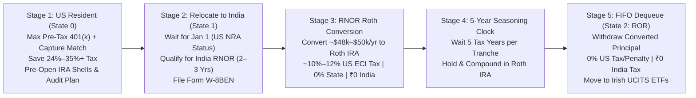
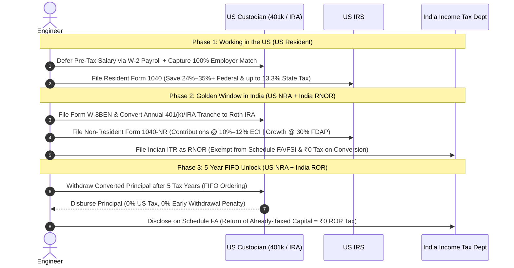
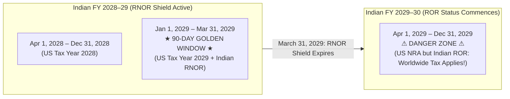
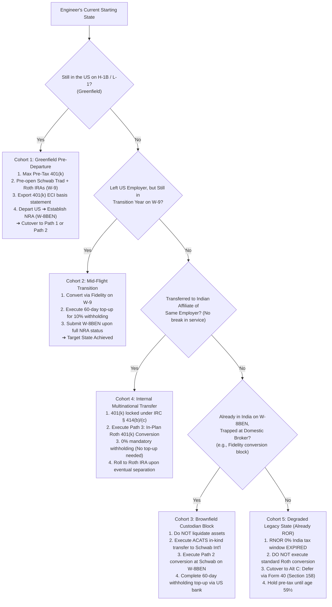

# TDD: Cross-Border 401(k) Tax Arbitrage & Principal Unlock Pipeline

**Self link**: [https://github.com/mradityagoyal/us-india-401k-blueprint](https://github.com/mradityagoyal/us-india-401k-blueprint)
**Web version**: [https://mradityagoyal.github.io/us-india-401k-blueprint](https://mradityagoyal.github.io/us-india-401k-blueprint)
**Visibility**: Public (US → India Engineering Returnee Community)
**Status**: Published `v0.1` (Community Review / RFC)
**Authors**: [Aditya Goyal](https://www.linkedin.com/in/mradityagoyal/)
**Contributors**: Google Gemini Argon (high), Google Gemini Flash 3.8 (high)
**Reviewers**: Claude Opus 5.5
**Last major revision**: 2026-11-01

---

> [!CAUTION]
> **Legal & Tax Disclaimer**: This document is an engineering systems analysis written strictly for informational, educational, and architectural evaluation. It does not constitute formal tax, legal, or investment advice. Cross-border tax execution involves strict statutory deadlines and individualized facts (including state tax domicile severance, trailing equity sourcing, and custodian compliance). You should consult a licensed US Certified Public Accountant (CPA) and Indian Chartered Accountant (CA) specializing in cross-border taxation before executing any rollovers, conversions, or distributions.

## Executive Summary

This document is a technical design for Indian software engineers residing in the US on non-immigrant visas (H-1B / L-1) who plan to return to India permanently or those who have recently returned. It models a cross-border regulatory pipeline to resolve the central financial dilemma faced by returning engineers: **should you contribute to a US pre-tax 401(k) if you plan to leave the country within a few years?** or **what options are available if you already have funds in a traditional 401(k)?**

- **The Problem**: Many Indian returnees default to skipping their 401(k) due to fears of an age 59½ lock-in, early withdrawal penalties, dual-country tax friction, and a 40% US Estate Tax cliff on non-resident assets above \$60,000. Skipping contributions forfeits 100% of the free employer match and pays peak 32%–35%+ Federal and 9%–13% State taxes upfront.
- **The Proposed Pipeline**: Instead of skipping or liquidating with penalties, this architecture chains three standard legal subsystems (**US NRA ECI rules**, **India's RNOR tax shield**, and **IRS Roth FIFO rules**) across a 3-phase execution lifecycle:
  1. *Phase 1: Accumulate & Defer*: Max out the pre-tax 401(k) while working in the US to capture 100% employer match and defer peak marginal tax.
  2. *Phase 2: Paced RNOR Roth Conversion*: After relocating to India and establishing **US Non-Resident Alien (`NRA`)** status, execute annual ~\$50k Roth conversions during India's 2–3 year **RNOR (*Resident But Not Ordinarily Resident*)** window. Under `IRS Pub 519` and `IRC § 864(c)(6)`, contribution principal is taxed at low graduated **ECI rates (10%–12%)**, while India exempts foreign-source income (`₹0` Indian tax under `Income-tax Act, 2025 § 5(1)(c)`).
  3. *Phase 3: 5-Year FIFO Unlock & Estate Tax Exit*: After a 5-tax-year seasoning clock, IRS Roth IRA **FIFO ordering** (`IRC § 408A(d)(4)`) allows 100% of converted principal to be withdrawn at any age with **0% US tax and 0% penalty**, and **defensible as a ₹0 Indian ROR tax event** under the judicial return-of-capital principle (`Income-tax Act § 2(24)`). Once extracted, the USD capital can be redeployed offshore into **Irish-domiciled UCITS ETFs**, eliminating the catastrophic 40% US estate tax cliff on the migrated capital (`IRC § 2105`).
- **Bottom-Line Impact (Benchmark)**: On a \$50,000 balance (\$30k salary deferral + \$10k match + \$10k growth) for a CA/NY engineer, this pipeline yields **\$42,448 net after tax**—a **+\$20,435 net wealth gain** over skipping the 401(k) and investing in a taxable brokerage.
- **When NOT to Use This Pipeline (Boundary Conditions)**:
  - *In 0%-State-Tax States (`WA / TX`) Without a Match*: Pre-conversion 401(k) growth is hit with a flat 30% US `FDAP` tax during RNOR, whereas capital gains in a taxable brokerage face **0% US and ₹0 Indian tax**. On unmatched dollars in WA/TX, the net gain over a taxable brokerage is narrow (~+\$2,648) and easily eaten up by multi-year `Form 1040-NR` CPA fees.
  - *Immediate Liquidity Needs*: Simply cashing out the 401(k) in RNOR and paying the 10% penalty (**Alt A**) nets **\$37,448 immediately** (vs. \$42,448 locked for 5 years), bypassing all Roth conversion friction.
  - *Hard Disqualifiers*: Leaving before your employer match vests, staying outside India for `< ~5.5–6 years` (`> 729 days` in India over the prior 7 years, which disqualifies you from the multi-year RNOR window), or having heavy trailing post-departure US RSU vests.

---

## Context and Scope

### Objective

**Primary Objective**: Enable Indian engineers on US work visas (H-1B / L-1) planning to return to India to **arbitrage their US federal marginal income tax rate down from 24%–35%+ to ~12% federal marginal tax rate** and **unlock their retirement principal 100% US tax- and penalty-free after 5 years** (with documented return-of-capital basis defense in India)—without waiting until age 59½ or incurring double taxation in India.

**Secondary Objectives**:

1. **Employer Match Capture**: Capture **100% of the employer 401(k) match** that returning individuals typically forfeit when they prematurely stop contributing.
2. **US Estate Tax Exposure Mitigation**: Unlock principal from US retirement wrappers after 5 years to escape the **40% US Estate Tax exposure** (above the \$60,000 NRA exemption cliff) on those funds, enabling re-deployment into **non-US situs assets** (such as USD-denominated Irish-domiciled UCITS ETFs) or optional repatriation.

*Non-Goals*:

- **Macro Currency Hedging (`USD` vs. `INR`)**: This design does not require converting USD to INR; unlocked capital can remain denominated in USD.
- **Alpha Generation / Security Selection**: Specific equity or index allocations inside the wrappers are out of scope (except situs selection for estate tax mitigation).
- **Non-India Corridors**: Strictly scoped to the **USA → India** tax and residency corridor.
- **Green Card Covered Expatriate Exit Tax (`IRC § 877A`)**: Primary target is non-immigrant visa holders leaving the US without triggering the 8-of-15-year Long-Term Resident exit tax.

*Audience & Format Note*: This Technical Design Document (TDD) models cross-border tax, residency, and retirement regulations from a **systems-engineering POV** (state machines, packet splitting, rate-limiting, and FIFO queues) to make the end-to-end execution pipeline unambiguous and easy to parse for software engineers.

### Background & Problem Statement

Ask 10 Indian H-1B holders planning to return to India whether to contribute to a 401(k), and 9 will tell you to stop.

Returning individuals typically view the 401(k) as a broken data store plagued by five major pain points and blind spots:

1. **Multi-Decade Lock-In Until Age 59½**: Leaving capital trapped for 20–30+ years when returnees often want liquidity within 5–7 years (e.g., buying a home or funding a startup in India), while staying exposed to future Indian Resident and Ordinarily Resident (ROR) slab taxes (~30%+) at retirement.
2. **Early Liquidation Haircut**: Withdrawing early upon leaving the US and suffering a **10% early withdrawal penalty** on top of ~30%–40% in taxes.
3. **Decades of Dual-Country Tax Filing Overhead**: Maintaining an active US retirement account from India forces decades of cross-border tax administration and dual-country filings.
4. **40% US Estate Tax Exposure over a 20+ Year Lock-In**: Once an Indian citizen leaves the US and becomes a Non-Resident Alien (NRA), their US estate tax exemption drops from **\$15,000,000** (the 2026 US citizen/resident threshold) to just **\$60,000**—meaning an account locked in until age 59½ exposes every dollar above \$60,000 to up to a **40% US Estate Tax** for 20–30+ years, which alone scares many returnees away from funding a 401(k). *(Note: US-domiciled stocks/ETFs in a regular taxable brokerage also carry this \$60k NRA estate tax exposure, but a taxable brokerage can be migrated into non-US situs Irish UCITS ETFs immediately upon leaving the US, whereas a traditional 401(k) held until age 59½ traps the balance inside a US-situs wrapper for decades).*
5. **US Custodian Lockout & Access Friction**: Fear of US brokerages restricting accounts to liquidation-only upon filing `Form W-8BEN`, losing 2FA access tied to US phone numbers, or struggling to wire distributions without an active US bank account.

In practice, this hesitation is not entirely irrational—cross-border 401(k) extraction *does* carry real operational friction (custodian `W-8BEN` restrictions, a flat 30% US `FDAP` tax on pre-conversion market growth inside the plan, and specialist `Form 1040-NR` CPA costs). At the same time, online guidance is plagued by widespread misinformation, half-truths (such as the myth that *all* non-resident withdrawals—including contributions—face a flat 30% tax plus a 10% penalty), and fragmented advice. Because the actual rules governing how the IRS and Indian Income Tax Department interact are buried across hundreds of pages of dense statutory legalese (`IRS Pub 519`, `IRC § 408A`, `Income-tax Act, 2025 § 5 & § 6(13)`, and the `India-US DTAA`), most returning engineers default to skipping their 401(k) entirely without modeling when the arbitrage wins big versus when a simpler alternative is better.

#### The Opportunity: How This Architecture Solves Each Pain Point

Rather than viewing the 401(k) as a multi-decade trap, this design treats it as a temporary, high-yield pre-tax liquidity buffer. Each of the five pain points above is architecturally neutralized by chaining US and Indian tax code provisions:

| The 5 Returnee Pain Points                           | How This Design Architecturally Resolves It                                                   | Concrete Deliverable / Outcome                                                                           |
| :--------------------------------------------------- | :-------------------------------------------------------------------------------------------- | :------------------------------------------------------------------------------------------------------- |
| **1. Multi-Decade Lock-In (Age 59½)**         | Routes funds through the **Roth IRA 5-Year FIFO Queue** (`IRC § 408A(d)(4)`)         | 100% of converted principal unlocked in **5 tax years** at any age instead of 20–30+ years.       |
| **2. Early Liquidation Haircut (10% Penalty)** | Paces conversions during **India RNOR** at graduated **ECI rates** (`10%–12%`) | Eliminates the 10% early withdrawal penalty entirely; slashes tax from **~41% down to ~11%–12%**. |
| **3. Decades of Dual-Country Filing Overhead** | Drains the US pre-tax wrapper within a **2–3 year RNOR window**                        | Once principal is dequeued at `Year T+5`, US tax ties can be severed completely.                       |
| **4. 40% US Estate Tax Exposure (> \$60k)**    | Unlocks capital to migrate into **Irish-domiciled UCITS ETFs**                          | Reduces US estate tax exposure on migrated holdings from **40% down to \$0**.                      |
| **5. Custodian Lockout & Access Friction**     | Maps **3 pre-validated execution paths** (Direct 401k, Schwab Int'l, In-Plan)           | Eliminates account freezes with pre-flight IRA shells and verified `W-8BEN` rails.                     |

By reframing the 401(k) as a two-phase tax-deferral engine—capturing maximum upfront deductions and employer matches while in the US, and extracting the principal during the transient tax asymmetry of RNOR—returning engineers can turn what is commonly viewed as a financial liability into a multi-thousand-dollar arbitrage opportunity.

---

## System Architecture & Design

### Overview

Instead of skipping the 401(k) or cashing it out with penalties, this design chains three existing regulatory subsystems—**US Non-Resident Alien (NRA) Effectively Connected Income (ECI) rules**, **India's RNOR (Resident But Not Ordinarily Resident) tax shield**, and **IRC § 408A Roth IRA conversion FIFO rules**—into a 5-stage pipeline:

By executing taxable Roth conversions *after* becoming a US NRA and *while* inside India's 2–3 year RNOR window, the individual converts pre-tax deferred compensation into post-tax Roth principal at a ~10%–12% effective US tax rate—**with ₹0 Indian tax liability** under India's RNOR foreign income exemption. *(Note: ECI graduated tax rates apply **only to the contribution amount**—employee deferrals plus employer match—and **not** to market growth already accrued inside the 401(k), which is taxed as FDAP at a flat 30%).* Once the 5-year conversion seasoning timer expires, IRS First-In, First-Out (FIFO) rules allow the **entire converted balance** (which becomes your tax-paid Roth conversion principal) to be withdrawn **100% tax- and penalty-free in the US**, and redeployed into non-US situs assets or held in USD (with optional repatriation), supported as a **tax-free return of capital under Indian ROR** backed by documented cost-basis records.

The net outcome is thousands of dollars saved via cross-border tax arbitrage, unlocking retirement capital decades earlier, and gaining the operational freedom to move those funds completely outside the US estate tax umbrella.

**Expected System Impact (Baseline vs. RNOR Roth Pipeline)**:

| Metric (Principal = Contributions + Match)      | Initial / Baseline (Status Quo)                     | Post-Execution (RNOR Roth Pipeline)                                                                                  | Net Impact                                     |
| :---------------------------------------------- | :-------------------------------------------------- | :------------------------------------------------------------------------------------------------------------------- | :--------------------------------------------- |
| **US Federal Marginal Tax Rate**          | **24% – 35%+** (while working in the US)     | **10% – 12%** (`Form 1040-NR` ECI slabs; **12%** marginal ceiling up to **\$50.4k/yr** in 2026) | **12% – 23%+ federal rate reduction**   |
| **US State Marginal Tax Rate**            | **0% – 13.3%** (e.g., ~9.3%–13.3% in CA/NY) | **0%** (Non-resident of US state; federally barred by **`4 U.S.C. § 114`**)                           | **100% state tax elimination**           |
| **Indian Tax on Conversion & Principal**  | **~30%+ ROR slab** (if left until retirement) | **₹0 in RNOR**; return of capital defense in ROR                                                              | **0% in RNOR; return of capital in ROR** |
| **Early Withdrawal Penalty (< Age 59½)** | **10% IRS penalty** (on early cash-out)       | **0% penalty** (via `IRC § 408A` FIFO dequeue)                                                              | **10% penalty eliminated**               |
| **Principal Lock-In Period**              | **20 – 30+ years** (locked until age 59½)   | **5 tax years** per conversion tranche                                                                         | **Unlocked decades early**               |

> [!IMPORTANT]
> **Scope of the Arbitrage — Best-Case Benchmark vs. Boundary Conditions (Not a Magic Bullet)**:
>
> - **Best-Case Regime (`+\$20,435` Net Wealth Advantage)**: On a **\$30,000 gross salary slice** in a high-tax state (`CA / NY` at `41.3%` combined marginal rate) with a **\$10,000 vested employer match** and `25%` cumulative growth (**\$50,000** balance), this pipeline yields **\$42,448 net after tax** (`+\$9,038` in pure salary tax arbitrage + `+\$8,800` in net after-tax match) compared to just **\$22,013** if you skip the 401(k) and invest in a taxable brokerage.
> - **Where the Advantage Narrows or Fails (See [Alternatives Considered](#alternatives-considered) & [Sensitivity Analysis](#sensitivity-analysis-boundary-conditions--failure-modes))**:
>   1. *Unmatched Contributions in 0%-State-Tax States (`WA / TX`)*: While the 401(k) slashes tax on *principal* (`10%–12%` ECI), pre-conversion *market growth* inside the 401(k) faces a **30% US `FDAP` tax**, whereas capital gains in a regular taxable brokerage harvested during `NRA + RNOR` face **`0%` US tax and `₹0` Indian tax**. In `WA/TX`, contributing *beyond* your employer match cap barely beats a taxable brokerage once multi-year `Form 1040-NR` CPA fees (`\$500–\$1,500/yr`) are deducted.
>   2. *Immediate Liquidity Needs (`Alt A`)*: Simply cashing out the 401(k) directly during RNOR and paying the 10% early withdrawal penalty nets **\$37,448 immediately** (vs. **\$42,448** locked for 5 years)—making a direct RNOR cash-out a very strong low-friction alternative.
>   3. *Hard Disqualifiers*: Leaving your employer before your 401(k) match vests, returning to India after `< ~5.5–6 years` outside India (`> 729 days` in India over the prior 7 years → **0 RNOR years**), or having heavy post-departure US RSU vests that fill your `10%–12%` US brackets during RNOR.

### Infrastructure

This design requires no custom legal wrappers or loopholes; it chains seven standard pieces of tax, brokerage, and advisory infrastructure:

1. **Cross-Border Residency State Machine**:
   - `State 0 (Working in the US)`: Taxed as a US Resident at peak Federal (24%–35%+) and State rates; non-Indian income is untaxed in India.
   - `State 1 (The "Golden Window" — US Non-Resident + India RNOR)`: Once you move back and stop meeting US Substantial Presence Test, you become a **US Non-Resident Alien (`NRA`)**. Simultaneously, for your first **2–3 years back in India**, you qualify as **RNOR (*Resident But Not Ordinarily Resident*)**—a transitional status where your non-Indian income is **100% exempt from Indian tax**.
   - `State 2 (Settled in India — US Non-Resident + India ROR)`: After 2–3 years, you become an **ROR (*Resident and Ordinarily Resident*)** in India. Your global income becomes taxable in India, *except* for withdrawals of already-taxed principal (which are treated as a tax-free return of capital).
2. **IRS "Contributions vs. Growth" Classifier (`IRS Pub 519`)**:
   - Splits any 401(k)/IRA distribution to a US Non-Resident Alien into **Contributions (`ECI`)**—taxed at low graduated US federal brackets (10%, 12%)—and **Pre-Conversion Market Growth (`FDAP`)**—taxed at a flat 30%.
3. **The Roth IRA `FIFO` Queue & 5-Year Clock**:
   - Withdrawals from a Roth IRA follow strict **First-In, First-Out (`FIFO`)** ordering: **contributions and converted principal come out first, and post-conversion investment growth comes out last**.
   - Each Roth conversion starts its own **5-tax-year timer**. Once 5 years pass, you can withdraw 100% of that converted principal with **0% US tax and 0% early withdrawal penalty** at any age.
4. **India's RNOR Foreign-Source Income Shield (`Income-tax Act, 2025 § 5(1)(c) & § 6(13)–(14)`; formerly `1961 Act § 5(1) & § 6(6)`)**:
   - Under **`Section 5(1)(c)`** and **`Section 6(14)`** of the *Income-tax Act, 2025*, an RNOR taxpayer's **"income from foreign sources"**—defined as income that accrues or arises outside India (and is not derived from a business controlled in or profession set up in India)—is **100% excluded from Indian total income (`₹0` tax)**, provided its **first point of receipt** is outside India (`§ 5(1)(a)`).
   - Because a US 401(k)/IRA was earned from prior US employment and a Roth conversion (or rollover) settles between US custodial accounts (first received outside India), it is completely outside the Indian tax base and exempt from **`Schedule FA` (Foreign Assets)** reporting throughout the RNOR window.
5. **India–US Double Taxation Shield (`DTAA`)**:
   - The pipeline relies directly on domestic statutory codes for the conversion: the **US Internal Revenue Code (`IRC § 864(c)(6)`)** on the US side and **India's statutory RNOR exemption (`Income-tax Act § 5(1)(c)`)** on the Indian side—*not* on an Article 20 treaty pension exemption (since lump-sum distributions and Roth conversions fall under Article 23 *Other Income* where source-state taxing rights are preserved). If you ever pay the 30% US tax on retirement growth after becoming an Indian ROR, the **India–US DTAA (Article 25)** allows you to claim a **Foreign Tax Credit** in India via `Form 67` so you aren't taxed twice on the same gains.
6. **Brokerage & Custodian Rails**:
   - Standard employer 401(k) administrators (Fidelity, Schwab, Vanguard) and IRA custodians used to execute the rollover and conversion.
7. **Cross-Border Advisory Layer (US CPA & Indian CA)**:
   - This pipeline is an advanced strategy requiring synchronization across two tax jurisdictions. Executing it safely involves non-resident US filings (`Form 1040-NR` + `Schedule NEC`; `Form 8606 Part II` for IRA conversions, and `Form 8606 Part III` for Year T+5 exit distributions), managing the 60-day indirect rollover top-up, certifying RNOR status in Indian ITR filings, and preparing defensible return-of-capital basis proof for Indian tax scrutiny in ROR.
   - Retaining a licensed US CPA and an Indian Chartered Accountant (CA)—or an integrated cross-border advisory firm—provides the human operational infrastructure needed to audit custodian tax slips (`1042-S` / `1099-R`) and avoid costly procedural errors.

### System Preconditions, Statutory Certainty & Assumptions

#### 1. System Preconditions & Residency Invariants

For this architecture to hold, the returning engineer must satisfy both the **US Non-Resident** and **Indian RNOR** preconditions before executing any Roth conversions:

- **Precondition 1 — US Non-Resident Alien (`NRA`) Timing, `< 31-Day` SPT Safe Harbor & State Tax Immunity**:
  - **Default Rule — Wait Until January 1 Following Departure**: If you relocate to India mid-year (after spending `≥ 183 weighted days` in the US under the Substantial Presence Test), the IRS defaults to treating you as a **US Tax Resident through December 31** of that calendar year (`IRC § 7701(b)(2)(B)`). While a mid-year departee can technically establish an earlier **Residency Termination Date** via a **Dual-Status Return** (filing a closer-connection statement showing a foreign tax home in India for the remainder of the year), dual-status filings carry special restrictions and invite part-year residency audits from aggressive state tax boards like the California FTB. Therefore, the **recommended conservative default** is to wait until **January 1 of the first full calendar year outside the US (`Year T_1`)**, when you cleanly qualify as a full-year **US Non-Resident Alien (`NRA`)** and have severed state tax domicile.
  - **Critical `Year T_1` Return-Trip Rule (The `< 31-Day` SPT Safe Harbor under `IRC § 7701(b)(3)(A)(i)`)**: Because the Substantial Presence Test (SPT) counts **1/3 of your US days from `Year T_0`** and **1/6 of your US days from `Year T_-1`**, an engineer who lived in the US full-time prior to moving to India carries **~120–180 weighted carryover days** into `Year T_1`. Under `IRC § 7701(b)(3)(A)(i)`, **as long as you spend `< 31 physical days` in the US during `Year T_1`, you are automatically a US Non-Resident Alien (`NRA`) regardless of your 3-year weighted total**. However, if you return to the US for business or pleasure for **31 or more physical days** in `Year T_1` and your 3-year weighted total reaches `≥ 183 days`, you accidentally re-trigger **US Tax Resident** status for all of `Year T_1`! *(Note: While `Form 8840` — Closer Connection Exception — normally allows up to 182 physical days in `Year T_1`, **`Treas. Reg. § 301.7701(b)-2(f)`** permanently bars you from using `Form 8840` if you ever applied for a US Green Card or had an approved **`Form I-140`** immigrant petition! Therefore, keeping US visits strictly under **`< 31 physical days`** in `Year T_1` is the universal safe harbor).*
  - **Federal Bar on State Retirement Taxation (`4 U.S.C. § 114`)**: Once you have severed domicile in your former US state (e.g., California or New York), federal statutory law (**`4 U.S.C. § 114`** — *Limitation on State Income Taxation of Certain Pension Income*) explicitly prohibits any US state from taxing retirement plan distributions or Roth conversions paid to a non-resident.
- **Precondition 2 — Indian Residency Determination & The RNOR Qualification Tests (`Section 6`, Income-tax Act)**:
  - *Statutory Transition Note*: India's **Income-tax Act, 2025** took effect on **April 1, 2026** (replacing the *Income-tax Act, 1961* and unifying "Previous Year / Assessment Year" into **"Tax Year"**). Both the 1961 Act (`§ 6(1)` & `§ 6(6)`) and the 2025 Act (`Section 6`) preserve the exact same substantive residency tests and RNOR foreign income exemptions.
  - **Step 1: First-Year Non-Resident (`NRI`) Qualification (`Section 6(1)`)**:
    - Under Indian tax law, you are a **Resident** in India in any Financial Year (April 1 – March 31) if you satisfy *either* of two statutory conditions:
      - **Leg 1 (`Section 6(1)(a)`)**: You are in India for **182 days or more** during that financial year; **OR**
      - **Leg 2 (`Section 6(1)(c)`)**: You are in India for **60 days or more** during that financial year **AND** for **365 days or more** across the **4 preceding financial years**.
    - *Why US Returnees Cleanly Win on Leg 2*: While the "visit exception" (which relaxes the 60-day threshold to 182 days for Indian citizens visiting India) is debated regarding whether it covers individuals returning permanently, returning engineers who worked in the US for 4+ years satisfy Leg 2 by definition: their cumulative vacation visits to India during the 4 preceding years (typically 2–4 weeks annually, totaling ~60–90 days) are **far below the 365-day threshold**. Therefore, arriving in India after October 1 (spending `< 182 days` in India that first financial year) guarantees **Non-Resident (`NRI`)** status in Year 1 because *neither* Leg 1 nor Leg 2 is satisfied.
  - **Step 2: The Two RNOR Qualification Tests (`Section 6(13)` / formerly `§ 6(6)`)**:
    - Once you cross into residency in Year 2, you qualify as **Resident but Not Ordinarily Resident (`RNOR`)** if you satisfy *either* of two independent statutory tests:
      1. **The 9-of-10 Year NRI Test**: You were a Non-Resident in India in **at least 9 out of the 10 preceding tax years**; **OR**
      2. **The 729-Day Physical Presence Test**: You spent a cumulative total of **≤ 729 days** in India during the **7 preceding tax years**.
- **Minimum Time Outside India Assumption (`~5.5 to 6+ Years` Outside India)**:
  - **The 729-Day Arithmetic**: Seven Indian tax years contain `2,556 days`. Because `729 days` in India equals **`2.0 full years`**, you must have spent at least **`5.0 full years` (`1,827 days`) physically outside India** across those 7 preceding tax years. Once you factor in typical annual vacation visits to India of 2–4 weeks per year (`~100–200 days` over 5–6 years), an engineer generally needs **`~5.5 to 6+ consecutive years` living outside India** to satisfy the `≤ 729-day` test and unlock the multi-year RNOR window.
  - *Hard Failure Constraint*: If an engineer lived outside India for **less than ~5.5 years**, their cumulative physical presence in India over the 7 preceding tax years will exceed `729 days`, disqualifying them from the multi-year RNOR shield (unless they time an October–March return so their first partial year in India is `< 182 days` as an NRI).
- **Why RNOR Lasts 2 to 3 Financial Years**:
  - **Scenario A (Return after October 1 — 3 Years of Tax Shield)**: Arriving in India with `< 182 days` spent in India during that first Indian FY keeps you classified as a **Non-Resident (NRI)** for Year 1. Your 1st RNOR year only begins the following April 1, yielding **1 year NRI + 2 years RNOR = 3 full Indian Financial Years** of zero Indian tax on foreign conversions.
  - **Scenario B (Return before October 1 — 2 Years of Tax Shield)**: Spending `≥ 182 days` in India makes you a Resident in Year 1, qualifying as **RNOR for Year 1 and Year 2**. By Year 3, your rolling physical presence in India crosses 730 days, transitioning you to ROR.
- **Pre-Flight Requirement**: Before planning multi-year conversion tranches, reconstruct your exact travel ledger (passport entry/exit stamps) across the preceding 7 Indian FYs to lock in whether you have a **2-year or 3-year conversion runway**.

#### 2. Statutory Certainty Matrix: Settled Law vs. Chained Interpretation vs. Gray Areas

Because cross-border retirement taxation spans two independent statutory regimes, it is critical to distinguish **black-letter statute** from **chained administrative rules** (where standard custodian tax slips do not match your actual return), **fact-dependent execution**, and **genuine uncodified gray areas** (where domestic tax codes lack explicit cross-border provisions).

| Tier                                                                                                                      | Pipeline Claim / Mechanism                                                                                                                                                                                                                                                                                                                                                                                                                                                                                                                                              | Governing Authority                                                                                                                                                                                                                                                                                                  | What Is Settled vs. Where the Operational / Audit Friction Lives                                                                                                                                                                                                                                                                                                                                                                                                                                                                                                                                                                                                                                                                                                                                          |
| :------------------------------------------------------------------------------------------------------------------------ | :---------------------------------------------------------------------------------------------------------------------------------------------------------------------------------------------------------------------------------------------------------------------------------------------------------------------------------------------------------------------------------------------------------------------------------------------------------------------------------------------------------------------------------------------------------------------- | :------------------------------------------------------------------------------------------------------------------------------------------------------------------------------------------------------------------------------------------------------------------------------------------------------------------- | :-------------------------------------------------------------------------------------------------------------------------------------------------------------------------------------------------------------------------------------------------------------------------------------------------------------------------------------------------------------------------------------------------------------------------------------------------------------------------------------------------------------------------------------------------------------------------------------------------------------------------------------------------------------------------------------------------------------------------------------------------------------------------------------------------------- |
| **Tier 1: Settled Black-Letter Statute** *(Explicitly codified in law)*                                           | • **0% US State Tax** on non-resident 401(k)/IRA distributions & conversions• **General RNOR Exclusion** for qualifying foreign-source income received outside India• **5-Tax-Year Conversion Seasoning & FIFO Ordering** (`Basket 2` conversion principal out before `Basket 3` earnings; 10% `§ 72(t)` penalty waived after 5 tax years)• **Direct 401(k) → Roth IRA (`Path 1`) & In-Plan Roth 401(k) (`Path 3`)** rollover rights• **\$60,000 NRA US Estate Tax Exemption & Graduated Rates (18%–40%)** on US-situs assets (with IRA situs determined under IRS look-through doctrine) vs. statutory exclusion for foreign-incorporated UCITS ETFs (`IRC § 2105(a)`) | • `4 U.S.C. § 114`• `India IT Act, 2025 § 5(1)(c) & § 6(13)` (`1961 Act § 5(1) & § 6(6)`)• `IRC § 408A(d)(3)(F)` & `§ 408A(d)(4)`• `IRC § 401(a)(31)`, `Notice 2008-30`, `Notice 2010-84`• `IRC § 2102(b)(1)` & `§ 2105`                                                          | **100% Settled Law.** These rules are unambiguous in the US and Indian statutes. The statutory baseline is firm; friction arises only if operational execution fails (e.g., wiring distributions into an Indian bank account as first receipt).                                                                                                                                                                                                                                                                                                                                                                                                                                                                                                                                                     |
| **Tier 2: Administrative Foundation with Manual Reporting** *(Law is explicit, but custodian reporting is blind)* | • **Splitting a Non-Resident Roth Conversion into `ECI` (Contributions + Match @ 10%–12%) and `FDAP` (Pre-Conversion Growth @ Flat 30%)**                                                                                                                                                                                                                                                                                                                                                                                                                   | • `IRC § 408A(d)(3)(A)` (conversions taxed as distributions)• `IRC § 864(c)(6)` & `IRS Pub 519 (Pensions)` (post-1986 personal-service contributions are `ECI`; passive earnings are `FDAP`)                                                                                                           | **Substantive Rule Is Explicit, Reporting Is Manual.** While `IRS Pub 519` and `IRC § 864(c)(6)` establish that retirement distributions attributable to US personal-service contributions retain `ECI` character, **US custodians do not bifurcate `ECI` vs. `FDAP` on `Form 1042-S` / `1099-R`**—they issue a single gross slip with flat 30% withholding. Your CPA must manually split the conversion on `Form 1040-NR` (main form for `ECI` + `Schedule NEC` for `FDAP`) backed by historical plan statements. Expect 6–9 month manual IRS processing delays when claiming `Form 1042-S` refunds.                                                                                                                                                              |
| **Tier 3: Fact-Dependent Statutory Execution** *(Factual discipline required)*                                    | • **Preserving Foreign "First Point of Receipt" Outside India** for RNOR tax exemption• **60-Day Rollover Top-Up Protocol** to cure mandatory 30% withholding (`Path 2`)                                                                                                                                                                                                                                                                                                                                                                                | • `India IT Act § 5(1)(a)` (receipt in India is taxable regardless of residency)• `IRC § 402(c)(3)` & `IRS Pub 590-A` (strict 60 calendar-day window)                                                                                                                                                      | **Requires Strict Operational Discipline.**1. If rollover/conversion proceeds are wired directly to an Indian INR bank account, the ITD can argue income was "first received" in India, destroying RNOR protection.2. If external USD cash is not deposited within exactly 60 calendar days under `Path 2`, the 30% withheld slice becomes a permanent taxable cash distribution subject to a 10% penalty.                                                                                                                                                                                                                                                                                                                                                                                        |
| **Tier 4: Uncodified Gray Areas & Defensive Stances** *(Requires archival documentation & conservative defense)*  | • **Indian `ROR` Return-of-Capital Treatment at `Year T+5`** when withdrawing converted Roth principal• **Indian `ROR` Taxation of Post-Conversion Growth (`Tier 3`)** inside a Roth IRA (`Section 158` / `Form 40` does *not* cover Roth IRAs)• **Treaty Classification (`DTAA Art. 20` vs `Art. 23`)** on lump-sum retirement conversions                                                                                                                                                                                      | • `India IT Act § 2(24)` (judicial doctrine that return of capital is not income; *no Roth-specific statute*)• `Section 158` (`1961 Act § 89A`) applies only to *tax-deferred* accounts, not tax-exempt Roth accounts• `India-US DTAA Art. 20(1)` (periodic pensions) vs `Art. 23` (other income) | **Genuine Gray Areas:**1. **ROR Principal Withdrawal**: Indian tax law does not codify "Roth IRAs" or `FIFO` ordering. Proving that a `Year T+5` withdrawal is a tax-free return of already-taxed capital (and not taxable income) during an Indian scrutiny audit depends entirely on producing your complete archive of US `Form 1040-NR` filings, `Form 1099-R` slips, plan statements, and `Form 8606` (Part II for IRA conversions / Part III upon exit distribution).2. **Post-Conversion Roth Growth in ROR**: India does *not* recognize the Roth IRA's tax-free wrapper. Dividends or realized capital gains inside the Roth IRA during ROR years are technically taxable in India on an arising basis—which is why residual funds left in the Roth during ROR must be held in **non-dividend / ultra-low-dividend growth ETFs with zero rebalancing sales**. |

### Detailed design

#### 1. Ingestion & Match Capture (`Years ≤ T_0` — All US Working Years)

- Throughout every working year in the US (`Year T_0` and prior), max out pre-tax 401(k) contributions up to the annual IRS statutory limit and capture **100% of the available employer match**.
- *Annual Impact*: Shelters the entire contribution amount from peak US Federal (24%–35%+) and State (up to 13.3%) marginal taxes every single year while locking in free employer-matched capital that would otherwise be forfeited.

#### 2. Paced Roth Conversions During RNOR (`Years T_1 to T_3` — US NRA + India RNOR)

After relocating to India and establishing **US Non-Resident Alien (`NRA`)** status (no longer meeting the Substantial Presence Test) while inside the **Indian RNOR** window, roll over and convert the 401(k) into a Roth IRA across multiple annual tranches.

##### 2.1. Packet Splitting (`Form 1040-NR`: Contributions vs. Growth)

- Each annual Roth conversion tranche is statutorily treated as a taxable retirement distribution (`IRC § 408A(d)(3)(A)`) and split into two tax components:
  - **`Component A` — Contribution Principal (Employee Deferrals + Employer Match)**: Because both employee deferrals and employer matching contributions are deferred compensation earned for personal services performed in the US (`IRC § 864(c)(6)`), they are classified as **ECI** and reported on the main `Form 1040-NR`. With no full-time US salary filling up your tax brackets, this principal drops to the bottom of the graduated federal tax table (**10% and 12% brackets**) instead of the 24%–35%+ bracket you deferred it at.
  - **`Component B` — Accumulated Pre-Conversion Growth**: Investment gains accrued inside the 401(k) prior to conversion are passive investment returns rather than compensation for services; they are classified as **FDAP** income and taxed on `Form 1040-NR (Schedule NEC)` at a **flat 30%** (`IRC § 871(a)`).
- **US State Tax**: **0%** once you have severed residency/domicile in your former US state, reinforced by federal statutory preemption under **`4 U.S.C. § 114`** (*Pension Source Tax Act*).
- **Indian Tax & Reporting (`₹0` Tax + Exempt from `Schedule FA` / `FSI`)**: Because the US retirement account accrued outside India from prior US employment (and is unrelated to any business controlled in or profession set up in India), the conversion is **₹0 taxable in India** during the RNOR period (`India IT Act, 1961 § 5(1)` proviso & `§ 6(6)` / `Income-tax Act, 2025`). Furthermore, while you still file your normal Indian ITR (selecting `RNOR` status to report your Indian salary), CBDT return instructions exempt RNOR taxpayers from filing **`Schedule FA` (Foreign Assets)** and **`Schedule FSI` (Foreign Source Income)**—meaning foreign asset reporting in India only begins once you transition to ROR.

> [!NOTE]
> **Why This Works — The Statutory Bridge from Retirement Distributions to Roth Conversions ([Appendix A.1](#a1-us-non-resident-alien-nra-residency--eci-vs-fdap-classification) & [A.2](#a2-401k-rollovers-roth-ira-conversions-fifo-ordering--withholding))**:
> A common misconception is that all US retirement distributions to a Non-Resident Alien face a flat 30% tax—or that `IRS Pub 519` only applies to traditional pension payouts and not Roth conversions. In reality, two statutory rules chain together:
>
> 1. **Roth Conversions Are Taxed Identically to Retirement Distributions**: Under **`IRC § 408A(d)(3)(A)`** and **`Treas. Reg. § 1.408A-4`** (and **`IRC § 402A(c)(4)`** for in-plan 401(k) conversions), any amount converted from a traditional retirement plan to a Roth account is *"includible in gross income in the same manner as if such distribution were not rolled over."*
> 2. **Contributions Retain `ECI` Character for Non-Residents**: Per **[IRS Publication 519 (*Pensions*)](https://www.irs.gov/publications/p519#id54)** and **`IRC § 864(c)(6)`**, retirement distributions attributable to personal services performed in the US after 1986 retain their character as **Effectively Connected Income (`ECI` — graduated 10%/12% brackets) to the extent attributable to contributions**, while passive investment earnings are taxed as **`FDAP` (flat 30%)**—even when distributed or converted in a later year while you are a Non-Resident Alien living in India.

##### 2.2. Conversion Rate-Limiting (~\$48k–\$50.4k/year ECI Throughput Ceiling)

With the balance split into `ECI` and `FDAP`, a natural question arises: *why not convert the entire 401(k) balance in one shot right after moving to India?*

While **pre-conversion market growth (`FDAP`)** is immune to bracket creep—taxed at a flat 30% on `Schedule NEC` whether you convert \$5,000 or \$500,000—**contribution principal (`ECI`)** is strictly volume-sensitive. Dumping a six-figure contribution balance into a single tax year causes a "bracket blowout," pushing principal past the 10% and 12% brackets into the 22%, 24%, and 32%+ tiers and eroding the arbitrage.

Therefore, the rate-limiting protocol is designed **specifically to throttle the ECI contribution principal** into your empty **10% and 12% federal tax brackets**. By pacing conversions so the **ECI portion** of each annual tranche tops out near the ceiling of the 12% bracket (**\$50,400/year** under the 2026 IRS Single Filer schedule, indexed annually for inflation), an engineer drains their pre-tax corpus at an effective federal tax rate of just **~10%–11.5%** on principal:

- **Sizing Your Gross Annual Tranche (The Pro-Rata Packet Ratio)**:
  - 401(k) custodians convert pre-tax balances proportionally (pro-rata between contributions and market growth).
  - *Example*: If your cumulative balance is **80% contributions** and **20% growth**, an optimal gross conversion tranche is **~\$60,000–\$63,000** (using a \$60,000 baseline):
    - **\$48,000 ECI** (`\$60k × 80%`) sits comfortably inside the 10% and 12% brackets (below the \$50,400 ceiling, so marginal rate is capped at 12%).
    - **\$12,000 FDAP** (`\$60k × 20%`) is taxed separately at the flat 30% rate on `Schedule NEC` and does *not* push your \$48,000 of contribution principal into the 22% bracket.
- **The Federal Bracket Thresholds (`2026 IRS Single Filer`, `Rev. Proc. 2025-32`)**:
  - **10% bracket**: Up to **\$12,400** *(2025 was \$11,925)*.
  - **12% bracket**: **\$12,400 to \$50,400** *(2025 was \$48,475)*.
  - Keeping annual ECI contributions within this range ensures not a single dollar of principal is taxed above 12%.
- **Multi-Year RNOR Throughput Capacity**:
  - Over a **2-year RNOR window**, optimal conversion throughput is **~\$100,000** of contribution principal.
  - Over a **3-year RNOR window** (e.g., returning after October 1), optimal throughput expands to **~\$150,000** of contribution principal.
  - *(Balances above \$150,000)*: If contribution principal exceeds \$150k, converting into the 22% and 24% brackets still provides arbitrage against original 32%–35% Federal + 9.3%–13.3% CA/NY rates (~41%–48% combined), but staying within the 12% ceiling yields maximum arbitrage efficiency.
- **The Trailing FAANG RSU Variable**: For engineers relocating via internal transfer (or holding unvested US stock grants that vest post-departure), the trailing US-sourced portion of those vesting RSUs is reported on `Form W-2` / `1042-S` and qualifies as **US-sourced ECI**.
  - Because trailing US RSUs stack first and consume the 10% and 12% brackets, engineers should model their trailing vest schedule: either size conversion tranches to fit within remaining headroom or execute their conversions in tax years when trailing US vests drop off.

##### 2.3. Cross-Border Calendar Asynchrony & The 90-Day Q1 Window (US Calendar Year vs. Indian Fiscal Year)

A major timing trap that can inadvertently trigger 30%+ Indian slab tax is the calendar misalignment between the US and Indian tax systems:
- **US Tax Year**: Runs on the calendar year (**January 1 to December 31**).
- **Indian Financial Year (`FY`) / Tax Year**: Runs from **April 1 to March 31**.

- **The Worked Case Study**:
  - Suppose an engineer relocates to India in **June 2027**.
  - **Indian RNOR Runway**: Spans **FY 2027–28** and **FY 2028–29**. The RNOR tax shield **expires permanently on March 31, 2029**. On **April 1, 2029**, the engineer transitions into **Indian ROR** (worldwide income taxable).
  - **US NRA Status**: Begins **January 1, 2028** (first calendar year meeting `< 31 physical days` in the US).
  - **Tranche 1 (US Tax Year 2028)**: Executed between January 1, 2028 and December 31, 2028. Covered 100% by both US NRA status and Indian RNOR (FY 2028–29).
  - **Tranche 2 (US Tax Year 2029 — The 90-Day Q1 Execution Window)**:
    - The US 2029 tax year begins on **January 1, 2029**, giving the engineer a fresh set of empty 10% ($12.4k) and 12% ($50.4k) US federal brackets.
    - **HOWEVER**, Indian RNOR status terminates on **March 31, 2029**!
    - **The Golden Window**: The 2029 conversion tranche **must be executed between January 1, 2029 and March 31, 2029** (a strict 90-day window).
    - *The Disaster of Converting in May 2029*: If the engineer delays and executes the 2029 conversion in May, June, or November 2029, they are still a US NRA, **but they are now an Indian ROR**. India levies worldwide income tax on foreign receipts at progressive slab rates (up to **39%**), destroying the tax arbitrage and creating double taxation!
- **Actionable Operational Invariant**: *Always execute your final annual conversion tranche within the first quarter (January 1 to March 31) of that calendar year before the Indian financial year closes on March 31.*

#### 3. Five-Year Seasoning & FIFO Dequeue (`Year T+5` — India ROR)

By Year `T+5`, the engineer's residency has reached its steady state: **US Non-Resident Alien (`NRA`)** and **Indian `ROR` (*Resident and Ordinarily Resident*)**. The goal of this stage is two-fold:

1. **Escape the 40% US Estate Tax Trap**: As long as capital remains inside a US retirement wrapper (401(k) or Roth IRA), every dollar above \$60,000 is a US-situs asset exposed to a **40% US Estate Tax**. Withdrawing the seasoned principal from the Roth IRA frees you to redeploy the USD into **non-US situs assets** (such as **Irish-domiciled UCITS ETFs** held in an international brokerage), keeping the money in USD while dropping US estate tax exposure to **\$0**.
2. **Capital Liquidity & Optionality**: Unlock the tax-arbitraged capital decades before age 59½—whether to keep it invested in global USD equities, hold in a US brokerage account, or optionally repatriate to India—without triggering early withdrawal penalties or double taxation.

This unlock relies on three core mechanics:

##### 3.1. 5-Tax-Year Seasoning & Statutory FIFO Ordering (`IRC § 408A`)

- **5-Year Conversion Seasoning Summary (`IRC § 408A(d)(3)(F)`)**: Each annual Roth conversion tranche starts its own **5-tax-year conversion clock** (backdated to January 1 of the conversion tax year; see [Appendix A.2](#a2-401k-rollovers-roth-ira-conversions-fifo-ordering--withholding) for exact timer rules). Once 5 tax years have elapsed, the **10% IRS early withdrawal penalty (`IRC § 72(t)`)** is permanently waived on that converted principal at any age.
  - *Crucial Distinction — The Two 5-Year Roth Rules*: Do not confuse the **5-Year Conversion Rule (`IRC § 408A(d)(3)(F)`)**—which waives the 10% early withdrawal penalty on already-taxed *conversion principal* (`Tier 2`) at any age—with the separate **5-Year Qualified Distribution Rule (`IRC § 408A(d)(2)(B)`)**, which governs post-conversion *earnings* (`Tier 3`) and requires both 5 tax years since your first Roth contribution *plus* reaching **age 59½** (or another qualifying event).
- **Statutory `FIFO` Ordering / Queue Dequeue (`IRC § 408A(d)(4)`)**: Unlike 401(k)s and Traditional IRAs (which force pro-rata withdrawals of taxable gains), Roth IRA distributions follow a strict **First-In, First-Out (`FIFO`)** ordering across three statutory accounting baskets:
  1. **Basket 1 (Regular Contributions)**: Annual direct Roth contributions (always tax- and penalty-free).
  2. **Basket 2 (Conversion Principal)**: Taxable and non-taxable **conversion principal** in chronological order (**0% US tax** because tax was already paid at conversion, and **0% penalty** once its 5-year conversion clock has seasoned under `IRC § 408A(d)(3)(F)`).
  3. **Basket 3 (Post-Conversion Earnings)**: Investment growth accrued inside the Roth IRA after conversion (withdrawn last; qualified tax-free at age 59½ + 5 years).
- Because Basket 2 sits ahead of Basket 3, you can withdraw **100% of your converted principal** (employee deferrals + employer match + pre-conversion growth that was already taxed at conversion) without touching a single dollar of post-conversion earnings.
- **Year T+5 Exit Withholding & The `Form 1042-S` Refund Cycle**:
  - *The Operational Gotcha*: When you request a principal distribution from your US Roth IRA at `Year T+5` while residing in India with `Form W-8BEN` on file, retail custodians (including Charles Schwab) do not track your historical conversion basis ledgers. As a compliance default, custodians frequently apply **statutory 30% NRA withholding (`IRC § 1441`)** on the gross distribution and issue `Form 1042-S`.
  - *The Reclamation Protocol (`Form 1040-NR` + `Form 8606 Part III`)*: To recover the withheld tax, the engineer files a US `Form 1040-NR` for the exit year:
    1. Complete **`Form 8606 Part III` (Distributions From Roth IRAs)**. On **Line 24**, enter your cumulative seasoned conversion basis.
    2. Because your conversion basis equals or exceeds the distribution, **Line 25c (Taxable amount)** is **$0.00**.
    3. Enter the \$0 taxable distribution on `Form 1040-NR Line 5b`.
    4. Report the 30% tax withheld (from `Form 1042-S Box 10`) on `Form 1040-NR Line 25g`, creating an equivalent **100% tax overpayment**.
    5. Claim the full refund direct-deposited to your US bank account (or via paper check mailed abroad), planning for a **6- to 9-month IRS manual processing timeline**.

##### 3.2. Indian ROR Tax Treatment, FEMA § 6(4) Reinvestment & Foreign Asset Disclosure (`Schedule FA`)

Withdrawing seasoned principal from a Roth IRA **does not require bringing or converting the money to India**—the funds can remain 100% in USD in a US or international brokerage account (or be moved into Irish-domiciled ETFs). In India ROR, your obligation is strictly **reporting**, not forced repatriation:

- **FEMA § 6(4) Offshore Retention & Reinvestment Right**: Under **`Section 6(4) of the Foreign Exchange Management Act (FEMA), 1999`** (and the *FEMA Foreign Currency Accounts by a Person Resident in India Regulations*), a person resident in India is legally permitted to hold, own, transfer, or reinvest any foreign currency, foreign security, or offshore property if it was acquired when they were a resident outside India (and any income/proceeds arising therefrom), without being subject to Reserve Bank of India (RBI) Liberalised Remittance Scheme (LRS) caps—provided the funds remain offshore and are not repatriated into INR.
- **Indian Tax Treatment (`₹0` Tax — The Dual-Pillar Accrual & Return-of-Capital Defense)**:
  Because Indian tax statutes do not explicitly codify "Roth IRAs" the way `Section 158` (formerly `§ 89A`) codifies traditional retirement accounts, defending a tax-free `Year T+5` principal withdrawal during an Indian Income Tax Department (ITD) scrutiny assessment relies on two robust, complementary doctrines under Indian tax jurisprudence:
  1. **Primary Defense — The Income Accrual Doctrine (`Section 5(1)(c)`)**:
     - Under Indian tax jurisprudence, income is taxed based on the fundamental distinction between **accrual** and **subsequent receipt**.
     - The taxable event occurred at the moment of the Roth conversion in the US during an **RNOR Financial Year**. Under **`Section 5(1)(c)`** of the *Income-tax Act, 2025* (and `§ 5(1)(c)` of the 1961 Act), income that accrues or arises outside India during an RNOR period is **100% statutorily exempt from Indian income tax**.
     - Settled Supreme Court jurisprudence (*CIT v. Ashokbhai Chimanbhai [1965] 56 ITR 42 (SC)*; *E.D. Sassoon & Co. Ltd. v. CIT [1954] 26 ITR 27 (SC)*) establishes that **income accrues only once**, when the right to receive or the economic transformation crystallizes. A subsequent transfer, withdrawal, or receipt of already-accrued, tax-exempt capital corpus during an ROR year **cannot be legally re-characterized or taxed a second time as fresh taxable income**.
  2. **Secondary Defense — The Return of Capital Principle (`Section 2(24)`)**:
     - Under **`Section 2(24)`** of the *Income-tax Act, 2025*, Indian tax is levied strictly on *income*, not on the return or recovery of capital.
     - Withdrawing converted principal is simply the realization of already-taxed capital corpus (on which US ECI/FDAP tax was discharged at conversion).
     - Under seminal judicial authorities (*CIT v. Shaw Wallace & Co. (1932)*; *Padmaraje R. Kadambande v. CIT [1992] 195 ITR 877 (SC)*), a receipt that is capital in nature cannot be taxed unless explicitly deemed as income by statute (e.g., capital gains on the transfer of a capital asset). Withdrawing one's own funds from a personal custodial account involves no transfer of an asset and generates zero income.
  - *Evidence Requirement*: Successfully presenting this dual-pillar defense during an Indian scrutiny assessment requires producing your complete, immutable US tax archive (`Form 1099-R`, filed `Form 1040-NR` transcripts, and `Form 8606 Part III` exit documentation) proving that 100% of the disbursed funds represent already-taxed conversion principal.
- **Mandatory ROR Disclosure (`Schedule FA`) & The BMA ₹20 Lakh Safe Harbor**:
  - Once you transition from RNOR to ROR, you are legally mandated to declare all foreign retirement, custodial, and brokerage accounts annually on **`Schedule FA` (Foreign Assets)** in your Indian ITR (`ITR-2` / `ITR-3`).
  - **The Finance (No. 2) Act, 2024 Safe Harbor (`Effective Oct 1, 2024`)**:
    - Under the **Black Money (Undisclosed Foreign Income and Assets) and Imposition of Tax Act, 2015**, failure to report a foreign asset on Schedule FA carried an automatic, draconian penalty of **₹10,00,000 (₹10 lakh) per assessment year** under `Section 43`.
    - Effective October 1, 2024, the Indian Parliament enacted an amendment to **Sections 42 and 43 of the Black Money Act**: **no penalty of ₹10 lakh shall be leviable** if the failure to disclose relates to one or more foreign bank, retirement, or financial accounts whose aggregate value **does not exceed ₹20,00,000 (₹20 lakh, ~\$24,000 USD)** at any time during the financial year.
    - *Operational Rule*: While this safe harbor provides critical statutory relief against inadvertent omissions for small residual balances, 401(k) balances typically exceed ₹20 lakh. Therefore, **annual disclosure on Schedule FA remains strictly mandatory** once ROR commences to maintain absolute immunity from inquiry.

##### 3.3. Managing Residual Post-Conversion Earnings (Tier 3) & The Indian ROR Tax Asymmetry

Any investment growth accrued *inside* the Roth IRA after conversion remains behind in **Tier 3**:

- **The Cross-Border Tax Asymmetry on Roth Earnings (`US` vs. `India ROR`)**:
  - **In the US**: If you leave `Tier 3` post-conversion earnings inside the Roth IRA until **age 59½**, they become a 100% US tax- and penalty-free qualified distribution (`IRC § 408A(d)(2)(B)`).
  - **In India (`ROR` Gap — `Section 158` / `Form 40` Does *Not* Cover Roth IRAs)**: India's **`Section 158`** (*Income-tax Act, 2025*, formerly **`Section 89A`** / `Form 10-EE`) only defers Indian tax on foreign retirement accounts where distributions are *taxed at retirement* in the source country (i.e., Traditional 401(k)s and Traditional IRAs). Because a Roth IRA is tax-exempt at retirement in the US, India does **not** recognize the Roth IRA's tax-free wrapper once you become an **ROR**. Consequently, any dividends distributed or capital gains realized (via selling/rebalancing) *inside* the Roth IRA during your Indian ROR years are technically taxable in India on an arising basis—and if you eventually sell and withdraw `Tier 3` gains at age 59½ as an Indian ROR, those post-conversion gains are subject to Indian LTCG/slab tax (with `$0` US tax paid at 59½, meaning `$0` DTAA Foreign Tax Credit).
- **Recommended ROR Asset-Location Countermeasure**: Once your converted principal is dequeued at `Year T+5`, hold any remaining `Tier 3` balance inside the Roth IRA in **low-dividend / non-dividend broad growth ETFs** and **avoid selling or rebalancing inside the Roth IRA during ROR years** so that no taxable realization events occur in India prior to age 59½.
- **Alternative (Early Withdrawal of `Tier 3` Before Age 59½)**: Avoid withdrawing `Tier 3` earnings before age 59½—doing so triggers **40% US tax** (30% FDAP + 10% early withdrawal penalty), though you can claim a **Foreign Tax Credit under Article 25 of the India-US DTAA** (`Form 67`) against Indian ROR tax for the 30% US income tax portion.

#### 4. Summary of the Core Pipeline & Implementation Bridge

By chaining pre-tax US salary deferrals, RNOR packet splitting, and the Roth 5-year FIFO queue, this architecture achieves what most returnees assume is impossible: arbitraging peak US marginal tax rates down to ~10%–12%, capturing free employer matching compensation, eliminating 100% of state taxes, and escaping the 40% US estate tax cliff—all while unlocking the principal corpus decades before age 59½.

*Transition to Implementation*: However, while the statutory framework is fully supported by IRS and Indian tax codes, retail brokerage platforms and cross-border banking rails frequently impose friction on non-resident accounts. The following section details key production constraints, gotchas, and guardrails—navigating custodian `W-8BEN` blocks, executing the 60-day rollover top-up, resetting taxable brokerage basis, and preserving foreign first-receipt status—before evaluating the apples-to-apples [Alternatives Considered](#alternatives-considered), [Sensitivity Analysis](#sensitivity-analysis-boundary-conditions--failure-modes), and operational checklists in [Operations](#operations).

### Production Constraints, Gotchas & Guardrails

While the statutory tax rules (`IRS Pub 519`, `IRC § 408A`, `Income-tax Act, 2025 § 5 & § 6(13)`) explicitly allow Non-Resident Aliens to execute Roth conversions, **plan provider rules, brokerage compliance systems, and cross-border banking constraints** require strict guardrails in production.

#### 1. Custodian & Plan Routing Gotchas: The 3 Execution Paths

Once you move to India, update your residential address, and replace `Form W-9` with `Form W-8BEN`, how you execute the conversion depends on **where your retirement balance sits** and **whether you separated from your employer**:

1. **Path 1 (Best / Primary Statutory Path — Separated from US Employer, Funds Still in 401k): Direct `Pre-Tax 401(k) → Roth IRA` Rollover**
   - **How to Execute**: Do **not** blindly roll your Pre-Tax 401(k) into a Traditional IRA upon leaving your US job. Leave the balance inside your workplace 401(k) (even if administered by Fidelity NetBenefits, Empower, or Vanguard Institutional) until you enter your `NRA + RNOR` window. Then, instruct the 401(k) plan administrator to execute a **Direct Rollover straight from the Pre-Tax 401(k) into your pre-opened Roth IRA** (payable to `[Custodian] FBO [Your Name] Roth IRA`, reported as `Code G`).
   - **Why This Is the Cleanest Path (`IRC § 401(a)(31)` & `IRS Notice 2008-30`)**: Unlike retail IRA-to-IRA conversions (which are subject to arbitrary brokerage policy blocks), workplace 401(k) plans are governed by federal ERISA and Internal Revenue Code direct-rollover mandates. Under **`IRC § 401(a)(31)`**, **`26 CFR § 1.401(a)(31)-1`**, **`IRC § 408A(e)`**, and **[IRS Notice 2008-30](https://www.irs.gov/pub/irs-drop/n-08-30.pdf)** (Q&A-1, Q&A-3, Q&A-5), a qualified 401(k) plan **must** permit a separated employee to direct an eligible rollover distribution straight into a Roth IRA—bypassing retail `Traditional IRA → Roth IRA` conversion restrictions completely.
   - **Two Plan-Specific Checks Before Executing `Path 1`**:
     1. *Partial Direct Rollover Support*: Verify in your Summary Plan Description (SPD) whether your 401(k) permits **partial direct rollovers** (so you can roll over ~\$50k–\$60k per year across 2–3 RNOR years) or requires a **full-balance payout**. If your plan enforces an "all-or-nothing" full distribution rule, use a **split direct rollover** (`26 CFR § 1.401(a)(31)-1`, Q&A-9 & Q&A-10): direct your Year 1 tranche (`~\$60,000`) straight to your **Roth IRA**, and direct the remaining balance straight into your **Schwab Traditional Rollover IRA** (to convert in Year 2 and Year 3 via `Path 2`).
     2. *Confirming `0%` Source Withholding on `Form W-8BEN`*: Under `IRC § 3405(c)` and `IRS Notice 2008-30` (Q&A-1), a direct rollover (`Code G`) from a 401(k) to a Roth IRA is exempt from the 20% mandatory domestic rollover withholding. However, once `Form W-8BEN` is on file, some conservative plan recordkeepers still apply 30% Chapter 3 NRA withholding (`IRC § 1441`) unless the rollover is processed as a trustee-to-trustee transfer. Always confirm with the plan's Workplace Rollover Specialist whether `0%` or `30%` withholding will be applied before initiating the check/wire, and keep a 60-day cash top-up buffer ready if the recordkeeper withholds.
   - **Tax Return Mechanics for Path 1 (`Form 1040-NR` vs. `Form 8606`)**:
     - *Conversion Years*: A direct 401(k)-to-Roth rollover is reported on **`Form 1040-NR Line 5a` (Total pensions and annuities)** and **`Line 5b` (Taxable amount)** backed by `Form 1099-R` (`Code G` in Box 7). **`Form 8606 Part II` is NOT filed for Path 1**, as IRS Form 8606 instructions explicitly restrict Part II to conversions originating from Traditional, SEP, or SIMPLE IRAs. Your CPA attaches an explanatory statement to `Form 1040-NR` allocating the conversion into `ECI` (taxed on the return face at 10%–12%) and `FDAP` (taxed on `Schedule NEC Line 7` at 30%).
     - *Audit Paper Trail*: The 5-year basis archive for Path 1 consists of `Form 1099-R` (showing gross in Box 1 and taxable in Box 2a), 401(k) plan distribution confirmation statements, and the filed `Form 1040-NR`. Converted basis only enters `Form 8606` in **Year T+5 upon exit distribution** under **Part III Line 24**.

2. **Path 2 (If Funds Are Already in a Traditional IRA): `Traditional IRA → Roth IRA` via Charles Schwab International + 30% Withholding Top-Up**

- **The Fidelity Retail IRA Gotcha**: If you already rolled your 401(k) into a Fidelity Traditional IRA before moving to India, you will hit a hard roadblock once `Form W-8BEN` is filed. While Fidelity allows non-residents on `W-8BEN` to hold or liquidate existing accounts, Page 1 of Fidelity's official [Roth IRA Conversion Form](https://www.fidelity.com/bin-public/060_www_fidelity_com/documents/riracon.pdf) and [Automatic Withdrawals Form](https://www.fidelity.com/bin-public/060_www_fidelity_com/documents/automatic-investments-mrd-life-expectancy.pdf) explicitly prohibit NRA conversions: ***"Not available to nonresident aliens due to tax-withholding requirements"*** (since NRAs are barred from using domestic `Form W-4R` to elect 0% withholding and instead fall under `IRC § 1441` 30% NRA withholding).
- **How to Execute via Charles Schwab International**: Unlike domestic-only Fidelity, **[Charles Schwab International](https://international.schwab.com/us-investing-brokerage-account)** (`Schwab One International`) is licensed to service non-US residents in India, and Schwab's official [Roth IRA Conversion Form](https://www.schwab.com/resource/roth-ira-conversion-form-and-account-application) contains no blanket NRA ban.
  1. Transfer your Traditional IRA via a direct custodian-to-custodian IRA transfer (also called an **ACATS** — *Automated Customer Account Transfer Service* — transfer) to your pre-opened **Schwab Traditional Rollover IRA**.
  2. Once your profile is updated to an Indian residential address with `Form W-8BEN`, submit Schwab's paper Roth IRA Conversion Form through the **Schwab International Service Desk**.
  3. Because `W-8BEN` is on file, Schwab will enforce mandatory **30% statutory NRA federal withholding** (`IRC § 1441`) inside the conversion—which you then make whole within 60 days using the **60-Day Rollover Top-Up Protocol** detailed below.

   
<b>Deep Dive: The Mandatory Withholding Penalty Trap & 60-Day Top-Up Protocol</b>

> **The Penalty Trap**:
> When converting from an IRA under `Form W-8BEN`, custodians apply mandatory 30% statutory non-resident withholding (`IRC § 1441`). If you request a \$50,000 gross Roth conversion and Schwab withholds 30% (\$15,000) to remit to the IRS, only \$35,000 lands in your Roth IRA. Under IRS rules, the \$15,000 withheld slice is treated as a **cash distribution** to you. Because you are under age 59½, that \$15,000 is permanently hit with the **10% early withdrawal penalty (\$1,500 haircut)**!
>
> **The 60-Day Indirect Rollover Solution (`IRC § 402(c)(3)` & `IRS Pub 590-A`)**:
> Under IRS rules, taxpayers have **60 calendar days** from the date of distribution to complete an indirect rollover:
>
> 1. **Fund the Difference**: Within 60 calendar days of the conversion date, deposit out-of-pocket cash equal to the withheld amount (e.g., \$15,000) from an external bank account directly into the receiving Roth IRA as a rollover completion.
> 2. **Preserve 100% Tax-Free Basis**: By topping up the \$15,000, 100% of the \$50,000 gross conversion lands safely inside the Roth IRA—completely eliminating the 10% early withdrawal penalty.
> 3. **Reclaim the Buffer via Form 1040-NR**: When you file your annual non-resident tax return (`Form 1040-NR`), the IRS reconciles your true tax liability (e.g., **\$7,552** on the baseline \$50k balance) against the \$15,000 withheld on `Form 1042-S`, and direct-deposits the excess refund (**+\$7,448**) back into your US checking account.
>
> 4. **FEMA § 6(4) Capital Source Invariant (Strict Prohibition on LRS Remittances)**:
>    - The out-of-pocket cash used to fund the 60-day top-up **must originate strictly from pre-existing offshore funds** (e.g., a US checking account or brokerage balance acquired while you were a US resident) under **`FEMA Section 6(4)`**.
>    - **The LRS Commingling Violation**: You must **NEVER remit money from an Indian domestic bank account under the Liberalised Remittance Scheme (LRS) to fund the 60-day top-up!** Sending domestic Indian rupees into an offshore Roth rollover commingles domestic Indian wealth into the foreign retirement wrapper, violating the clean "foreign asset acquired while non-resident" shield under `FEMA § 6(4)`, triggering **20% Indian Tax Collected at Source (`TCS`)**, and subjecting the transaction to complex RBI reporting scrutiny. Always preserve a liquid USD cash buffer in your US checking account before departing the US.

3. **Path 3 / Gotcha 3 (Internal Company Transfer — e.g., `Oracle US → Oracle India`): The "Same-Employer In-Service Lock" & In-Plan Roth 401(k) Conversion**

- **The Gotcha**: If an engineer moves to India via an internal transfer within the same multinational corporation (e.g., transferring from Oracle America to Oracle India, or Google US to Google India), IRS controlled-group rules (`IRC § 414(b)/(c)` and `IRC § 401(k)(2)(B)(i)(I)`) do **not** treat an internal transfer to a foreign subsidiary as a *"severance from employment"*—unless the employee completely stops working for the employer group for at least the plan's mandatory break-in-service period (typically **45+ days**). As long as you remain employed by the Indian subsidiary, the 401(k) administrator locks your pre-tax balance against external rollovers (`Path 1` and `Path 2` are unavailable).
- **The Solution (`In-Plan Roth 401(k) Conversion` under `IRC § 402A(c)(4)`)**: While a bit more involved to coordinate, executing an **In-Plan Roth Conversion (`Pre-Tax 401(k) → Designated Roth 401(k)`)** *inside* the workplace 401(k) is 100% permitted for Non-Resident Aliens under IRS rules (**[IRS Notice 2010-84](https://www.irs.gov/pub/irs-drop/n-10-84.pdf)** and **[IRS Notice 2013-74](https://www.irs.gov/pub/irs-drop/n-13-74.pdf)**)—and **in many ways is actually a superior option**:
  - **Why It Is Often Better (`0% Source Withholding` — No 60-Day Cash Top-Up Needed)**: Under `IRS Notice 2010-84` (Q&A-7) and `IRS Notice 2013-74` (Q&A-2), because a direct In-Plan Roth rollover happens entirely *inside* the 401(k) trust without cash leaving the plan, it is **not** subject to mandatory withholding under `IRC § 3405(c)`—and for otherwise nondistributable in-service balances, the plan is **legally prohibited from withholding tax from the converted balance**. This means **100% of your pre-tax tranche converts in-place with `0%` withholding**, completely bypassing the 30% `W-8BEN` withholding haircut and eliminating the need to keep \$15,000 of spare liquidity for a 60-day rollover top-up! You simply pay the `10%–12%` ECI tax out-of-pocket via estimated tax payments / `Form 1040-NR`.
  - **Why It Is More Involved (Two Operational Requirements)**:
    1. *Plan-Specific Eligibility (`IRC § 402A(c)(4)` & `IRC § 401(a)(4)`)*: Unlike `Path 1` (which federal law forces every 401k plan to allow under `IRC § 401(a)(31)`), offering In-Plan Roth conversions is an **optional plan feature** (`Notice 2010-84`, Q&A-3). While most large tech plans (Google, Meta, Microsoft, Oracle, Amazon) include this feature to support the "Mega Backdoor Roth," you must verify in your Summary Plan Description (SPD) that inactive/transferred foreign-affiliate employees remain eligible to convert in-plan, and you may need to initiate the conversion by phone via the Workplace Plan Specialist desk if the recordkeeper's web UI disables self-service conversions once `Form W-8BEN` is on file.
    2. *Mandatory Downstream Rollover to Roth IRA Before Withdrawal (`Roth 401(k) Pro-Rata Rule` vs. `Roth IRA FIFO Rule`)*: Converting in-plan moves your balance into a **Designated Roth 401(k)**, not a Roth IRA. Unlike a Roth IRA (where `IRC § 408A(d)(4)` **FIFO ordering** lets you withdraw 100% of converted principal first at `Year T+5` without touching post-conversion growth), withdrawals taken directly from a **Roth 401(k)** follow the **pro-rata rule** (`IRC § 402A(d)(4)`), pulling out a proportional slice of taxable/penalized post-conversion earnings. Therefore, before withdrawing principal at `Year T+5`, you **must** eventually leave the employer (or reach a distributable event) and roll the **Designated Roth 401(k) → pre-opened Roth IRA**. Under **`Treas. Reg. § 1.408A-10` (Q&A-4)**, once inside the Roth IRA, standard Roth IRA **FIFO ordering** takes over, and the 5-year conversion recapture clock (`IRC § 408A(d)(3)(F)`) carries over from the original tax year of your In-Plan Roth conversion!

#### 4. The Traditional IRA Aggregation Trap & Pro-Rata Gotcha (`IRC § 408(d)(2)`)

A critical architectural constraint arises if an engineer already holds pre-tax funds in an existing **Traditional IRA**, **SEP IRA**, or **SIMPLE IRA** (e.g., from prior employer 401k rollovers or legacy non-deductible basis from past Backdoor Roth attempts):

- **The IRA Aggregation Rule (`IRC § 408(d)(2)`)**: Under federal tax law, when determining the taxable and non-taxable portions of any IRA distribution or Roth conversion, the IRS mandates that **all Traditional IRAs, SEP IRAs, and SIMPLE IRAs of the taxpayer are treated as a single aggregated account** as of December 31 of the conversion tax year. You cannot isolate after-tax basis or cherry-pick specific dollars to convert tax-free.
- **Why Path 1 (Direct 401k → Roth Rollover) Bypasses Aggregation Completely**:
  - Workplace 401(k) plans are qualified retirement trusts governed by **`IRC § 401(a)` and `§ 402(c)`**, distinct from individual retirement accounts governed by `IRC § 408`.
  - A direct rollover from a qualified 401(k) straight into a Roth IRA (**`Path 1`**) is **statutorily insulated from the IRA aggregation rule**.
  - *Example*: If an engineer holds **$100,000 of pre-tax funds in an old Schwab Traditional IRA** and **$50,000 in a workplace 401(k)**, executing **Path 1** rolls the $50,000 401(k) balance directly into a Roth IRA without pulling in or blending with the $100,000 Traditional IRA. The 401(k) converts under its own clean ECI/FDAP ratio.
- **The Danger of Path 2 When Traditional IRAs Already Exist**:
  - If that same engineer rolled their 401(k) into a Traditional IRA first (**`Path 2`**), the $50,000 merges into the IRA pool. Any subsequent Roth conversion triggers full **`IRC § 408(d)(2)` pro-rata aggregation** across all Traditional IRAs owned by the engineer, forcing complex `Form 8606 Part I/II` calculations and destroying the clean pacing of the conversion.
- **Actionable Architectural Guardrail**:
  - **Rule**: If you hold pre-existing Traditional IRA balances, **never use Path 2**. Keep your 401(k) funds inside the workplace plan and execute **Path 1 (Direct Rollover)**.
  - **Remediation Option**: If you already have a Traditional IRA before leaving the US, consider executing a **"reverse rollover"**—rolling the pre-tax Traditional IRA into your active workplace 401(k) before departing the US, wiping your IRA slate completely clean.

> [!IMPORTANT]
> **Critical Pre-Flight Requirement for Paths 1 & 2 (Pre-Open Your IRA Shells Before Leaving the US)**:
> While Charles Schwab International allows residents of India to maintain *taxable* brokerage accounts from India, **neither Schwab nor Fidelity allows opening a brand-new US IRA (Traditional or Roth) once you already reside in India with a foreign address.** At least 30–60 days *before* leaving the US (while you still have a valid US residential address and `Form W-9` status), you **must** open and seed a **Roth IRA** (and a **Traditional Rollover IRA**) so the destination account numbers are active before you relocate.

#### 2. Taxable Brokerage Cost-Basis Step-Up (The RNOR Basis Reset Gotcha)

While the primary focus of this TDD is the tax-advantaged 401(k) pipeline, returning engineers almost always hold significant appreciated assets in **taxable brokerage accounts** (e.g., vested employer RSUs, ESPP, and index funds).

- **The ROR Capital Gains Trap**: Once you transition from RNOR to **ROR**, India taxes your **worldwide income and capital gains** (`India IT Act § 5(1)`). Under Indian tax law, the cost basis for calculating capital gains on foreign assets is your **original purchase price in the US**, *not* the market value on the day you moved to India. If you hold stock with large unrealized gains dating back years, selling them as an ROR triggers Indian Long-Term Capital Gains (LTCG) tax on the entire historical appreciation!
- **The RNOR Reset Protocol (Harvesting at 0% Tax)**:
  - During your 2–3 year RNOR window, foreign capital gains are **100% exempt from Indian tax** (`§ 5(1)` proviso & `§ 6(6)`).
  - Additionally, as a **US Non-Resident Alien (`NRA`)**, your US capital gains on stocks and ETFs are subject to **0% US capital gains tax** (provided you spend `< 183 days` in the US during that calendar year; `IRC § 871(a)(2)`).
  - **Action**: Before the RNOR window closes (prior to March 31 of your final RNOR financial year), **liquidate all appreciated taxable US holdings and immediately repurchase them** (or switch into Irish-domiciled UCITS equivalents).
  - *Result*: You step up your cost basis to current market value with **0% US tax and ₹0 Indian tax**, completely wiping out historical unrealized gains before entering ROR.

#### 3. Preserving Foreign "First Point of Receipt" During RNOR (`Section 5(1)(a)` Guardrail)

Under **`Section 5(1)(a)`** of the *Income-tax Act, 2025* (and the 1961 Act), even an RNOR is taxable in India on any income that is **first received in India**:

- **The Rule**: Every 401(k) rollover, Roth conversion, or retirement distribution executed during RNOR must settle first into a **US custodial account or US bank account** (or an Indian Resident Foreign Currency / `RFC` account)—**never** instruct a US 401(k) administrator to wire a distribution directly into an Indian Rupee (`INR`) bank account as its first point of receipt.
- **Subsequent Remittance Is Tax-Free**: Once a distribution has been received inside your US custodial or US bank account, its legal "first receipt" occurred outside India (`§ 5(1)(c)`). Any subsequent wire transfer of those already-received funds from your US bank account to your Indian bank account is a post-receipt remittance of capital (`§ 5(3)–(4)`) and incurs **₹0 Indian tax**.

### Alternatives considered

Rather than pitching the Roth conversion pipeline as a one-size-fits-all solution, the table below models the **exact same \$30,000 slice of gross US salary** across all five realistic alternatives using a high-tax-state baseline (`41.3%` combined CA/NY marginal rate: `32%` Federal + `9.3%` State, a `\$10,000` vested employer match if contributing to the 401k, and `25%` cumulative market growth prior to conversion/liquidation during RNOR):

| Strategy (on `\$30,000` Gross Salary)                                                             | Invested Capital at `T_0`                                                                                    | Value After `25%` Growth                                 | Tax + Penalty Paid at Conversion / Exit                                                                      | **Net After-Tax USD Capital**                                       | Liquidity Timeline                                                          | Operational & Filing Friction                                                                                                                       |
| :-------------------------------------------------------------------------------------------------- | :------------------------------------------------------------------------------------------------------------- | :--------------------------------------------------------- | :----------------------------------------------------------------------------------------------------------- | :------------------------------------------------------------------------ | :-------------------------------------------------------------------------- | :-------------------------------------------------------------------------------------------------------------------------------------------------- |
| **1. Proposed: Pre-Tax 401(k) → RNOR Roth Pipeline**                                         | **\$40,000** (`\$30k` deferral + `\$10k` match)                                                      | **\$50,000**                                         | **\$7,552** (`\$4,552` ECI + `\$3,000` FDAP; `\$0` penalty; `₹0` India)                       | **\$42,448** *(+ post-conversion Roth growth)*                    | **5 tax years** (`Year T+5` for principal; `59½` for Roth gains) | **Moderate–High** (`1040-NR` ECI/FDAP split, `1099-R` basis archive, `Form 8606`, `Schedule FA` in ROR)                                              |
| **2. Alt A: Pre-Tax 401(k) → Direct Cash-Out in RNOR** *(Pay 10% Penalty, Skip Roth)*      | **\$40,000** (`\$30k` deferral + `\$10k` match)                                                      | **\$50,000**                                         | **\$12,552** (`\$4,552` ECI + `\$3,000` FDAP + **\$5,000 10% penalty**; `₹0` India)       | **\$37,448**                                                        | **Immediate in RNOR** (`Year T_1..T_3`)                             | **Low–Moderate** (One-time `1040-NR`; **zero** Roth conversion blocks, **zero** 5-yr wait, **zero** ROR `Schedule FA`) |
| **3. Alt B: The Hybrid Split — 401(k) *Only* Up to Match + Excess in Taxable Brokerage**   | **\$25,000** in 401k (`\$15k` + `\$10k` match) + **\$8,805** in Brokerage (`\$15k` post-tax) | **\$31,250** (401k) + **\$11,006** (Brokerage) | **\$4,627** on 401k (`\$2,752` ECI + `\$1,875` FDAP) + **\$0 tax on Brokerage gain in RNOR** | **\$37,629** (`\$26,623` Roth + `\$11,006` Brokerage)           | **\$11,006 Immediate** (`T_0/T_1`); **\$26,623 at `T+5`**   | **Moderate** (Captures 100% of match while keeping half of savings liquid with `0%` RNOR capital gains tax)                                 |
| **4. Alt C: Leave in Pre-Tax 401(k) Until Age 59½** *(File India `Form 40` / `10-EE`)* | **\$40,000** (`\$30k` deferral + `\$10k` match)                                                      | **\$50,000** *(compounds pre-tax until age 59½)*  | **`~31.2%–39%` Indian ROR slab tax** on *100% of withdrawals* at age 59½+ (`~\$15,600+` eqv.)  | **~\$30,500–\$34,400** *(present-value eqv. after ROR slab tax)* | **20–30+ years** (Locked until age `59½`)                         | **Low upfront, High long-term** (`Form 40` filing + 25 yrs of `Schedule FA` + **40% US Estate Tax** risk above \$60k)               |
| **5. Alt D: Skip 401(k) Completely → Taxable Brokerage + RNOR Basis Reset**                  | **\$17,610** (`\$30k` less `\$12,390` upfront tax; `\$0` match)                                    | **\$22,013**                                         | **\$0 US tax & ₹0 Indian tax** on the `\$4,403` capital gain during RNOR                            | **\$22,013**                                                        | **Immediate** (`T_0 / T_1`)                                         | **Trivial** (Standard brokerage; zero retirement lockups, zero `1040-NR` pension filings)                                                   |

<b>Show Step-by-Step 2026 Tax Arithmetic for the Baseline Model (\$50,000 Balance)</b>

1. **Upfront Tax Deferred & Match Captured (`Year T_0` in CA/NY at `41.3%`)**:
   - **On Your \$30,000 Salary Deferral**: Deferring \$30,000 of salary avoids **\$12,390.00** in upfront US Federal + State income taxes (`\$30,000 × 41.3%`).
   - **On Your \$10,000 Employer Match**: Captures **\$10,000.00** in free employer matching compensation (forfeited under `Alt D`).
2. **Conversion Tax Paid During RNOR (`2026 IRS Single Filer Brackets`)**:
   - **On the \$40,000 Contribution Principal (`ECI` — Graduated Federal Slabs)**: Taxed at **10%** on the first **\$12,400** (**\$1,240.00**) and **12%** on the remaining **\$27,600** (**\$3,312.00**) = **\$4,552.00 total ECI tax** (`11.38%` effective rate; `\$0` state tax; `₹0` Indian tax).
     - *Allocated to your \$30,000 salary deferral (first \$30k of ECI)*: `10% × \$12,400 (\$1,240) + 12% × \$17,600 (\$2,112)` = **\$3,352.00** (`11.17%` effective rate → **+\$9,038.00** pure salary tax arbitrage vs. \$12,390 upfront tax).
     - *Allocated to your \$10,000 employer match (next \$10k in 12% bracket)*: `12% × \$10,000` = **\$1,200.00** (→ **+\$8,800.00** net after-tax employer match).
   - **On the \$10,000 Pre-Conversion Growth (`FDAP` — Flat 30% NRA Rate)**: Taxed at a flat **30%** on `Form 1040-NR (Schedule NEC)` = **\$3,000.00** (`\$0` state tax; `₹0` Indian tax during RNOR).
   - **Total Conversion Tax (`Strategy 1`)**: `\$4,552 + \$3,000` = **\$7,552.00** (`15.10%` blended effective rate across the \$50,000 balance), leaving **\$42,448.00** net after tax (**+\$17,838** principal arbitrage + match gain over skipping, plus \$7,000 net retained growth vs. \$4,403 growth in `Alt D` = **+\$20,435** total net wealth advantage).

#### Objective Trade-Off Analysis: When to Choose Each Alternative

1. **When `Alt A (Direct Staggered Cash-Out in RNOR, Eating the 10% Penalty)` Is Actually the Smarter Choice**:
   - Notice how close `Alt A` (**\$37,448** immediate cash) is to the full Roth pipeline (**\$42,448** locked for 5 years)—a difference of exactly **\$5,000** (the 10% early withdrawal penalty on \$50,000).
   - In exchange for paying that 10% "convenience fee" during RNOR, you get **100% of your money immediately in `Year T_1`**, bypass every Roth conversion block, never have to declare the account on Indian `Schedule FA` during ROR, and eliminate any `Year T+5` Indian tax scrutiny risk—while still walking away **+\$15,435 richer than skipping the 401(k)** (`\$37,448` vs. `\$22,013`)!
   - *Choose `Alt A` if*: You need liquidity in India immediately upon return (e.g., buying a home or funding a startup), your total 401(k) balance is small enough (`< \$40,000`) that the 10% penalty isn't worth a 5-year wait, or you want a clean break from the US financial system before your RNOR window closes.
2. **When `Alt B (The Hybrid Split: Match-Only 401k + Taxable Brokerage)` Wins**:
   - The first dollars you contribute up to your employer's match cap earn an instant **50%–100% risk-free return** (`\$10,000` match), which overwhelms every downside.
   - However, for **unmatched contributions above the employer match cap**—especially if you live in a **0%-state-tax state (`WA / TX`)** or expect high investment growth—putting the excess into a **Taxable Brokerage (`Alt B`)** lets you keep half your savings 100% liquid from Day 1 and harvest the capital gains at **`0%` US tax and `₹0` Indian tax** during RNOR (instead of paying `30%` FDAP tax on growth inside the 401k).
3. **When `Alt C (Leave in Pre-Tax 401k Until Age 59½ with Form 40)` Makes Sense**:
   - If your 401(k) balance is very large (`\$400k+`), if you returned to India without an RNOR window (`< ~5.5–6 years` outside India), or if there is a high probability you will **move back to the US** later in your career, leaving the pre-tax 401(k) untouched and filing Indian **`Form 40` (`Section 158`)** avoids triggering a massive high-bracket tax bill today.
4. **Why `Alt D (Skipping the 401k Completely)` Almost Always Loses When a Match Exists**:
   - Even though a taxable brokerage enjoys **`0%` capital gains tax during RNOR** and zero paperwork, forfeiting the `\$10,000` employer match and paying `41.3%` upfront tax shrinks your starting principal from **\$40,000** down to **\$17,610**—creating a **-\$20,435 net wealth deficit** that `0%` capital gains tax can never recover over a normal working stint.

5. **Evaluating `Alt E` — Substantially Equal Periodic Payments (SEPP / `IRC § 72(t)`) & Treaty Article 20(1)**:
   - *The Concept*: Under **`IRC § 72(t)(2)(A)(iv)`**, early distributions from a qualified retirement plan are exempt from the 10% penalty if taken as a series of substantially equal periodic payments over the individual's life expectancy.
   - *The Treaty Angle*: Under **Article 20(1) of the India–US DTAA**, pensions paid in consideration of past employment are taxable only in the country of residence (India). Article 20(3) defines a pension as a *"periodic payment made in consideration of past employment."* If SEPP distributions satisfy Article 20(3), they arguably qualify for primary taxing rights in India—and during the RNOR window, foreign-source income is exempt in India (`₹0` tax under `Section 5(1)(c)`).
   - *Why SEPP Is Structurally Inferior for Full Balance Extraction (Three Fatal Flaws)*:
     1. **Glacial Distribution Velocity**: Under IRS-approved calculation methods (`Rev. Rul. 2002-62`), the annual payout rate for a 30- to 35-year-old engineer is only **~4.0%–4.8% of the account balance** per year. On a \$100,000 balance, you can only withdraw ~\$4,000–\$4,800 annually. It would take more than two decades to extract the balance.
     2. **The 25+ Year Modification Lock (`IRC § 72(t)(4)`)**: A SEPP schedule cannot be modified, paused, or altered until **5 full years or until you reach age 59½, whichever is longer**. For a 32-year-old engineer, this is an **irrevocable 27.5-year commitment**. Altering the distribution by even \$1 retroactively triggers the 10% penalty on all historical distributions plus compound statutory interest back to Year 1.
     3. **Fails to Eliminate the 40% US Estate Tax Cliff**: Because 95%+ of the corpus remains inside the US retirement wrapper for decades, the fatal US estate tax exposure above \$60,000 remains fully active.
   - *Verdict*: SEPP is theoretically intriguing under Treaty Article 20, but operationally impractical for engineers seeking clean, comprehensive capital extraction. It is only suitable for someone who genuinely desires a modest annual USD income annuity until age 60 and is comfortable with a lifetime lock.

---

### Sensitivity Analysis, Boundary Conditions & Failure Modes

The `Alternatives considered` table above models a high-arbitrage baseline (`41.3%` CA/NY marginal tax, a vested `\$10,000` employer match, an `80% principal / 20% growth` split, and `\$0` other US ECI during RNOR). To stress-test that model objectively, we examine how the output shifts when those parameters change and where the design degrades or fails in production.

> [!NOTE]
> **The Fundamental Mathematical Tension (`Principal Arbitrage` vs. `30% FDAP Tax on Growth`)**:
> Inside a pre-tax 401(k), pre-conversion market growth is converted into **30%-taxed `FDAP` pension income** (`IRC § 871(a)`). By contrast, inside a regular **Taxable Brokerage account**, long-term capital gains harvested during `US NRA + India RNOR` are taxed at **`0%` in the US (`IRC § 871(a)(2)`) and `₹0` in India (`RNOR`)**!
> Put simply: **the 401(k) wins on principal (`41.3% → 11.4%` tax arbitrage + free employer match), but actually *loses* on pre-conversion investment growth (`30%` FDAP tax vs. `0%` NRA capital gains tax).** Every boundary condition below flows from this tension.

#### 1. Parameter Sensitivity Matrix (How Variable Shifts Impact the Pipeline)

| Variable                                                | Baseline Model Assumption                                                     | What If This Variable Changes (Now or in the Future)?                                                     | Impact on Pipeline Output & Decision                                                                                                                                                                                                                |
| :------------------------------------------------------ | :---------------------------------------------------------------------------- | :-------------------------------------------------------------------------------------------------------- | :-------------------------------------------------------------------------------------------------------------------------------------------------------------------------------------------------------------------------------------------------- |
| **1. Working US Marginal Tax Rate (Fed + State)** | `41.3%` (`32%` Fed + `9.3%` CA/NY)                                      | Engineer works in a **0%-state-tax state (`WA / TX`)** at `22%–24%` Fed                        | Upfront salary tax savings drop from `~30%` net spread to `~10.6%–12.6%`. On unmatched contributions, the `30%` FDAP tax on growth and CPA fees nearly offset the narrow ECI tax spread (favoring `Alt B: Hybrid Split`).                  |
| **2. Employer Match & Vesting**                   | `33.3%` vested match (`\$10k` on `\$30k`)                               | **`0%` match** (or leaving the employer before hitting the 401k vesting cliff)                    | Removes the `+\$8,800` net after-tax match boost. The pipeline must rely purely on the salary tax-rate spread (`+\$9,038` in CA/NY, but only `~\$2,648` in TX/WA).                                                                            |
| **3. Principal-to-Growth Ratio in 401(k)**        | `80% Principal / 20% Growth` (`\$40k / \$10k`)                            | **Growth-heavy balance (`30% Principal / 70% Growth`)** after 10–15 yrs of compounding           | Because pre-conversion growth faces a flat **`30%` FDAP tax** (with no graduated bracket benefit), a growth-heavy 401(k) pays `~24%–26%` blended US tax at conversion, eroding the arbitrage.                                            |
| **4. Conversion-Year Trailing US Income**         | `\$0` other US ECI during RNOR                                              | **Heavy trailing FAANG RSU vests (`\$50k+/yr`)** after moving to India                            | Post-departure vests of US-granted RSUs generate US-sourced ECI that fills the `10%` (\$12.4k) and `12%` (\$50.4k) brackets first, pushing Roth conversions into the **`22%–24%+`** federal brackets.                                  |
| **5. Total 401(k) Balance vs. RNOR Duration**     | `\$50k–\$150k` over `2–3` RNOR years                                    | **Large balance (`\$300k–\$500k+`)** or only **1 RNOR year**                               | Exceeds the `~\$50.4k/yr` `12%` ECI bracket capacity during RNOR; excess must either convert at `22%–24%+` or remain in the pre-tax 401(k) until age 59½ (`Alt C: Form 40`).                                                              |
| **6. Length of US Stay (`RNOR` Eligibility)**   | `≥ ~5.5–6+ yrs` outside India (`≤ 729 days` in India over prior 7 yrs) | **Short US stint (`< ~5.5 yrs` outside India)** → `> 729 days` in India over prior 7 yrs       | Engineer becomes **Indian `ROR` immediately upon return** (`0` RNOR years, unless arriving after Oct 1 for 1 NRI year). Converting in ROR triggers `~31.2%–39%` Indian worldwide income tax. **Pipeline fails (use `Alt C`).** |
| **7. Free USD Cash Float (If Using Path 2)**      | `0%` source withholding (`Path 1` or `Path 3`)                          | Forced onto **Path 2 (30% NRA withholding)** without `\$15k` spare USD cash per `\$50k` tranche | Unable to fund the 60-day rollover top-up; the `30%` withheld slice suffers a permanent **`10%` early withdrawal penalty (`\$1,500` loss per `\$50k`)** and breaks tax-free basis.                                                    |
| **8. Future Legislative / Treaty Drift**          | 2026 IRS brackets & India's *Income-tax Act, 2025*                          | Congress raises lower brackets, alters `§ 864(c)(6)`, or India amends RNOR rules                       | Mitigated by **3-Way Optionality**: because funds sit in a standard 401(k), you can abort conversions and either withdraw directly (`Alt A`) or hold until age 59½ (`Alt C`).                                                            |

#### 2. Concrete Scenarios Where This Design Narrows or Fails in Production

1. **Failure Mode A — The "Zero-Match, Zero-State-Tax" Regime (`WA / TX` at `22%` Federal, `0%` Match)**:
   - *The Math*: Suppose an engineer in Seattle or Austin (`22%` Federal, `0%` State) defers **\$30,000** into a 401(k) with **\$0 employer match** (saving **\$6,600** in upfront tax), and the balance grows `25%` (`+\$7,500`) to **\$37,500**. Converting during RNOR costs **\$3,352** in ECI tax on the \$30k principal + **\$2,250** (`30%` FDAP) on the \$7.5k growth = **\$5,602 total tax**, leaving **\$31,898 net** locked for 5 years.
   - *The Taxable Brokerage Comparison*: Had that same engineer skipped the 401(k), paid the \$6,600 tax upfront, and invested the remaining **\$23,400** in a taxable brokerage, a `25%` gain (`+\$5,850`) harvested during `NRA + RNOR` pays **\$0 US capital gains tax and ₹0 Indian tax**, leaving **\$29,250 net** available immediately!
   - *Verdict*: The 5-year 401(k) pipeline beats the taxable brokerage by only **+\$2,648**—which is almost completely wiped out by 2–3 years of specialist cross-border `Form 1040-NR` CPA fees (`\$800–\$1,500/yr`)! **Rule of thumb: In a 0%-state-tax state (`WA/TX`), always contribute up to the employer match (`Alt B`), but think twice before locking up *unmatched* pre-tax dollars if you plan to return within a few years.**
2. **Failure Mode B — The Unvested Job-Hopper**:
   - Many tech companies enforce a **vesting cliff** on employer 401(k) matches (e.g., Amazon's 3-year cliff or graded 4-year vesting). If you relocate or switch employers before vesting, you forfeit 100% of the unvested match, dropping you back into the narrow single-engine regime above.
3. **Failure Mode C — The Short-Tenure Returnee (`< ~5.5–6 Years` Outside India)**:
   - Because `729 days` in India equals `2.0 full years` out of the preceding 7 tax years, an engineer who lived outside India for fewer than ~5.5–6 years (accounting for annual home visits) will exceed **729 physical days** in India, disqualifying them from **RNOR** under `Section 6(13)(a)(ii)`. Without the RNOR shield, you land directly in **Indian ROR** (unless you return after October 1 for a single `< 182-day` NRI year), where a Roth conversion is taxed as worldwide income at Indian slab rates (`30%+`).

#### 3. Real-World Operational Pain Points (Why Engineers Abandon the Pipeline Mid-Flight)

Even when the tax math wins by `+\$15,000+`, executing this pipeline in production carries real administrative friction that should not be underestimated:

- **Specialist Cross-Border CPA Costs (`\$500–\$1,500/yr`)**: Consumer tax software (`TurboTax`, `H&R Block`) does not support `Form 1040-NR`, and basic expat tools (`Sprintax`) are not designed to split a single `Form 1099-R` / `1042-S` retirement conversion into graduated **ECI** (`Form 1040-NR` main page) + **30% FDAP** (`Schedule NEC`) + **`Form 8606`** (Part II for IRA conversions, or explanatory statements for direct 401(k) rollovers). For smaller 401(k) balances (`< \$25,000`), multi-year specialist CPA fees will consume a large fraction of the tax savings.
- **6–9 Month IRS Refund Freezes on `Form 1042-S` (`Path 2` Liquidity Drag)**: If you cannot use `Path 1` (`401k → Roth IRA`) or `Path 3` (`In-Plan Roth 401k`) and are forced onto **`Path 2`** (`Traditional IRA → Roth IRA` via Schwab with mandatory 30% withholding), you must front **\$15,000 of your own post-tax USD cash** within 60 days on every \$50,000 conversion. When you file `Form 1040-NR` the following spring to reclaim the **+\$7,448** excess withholding, the IRS routinely freezes `Form 1042-S` refunds for **6–9 months** for manual withholding verification.
- **Manual Audit Defense Burden in Indian `ROR` (`Year T+5`)**: Indian income tax utilities (`ITR-2` / `ITR-3`) do not have a built-in checkbox for *"US Roth IRA FIFO Return of Previously Taxed Conversion Basis."* While converted principal is capital (`§ 2(24)`), if your Indian return is selected for scrutiny in `Year T+5` when you withdraw funds or report changes on `Schedule FA`, you and your Indian CA must manually submit your 5-year archive of US `Form 1099-R`, `Form 1040-NR`, and `Form 8606` filings to prove that only post-tax principal was withdrawn.

### Dependencies

Following standard systems engineering practice, this pipeline differentiates between **Critical-Path Dependencies** (hard blockers where an outage or missing component halts the entire pipeline), **Data Quality & Tuning Dependencies** (soft dependencies that affect tax bracket sizing), and **Observability Dependencies** (required to defend audit trails).

#### 1. Dependency Classification

##### A. Critical-Path Dependencies (Hard Blockers — Pipeline Halts if Unavailable)

1. **Pre-Flight Destination IRA Shells (The "Bootstrap Circularity" Trap)**:
   - *The Invariant*: An active, funded **Roth IRA** (and Traditional Rollover IRA) shell must be established at an NRA-friendly custodian (e.g., Charles Schwab) **prior to departing the US**.
   - *Validated Custodian Constraint*: While **Charles Schwab International** permits residents of India to open standard *taxable* brokerage accounts (`Schwab One International`), **Schwab International does NOT permit non-residents living in India to open new IRAs (Traditional, Rollover, or Roth)**. Schwab only allows non-residents to *maintain or transfer existing* IRAs that were originally provisioned under a US residential address on `Form W-9`. Failing to open and seed the destination Roth IRA before leaving the US permanently locks you out of retail IRA conversion rails.
2. **Active US Banking & ACH Clearing Rails**:
   - *The Dependency*: At least one active US checking account (e.g., Schwab Bank, Fidelity Cash Management, FirstTech Federal Credit Union, or Wise USD) linked to your IRA.
   - *Failure Mode*: Many US retail banks automatically close checking accounts once an Indian address is updated. Without an active US checking account, you lose the ACH rails necessary to execute a 60-day withholding rollover top-up or receive IRS `Form 1040-NR` direct-deposit tax refunds.
3. **Workplace 401(k) Plan Distribution Gate**:
   - *The Dependency*: Either a legally recognized **severance from employment** under `IRC § 401(k)(2)(B)` (mandatory direct rollover mandate under `IRC § 401(a)(31)` for `Path 1`) OR an employer plan document that has formally adopted **In-Plan Roth 401(k) Rollovers** under `IRC § 402A(c)(4)` (for `Path 3` internal transfers).
4. **Cross-Border Dual-Residency Alignment**:
   - *The Dependency*: Concurrently satisfying **US Non-Resident Alien (`NRA`)** status (`< 183 days` under the Substantial Presence Test) and **India `RNOR`** status (`≤ 729 days` in India over the 7 preceding tax years).
5. **Cross-Border Custodian Servicing Licensing**:
   - *The Dependency*: A US broker-dealer legally licensed and operationally willing to service accounts for residents of India under SEBI and cross-border regulatory frameworks (e.g., Charles Schwab International).

##### B. Data Quality & Bracket-Tuning Dependencies (Soft Dependencies)

1. **Cumulative 401(k) Historical Contribution Ledger**:
   - *The Dependency*: Plan recordkeeper statements breaking down cumulative employee pre-tax deferrals + employer match (`ECI`) versus market growth (`FDAP`).
   - *Fallback if Unavailable*: If the recordkeeper purges historical statements following an IRA rollover, the taxpayer must reconstruct their ECI contribution basis from historical `Form W-2`s (Box 12, Code D) and prior annual plan statements.
2. **Trailing US RSU Vesting Calendar**:
   - *The Dependency*: Transparency into the vesting schedule of US-granted equity after moving to India.
   - *Impact*: Trailing US-sourced RSUs generate US ECI that consumes the 10% and 12% brackets first. If vesting schedules are opaque, the engineer cannot accurately rate-limit annual conversion tranches within the 12% bracket ceiling.

##### C. Observability & Audit-Defense Dependencies (Debugging / Scrutiny Defense)

1. **IRS Tax Transcripts & Basis Archive**:
   - Official stamped copies of `Form 1040-NR` transcripts, `Form 1099-R` slips (`Code G`), 401(k) rollover statements, and `Form 8606` (`Part II` for Path 2 / `Part III` for exit distributions) tracking cumulative post-tax Roth conversion basis across all years.
2. **Custodian Tax Reporting Slips (`Form 1042-S` & `Form 1099-R`)**:
   - Required to substantiate source tax withholding credits on US tax returns and demonstrate foreign-source income characterization to the Indian Income Tax Department.
3. **Cross-Border Advisory Support**:
   - Retention of a dual-qualified or coordinated US CPA (specializing in non-resident `Form 1040-NR` ECI/FDAP pension reporting) and an Indian CA (experienced in `Schedule FA` foreign asset disclosures and Section 5(1) capital receipt defense).

#### 2. The Startup Bootstrap Problem (Circularity Analysis)

In systems architecture, a circular dependency occurs when Component A requires Component B to start, but Component B cannot be initialized without Component A:

- **The Cross-Border Trap**: To execute an NRA Roth conversion (`Path 1` or `Path 2`), the receiving **Roth IRA** must already exist. However, once you become an NRA living in India on `Form W-8BEN`, US brokerages (including Charles Schwab International) **forbid opening a new IRA**.
- **The Bootstrap Invariant**: The pipeline resolves this cycle by strictly enforcing an initialization invariant: **all destination retirement wrappers must be bootstrapped and seeded during `Stage 1` (while still in the US on `Form W-9`)**, ensuring the system starts up without blocking on foreign account opening restrictions.

#### 3. Upstream Outage & Failure Recovery Matrix

Following Google design standards, the table below documents the architectural fallback for every external service failure:

| Upstream Dependency Failure                                                                | Pipeline Impact                                                     | Architectural Fallback / Recovery Plan                                                                                                                                                    |
| :----------------------------------------------------------------------------------------- | :------------------------------------------------------------------ | :---------------------------------------------------------------------------------------------------------------------------------------------------------------------------------------- |
| **Retail Custodian Imposes NRA Conversion Block** (e.g., Fidelity retail IRA policy) | Cannot convert `Traditional IRA → Roth IRA` directly             | Execute **Path 1** (`Direct 401(k) → Roth IRA` rollover under `IRC § 401(a)(31)`) or transfer the Traditional IRA to Charles Schwab International (**Path 2**).         |
| **Primary US Bank Closes Checking Account** (due to foreign residential address)     | Loss of ACH rails for 60-day top-ups and IRS tax refund deposits    | Maintain **redundant banking rails**: keep at least two separate US accounts open before departure (e.g., Schwab International Brokerage Cash + Wise USD + FirstTech Credit Union). |
| **Workplace 401(k) Plan Lacks In-Plan Roth Support** (Internal company transfer)     | Balance locked in pre-tax 401(k) while employed by Indian affiliate | Shift to **Alt C**: Leave funds in pre-tax 401(k), file Indian **`Form 40` (`Section 158`)** to defer Indian accrual taxes, and convert upon eventual severance.          |
| **Custodian Exits India Market** (e.g., future regulatory or policy shift)           | Unable to execute future conversion tranches                        | **Alt A Fallback**: Liquidate remaining 401(k) balance directly during RNOR (paying 10% penalty), or freeze pipeline and hold until age 59½.                                       |
| **IRS Delays `Form 1042-S` Refund Processing**                                     | \$7,000–\$15,000 of personal liquidity frozen for 6–9 months      | Maintain a rolling **USD liquidity buffer**; never budget on an immediate IRS refund turnaround when executing 60-day withholding top-ups.                                          |

### Migrations

*"How do we get there from here?"* In systems architecture, an incomplete migration introduces operational complexity, lingering technical debt, and severe data corruption risks. For cross-border engineers, a botched migration can permanently lock retirement funds, trigger accidental 10% early withdrawal penalties, or result in double taxation.

The migration strategy maps five distinct starting states (legacy cohorts) into the target architecture, followed by strict protocols for basis data migration and account turndown.

#### 1. Baseline State Machine & Starting Cohorts

The flowchart below maps each starting engineering state to its required migration cutover path:

##### Detailed Migration Sequences by Cohort:

1. **Cohort 1: Greenfield Pre-Departure (Still in the US on H-1B / L-1)**:

   - *Current State*: Active pre-tax 401(k) contributions; domestic US address; active `Form W-9`.
   - *Migration Cutover Sequence*:
     - Maximize pre-tax 401(k) deferrals to bank 32%–35% federal + state tax arbitrage headroom.
     - **Pre-provision IRA shells**: Open an empty Traditional IRA and Roth IRA at Charles Schwab (or Fidelity) while still possessing a valid US address and `Form W-9`. This permanently bypasses the restriction where Charles Schwab International refuses to open new IRAs for non-residents living in India.
     - **Export basis proof**: Download comprehensive 401(k) contribution statements separating `Pre-Tax Contributions + Match (ECI)` from `Earnings (FDAP)` before employer separation.
     - **Establish redundant banking rails**: Ensure secondary US bank accounts (e.g., Schwab Brokerage Cash, Wise USD, Credit Union) are operational with app-based TOTP 2FA.
     - Depart the US, establish US NRA status (wait out SPT in `Year T_1`), submit `Form W-8BEN`, and execute **Path 1** (`401k → Roth IRA`) or **Path 2** (`Schwab Trad IRA → Roth IRA`).
2. **Cohort 2: Mid-Flight Transition (Left US Employer, Recently in India, Still on W-9 for Final Year)**:

   - *Current State*: Funds rolled into a Traditional IRA at Fidelity/Vanguard; living in India, but still classified as a resident alien for the departure tax year under a domestic `Form W-9`.
   - *Migration Cutover Sequence*:
     - Fidelity permits domestic Roth IRA conversions while on `Form W-9`, even with a foreign mailing address, but enforces the default domestic 10% withholding under `IRC § 3405(b)`.
     - Execute the conversion immediately before switching tax status to NRA.
     - **Execute 60-day indirect top-up**: Deposit external USD cash equal to the 10% withheld amount into the destination Roth IRA within 60 calendar days to avoid an early withdrawal penalty.
     - In the subsequent calendar year, file `Form W-8BEN` across all accounts to transition cleanly to NRA status.
3. **Cohort 3: Brownfield Custodian Block (In India on W-8BEN, Traditional IRA at Fidelity/Vanguard)**:

   - *Current State*: Traditional IRA holds pre-tax funds; user has submitted `Form W-8BEN`; custodian UI displays: *"Roth IRA conversions are not available to non-resident aliens due to tax-withholding requirements."*
   - *Migration Cutover Sequence*:
     - **Do NOT liquidate to cash** (liquidating a Traditional IRA without a rollover destination triggers 30% mandatory FDAP withholding and a 10% early withdrawal penalty).
     - **Option 3A — If You Pre-Opened Charles Schwab IRA Shells Before Leaving the US**: Initiate a direct, non-taxable custodian-to-custodian transfer (via ACATS) of your Traditional IRA from Fidelity/Vanguard into your **pre-opened Charles Schwab Traditional IRA**. Once settled, convert into your pre-opened **Schwab Roth IRA** under **Path 2** (with 30% mandatory NRA withholding + 60-day cash top-up).
     - **Option 3B — If You Did *Not* Pre-Open Schwab IRA Shells Before Leaving the US**: Because Charles Schwab International does **not** open *brand-new* IRAs for residents of India (`Bootstrap Invariant`), you cannot open a new Schwab IRA from India. Your two fallbacks are: (i) open a Traditional and Roth IRA with a specialized US Self-Directed IRA (SDIRA) trust company that accepts non-resident alien applications from abroad, or (ii) pivot to **`Alt A` (Direct Staggered Cash-Out during RNOR)** or **`Alt C` (Hold Pre-Tax IRA until Age 59½ with India `Form 40`)**.
4. **Cohort 4: Internal Multinational Corporate Transfer (`US Entity ➔ India Subsidiary`)**:

   - *Current State*: Transferred internally within the same multinational corporate group (e.g., Google US to Google India, Oracle US to Oracle India) without a 45+ day break in service. External rollovers are blocked under `IRC § 401(k)(2)(B)(i)(I)` and `IRC § 414(b)/(c)`.
   - *Migration Cutover Sequence*:
     - Execute **Path 3**: Request an **In-Plan Roth 401(k) Conversion** directly within the employer's plan recordkeeper portal.
     - Take advantage of **0% mandatory withholding** (`IRS Notice 2010-84`, Q&A-7), eliminating the 30% withholding haircut and the 60-day cash top-up requirement entirely.
     - Hold the funds in the Designated Roth 401(k) during the RNOR window.
     - Upon eventual severance from the multinational or eligibility for an in-service rollover, execute a direct rollover into a pre-opened **Roth IRA** to activate **FIFO ordering** (`IRC § 408A(d)(4)`) and preserve the original conversion seasoning clock.
5. **Cohort 5: Degraded Legacy State (Already in India > 3 Years, Classified as ROR)**:

   - *Current State*: Pre-tax 401(k) or Traditional IRA sitting in the US; engineer has exhausted the 2- to 3-year RNOR window and is now a Resident and Ordinarily Resident (ROR) in India subject to worldwide taxation.
   - *Migration Cutover Sequence*:
     - **ABORT standard Roth conversion pipeline**: Converting in ROR destroys the tax arbitrage. Indian tax treatment of the contribution component is an uncodified gray area (risking 30%+ Indian slab tax), and the foreign receipt exemption under `Section 5(1)(c)` is no longer available.
     - **Cutover to Alt C**: Keep funds compounding inside the pre-tax 401(k) / Traditional IRA.
     - File Indian **`Form 40` (`Section 158`, Income-tax Act, 2025; formerly `Section 89A` / `Form 10-EE`)** annually to legally defer Indian accrual taxation on internal dividends and capital gains.
     - Hold the account until age 59½, taking periodic distributions under India–US DTAA Article 20 (or lump-sum distributions under Article 23) with Foreign Tax Credit relief under Article 25 and Indian Form 67.

#### 2. Data Migration & Invariant Preservation: The 401(k) Record Purge Hazard

A critical failure mode in cross-border asset migrations is the **loss of immutable basis metadata**:

- **The Recordkeeper Purge Problem**: When an employee separates from a company and executes an external rollover, employer 401(k) recordkeepers (e.g., Fidelity NetBenefits, Vanguard, Empower) routinely archive or purge granular historical contribution ledgers after 12–24 months. Receiving IRA custodians record incoming rollover wires as a single commingled lump-sum asset, destroying the historical split between contributions and growth.
- **The State Invariant**: Under `IRC § 864(c)(6)` and `IRS Pub 519`, **Employee Pre-Tax Contributions and Employer Match are ECI** (taxed at 10%–12%), while **Market Earnings are FDAP** (taxed at flat 30%). Without granular proof of historical contributions, the IRS or an auditor may treat the entire conversion tranche as FDAP, or the Indian ITD during an ROR audit in `Year T+5` may classify the entire withdrawal as unexplained foreign income under the Black Money Act.
- **Mandatory Pre-Flight Protocol**: Prior to initiating any account transfer or rollover, the engineer must export and archive:
  1. The final cumulative 401(k) participant statement displaying lifetime employee pre-tax deferrals, lifetime employer matching contributions, and cumulative investment gains.
  2. Plan year-end statements for every year of active employment.
  3. All historical W-2 forms showing Box 12 (Code D) retirement deferrals.

#### 3. Asset & System Turndown Protocol

To prevent lingering operational exposure and orphaned accounts:

- **Legacy 401(k) Decommissioning**: After executing a direct rollover, verify the 401(k) account balance reaches exactly \$0.00. Confirm with the plan administrator that all trailing dividend sweeps have cleared, download the final `Form 1099-R`, and formally close the recordkeeper login.
- **Domestic W-9 Profile Deprecation**: Ensure every financial institution where accounts remain open receives an updated foreign address and `Form W-8BEN`. Retaining a domestic `Form W-9` after permanently relocating violates brokerage terms of service and triggers mismatched `Form 1099-R` filings with the IRS.
- **2FA Credential Migration**: Before relinquishing a US cellular telephone number, migrate all brokerage and banking multi-factor authentication from SMS to hardware security keys (e.g., YubiKey) or TOTP mobile authenticator apps (e.g., Google Authenticator). Losing access to US SMS rails while living abroad is the leading cause of permanent custodian account lockouts.

---

### Technical debt

Implementing this cross-border pipeline incurs defined technical, administrative, and compliance debt that must be tracked and managed over a multi-decade operational lifecycle.

#### 1. Incurred Technical & Operational Debt

1. **Stranded Post-Conversion Earnings (`Tier 3` Capital Lock-In & Indian ROR Tax Asymmetry Debt)**:

   - *The Debt*: While converted principal (`Tier 2`) is unlocked penalty- and tax-free after 5 tax years, any investment earnings that accrue *inside* the Roth IRA after conversion (`Tier 3`) remain statutorily locked until age 59½ in the US—and are **not** protected by India's `Section 158` (`Form 40` / `Form 10-EE`) tax-deferral election during Indian `ROR`.
   - *Impact*: Withdrawing `Tier 3` post-conversion earnings prior to age 59½ triggers a **flat 30% FDAP tax + 10% early withdrawal penalty (`40% total haircut`)** in the US. Furthermore, during your Indian `ROR` years, India does not recognize the Roth IRA as a tax-exempt wrapper—meaning dividends or realized capital gains inside the Roth IRA are technically taxable in India on an arising basis, and withdrawing `Tier 3` gains at age 59½ as an Indian ROR triggers Indian LTCG/slab tax (with `\$0` US tax paid at 59½, yielding `\$0` DTAA credit).
   - *Management*: Once `Tier 2` principal is dequeued at `Year T+5`, any residual `Tier 3` earnings left inside the Roth IRA must be invested in **non-dividend / ultra-low-dividend growth ETFs with zero rebalancing sales** during ROR to avoid annual Indian tax drag until age 59½.
2. **Decadal Multi-Tranche Timer Tracking (Basis Ledger & Reporting Debt)**:

   - *The Debt*: Staggering conversions across 2–3 RNOR years generates 2–3 independent 5-tax-year seasoning clocks under `IRC § 408A(d)(3)(F)`.
   - *Impact*: The engineer must track multiple overlapping seasoning timers and maintain an immutable historical cost-basis ledger across decades. An error in chronological FIFO ordering risks an accidental 10% early withdrawal penalty on unseasoned tranches.
3. **Annual Cross-Border Compliance Drag (Filing Overhead)**:

   - *The Debt*: For every year a conversion tranche is executed, the engineer must file a US `Form 1040-NR` with `Schedule NEC` (and `Form 8606 Part II` if using Path 2) to split ECI from FDAP and claim withholding refunds.
   - *Impact*: The engineer incurs professional advisory fees (\$1,500–\$3,500/yr for specialized US CPA and Indian CA support) and must endure 6–12 month IRS refund collection cycles for excess source withholding reported on `Form 1042-S`.
4. **US Banking Rail Maintenance (Escheatment Risk)**:

   - *The Debt*: Maintaining active US checking accounts and brokerage portals from abroad requires periodic affirmative logins and transactions.
   - *Impact*: Under US state unclaimed property laws, accounts inactive for 3–5 years are subject to **escheatment** (assets liquidated and remitted to state treasuries, requiring complex reclamation paperwork).

#### 2. Risk Analysis of Incurred Debt

| Incurred Debt Component                           | Severity | Probability | Potential Consequence                                                                        | Mitigation / Follow-Up Protocol                                                                                              |
| :------------------------------------------------ | :------: | :---------: | :------------------------------------------------------------------------------------------- | :--------------------------------------------------------------------------------------------------------------------------- |
| **Loss of Historical Basis Proof**          | Critical |     Low     | Indian ITD assesses 30%+ tax on principal during ROR; IRS challenges ECI bracket eligibility | Store immutable encrypted copies of all 401(k) statements, W-2s, `Form 1099-R` slips, and `Form 8606` in personal cloud vaults and CA archives. |
| **Schedule FA Omission in India**           | Critical |   Medium   | ₹10 lakh penalty per assessment year under Section 43 of the Black Money Act, 2015          | Maintain mandatory annual calendar reminder for Indian ITR filing with CA to declare Roth IRA in `Schedule FA`.            |
| **Premature Dequeue of Unseasoned Tranche** |   High   |     Low     | 10% early withdrawal penalty on converted principal under `IRC § 72(t)`                   | Strictly enforce the 5-tax-year seasoning calendar before executing any Roth IRA principal withdrawal.                       |
| **US Bank Account Inactivity Escheatment**  |  Medium  |   Medium   | Loss of USD ACH rails; funds transferred to State Controller                                 | Perform an automated \$10 recurring transfer or annual active login across all US bank accounts.                             |

#### 3. Debt Retirement & Turndown Plan ("Paying Down the Debt")

- **Phase 1 Pay-Down (`Year T+5` Principal Dequeue)**: When the 5-tax-year clock matures, the converted principal is fully dequeued from the US retirement wrapper and redeployed into Irish-domiciled UCITS ETFs (`§ 2105`, permitted offshore under **`FEMA § 6(4)`**). This retires 70%–85% of the total US-situs asset base, immediately eliminating the majority of the US estate tax risk and simplifying ongoing reporting.
- **Phase 2 Residual Wrapper Management (`Years T+6 to Age 59½`)**: The residual balance inside the Roth IRA (consisting solely of `Tier 3` post-conversion earnings) is held in a non-dividend / ultra-low-dividend growth ETF with zero turnover (no selling/rebalancing) so that no Indian ROR taxable realization events are triggered prior to age 59½.
- **Phase 3 Final Decommissioning (`Age 59½`)**: Upon reaching age 59½, all residual earnings become qualified distributions under `IRC § 408A(d)(2)(B)` (100% tax- and penalty-free in the US; subject to Indian LTCG/income tax if still in Indian ROR). The remaining funds are fully liquidated, allowing the Roth IRA account to be permanently closed and foreign asset disclosure obligations retired.

---

## Quality attributes

### Security

#### 1. Systemic Mortality Risk / Estate Tax Exposure: The \$60,000 US Estate Tax Cliff (`IRC § 2101`, `§ 2102` & `§ 2104` Look-Through)

- **Threat Model**: For non-citizen non-residents (NRAs), the US federal estate tax exemption on **US-situs assets** is capped at a meager **\$60,000** (`IRC § 2102(b)(1)`, via a \$13,000 unified credit). While `IRC § 2104` statutorily enumerates US real estate, domestic corporate stock, and domestic debt, individual retirement accounts (401k and Roth IRAs) are classified as US-situs property under well-established **IRS look-through administrative consensus** (looking through the trust wrapper to the underlying US assets and domestic custodian).
- **The Graduated Rate Schedule (Dispelling the "Flat 40%" Myth)**: A widespread misconception is that all assets above \$60,000 are taxed at a flat 40%. In statutory reality, estate tax rates for non-residents under **`IRC § 2001(c)` (as applied by `§ 2101`)** are **graduated from 18% to 40%**, with the top 40% marginal rate applying only to taxable estate amounts **exceeding \$1,000,000** (gross balances above \$1,060,000):

| Gross US Retirement Account Balance | Taxable Estate (Above \$60,000 Exemption) | Approximate US Estate Tax Liability | Blended Effective Estate Tax Rate | Calibrated Term Life Coverage Needed |
| :---------------------------------- | :---------------------------------------- | :---------------------------------- | :--------------------------------: | :----------------------------------- |
| **\$100,000**                       | \$40,000                                  | **\$8,200**                         |              **8.2%**              | ~\$10,000–\$15,000                   |
| **\$250,000**                       | \$190,000                                 | **\$51,600**                        |             **20.6%**              | ~\$55,000–\$65,000                   |
| **\$500,000**                       | \$440,000                                 | **\$135,400**                       |             **27.1%**              | ~\$140,000–\$150,000                 |
| **\$1,000,000**                     | \$940,000                                 | **\$322,400**                       |             **32.2%**              | ~\$325,000–\$350,000                 |
| **\$1,500,000**                     | \$1,440,000                               | **\$522,400**                       |             **34.8%**              | ~\$525,000–\$550,000                 |

- **Countermeasure 1 (During the 5-Year Lock — Calibrated Insurance Sizing)**: Rather than over-insuring by purchasing a policy sized at a flat 40% of the entire gross account balance, the engineer should bind a pure term life policy (in either the US or India) sized to match the **actual graduated liability** from the table above (e.g., ~\$140k of term coverage for a \$500k account).
- **Countermeasure 2 (Post-Unlock Situs Migration)**: As soon as the 5-tax-year FIFO clock matures, the engineer withdraws the converted principal from the Roth IRA into an international brokerage and invests exclusively in **non-US situs assets**—specifically **USD-denominated, Irish-domiciled UCITS ETFs** (e.g., `VUAA` / `VWRA`). Under `IRC § 2105(a)`, foreign-incorporated investment funds are statutorily exempt from US estate tax, reducing US estate tax exposure on the migrated capital to **\$0**. *(Note: Any residual `Basket 3` post-conversion earnings left inside the US Roth IRA until age 59½ remain US-situs assets subject to the \$60,000 threshold).*

#### 2. Account Security & Credential Isolation

- **Threat Model**: Loss of US mobile cellular telephony rails, SIM-swapping, and overseas session hijacking leading to unauthorized account access or permanent lockout.
- **Countermeasures**:
  - Discontinue reliance on SMS-based two-factor authentication before departing the US.
  - Enforce hardware-backed FIDO2 / WebAuthn tokens (e.g., YubiKey) or app-based time-based one-time password (TOTP) authenticators across all custodial portals.
  - Maintain an immutable physical backup of all custodial recovery codes stored in a secure fireproof vault in India.

### Reliability

#### 1. Legislative Drift & The Worst-Case Parity Theorem

- **Systemic Risk**: Future legislative amendments by the US Congress (e.g., altering non-resident alien retirement taxation) or the Indian Parliament (e.g., modifying RNOR foreign income rules).
- **Mitigation 1 (Accelerated Risk Horizon)**: Traditional retirement planning exposes an engineer to 20–35+ years of bilateral legislative drift. Converting to a Roth IRA collapses the entire regulatory exposure window to **5 tax years**, after which the principal is liquid and extricated from the US retirement system.
- **Mitigation 2 (The Worst-Case Parity Theorem)**:
  - Engineers who contributed pre-tax dollars in high-tax states (California, New York, New Jersey) deferred taxation at combined marginal rates of **41%–48%** (32%–35% Federal + 9%–13% State).
  - In a catastrophic failure scenario where the IRS entirely disallows ECI graduated brackets and enforces a flat **30% FDAP withholding tax + 10% early withdrawal penalty (`40% total haircut`)**, the engineer still breaks even against their initial deferral rate while retaining **100% of the vested employer matching contributions** and accumulated tax-deferred investment returns.

#### 2. Redundancy & High Availability of Financial Rails

- **Banking Redundancy**: Maintain at least two independent US financial institutions (e.g., Charles Schwab Bank + FirstTech Credit Union or Wise USD). If one institution closes the account due to foreign residency policies, the redundant rail preserves ACH capability for 60-day top-ups and IRS refund direct deposits.
- **Custodian Failover**: If the primary custodian (e.g., Fidelity) imposes an administrative block on NRA conversions, failover to Charles Schwab International via an in-kind ACATS transfer, or route through an employer In-Plan Roth conversion (**Path 3**).

### Data integrity

Because Indian tax law does not natively recognize the US statutory construct of a "Roth IRA," returning capital to India during **ROR** in `Year T+5` requires proving to the Indian Income Tax Department (ITD) that the withdrawal represents a **tax-free return of previously taxed capital**, not undisclosed foreign income subject to the Black Money Act.

- **Data Integrity Invariant**: The cumulative dollar amount of capital withdrawn from the Roth IRA must be strictly less than or equal to the cumulative post-tax conversion basis formally documented across filed **`Form 1040-NR`**, **`Form 1099-R`**, and **`Form 8606`** filings.
- **Corruption Prevention**: Converted Roth funds must never be commingled with post-departure direct contributions or untracked rollovers.
- **Immutable Audit Trail**: All source documents (`Form 1099-R`, `Form 1042-S`, `Form 8606`, `Form 1040-NR` transcripts, and 60-day top-up bank transfer confirmations) must be cryptographically hashed and backed up to multiple independent geographic cloud repositories.

### Conversion Capacity & Sizing Limits

- **The RNOR Throughput Bottleneck**:
  - Under the 2026 US federal tax brackets, the **10% and 12% ECI bracket ceiling** accommodates up to **\$50,400 per year** of taxable income for single filers.
  - Over a standard **2- to 3-year RNOR window**, total conversion throughput at the rock-bottom 10%–12% effective rate is **\$100,000 to \$150,000** of cumulative principal.
- **Scaling Beyond \$150,000 (Spillover Economics)**:
  - Balances exceeding \$150,000 converted during RNOR spill into the **22% bracket (\$50,400 to \$105,700 in 2026)** and **24% bracket (\$105,700 to \$201,775 in 2026)** (`Rev. Proc. 2025-32`).
  - *Economic Viability*: A conversion executed at 22% or 24% US federal tax is **still an arbitrage victory** for an engineer who deferred taxes at 41%–48% in California/New York and captured a 100% employer match. However, if the engineer originated from a zero-income-tax state (Washington, Texas) with no employer match, scaling beyond the 12% bracket degrades the net financial return.

### Operational Timelines & Statutory Waiting Periods

The operational timelines and statutory waiting periods for each pipeline phase are defined below:

| Operation                            |        Timeline / Waiting Period        | Bottleneck / Governing Rule                           | Fallback if Timeline Breached                  |
| :----------------------------------- | :-------------------------------------: | :---------------------------------------------------- | :--------------------------------------------- |
| **US NRA Qualification**       |           `1 Calendar Year`           | Substantial Presence Test (`IRC § 7701(b)`)        | Defer conversion to subsequent tax year        |
| **Withholding 60-Day Top-Up**  | `≤ 60 Calendar Days` (Hard Deadline) | Indirect rollover window (`IRC § 402(c)(3)`)       | Withheld portion suffers permanent 10% penalty |
| **IRS Withholding Tax Refund** |            `6–12 Months`            | IRS paper processing of `Form 1040-NR` + `1042-S` | Maintain personal USD liquidity buffer         |
| **Conversion Seasoning Clock** |       `5 Tax Years` per tranche       | Conversion seasoning rule (`IRC § 408A(d)(3)(F)`)  | Wait for full January 1 retroactivity maturity |
| **Indian RNOR Status Window**  |        `2–3 Financial Years`        | *Income-tax Act, 2025* Section 6(13)                | Shift remaining balance to Alt C (Form 40)     |

### Compliance Guardrails & High-Risk Anti-Patterns

- **Anti-Pattern (US Address Spoofing)**: Maintaining a friend's, relative's, or virtual mailbox's US residential address on file with custodians to conceal non-resident alien status and evade `Form W-8BEN` restrictions.
- **Systemic Hazards**:
  - *Civil & Criminal Fraud*: Filing a domestic `Form W-9` when legally an NRA constitutes a false declaration under penalties of perjury (`IRC § 7206`).
  - *Mismatched Reporting*: Custodians issue `Form 1099-R` to the IRS reporting resident status, while the engineer files `Form 1040-NR` claiming non-resident status, immediately triggering automated IRS CP2000 matching audits.
  - *Asset Freeze*: Custodians detecting foreign IP logins combined with domestic addresses routinely freeze accounts under AML/KYC fraud alerts, blocking all outbound wire transactions.
- **Policy**: The pipeline strictly enforces compliance with all US and Indian regulatory reporting. Always file `Form W-8BEN` and utilize sanctioned conversion paths (**Path 1, Path 2 via Schwab International, or Path 3**).

### Testability

Before executing a full \$50,000 production conversion tranche:

1. **Dry-Run Basis Ratio Verification**: Calculate the exact ratio of `Contributions (ECI)` to `Market Growth (FDAP)` using official historical recordkeeper statements to model the blended effective tax rate.
2. **Pre-Flight Verification & Initial Pilot Tranche**:
   - > [!WARNING]
     >
   - > **Post-2017 Irreversible Action Warning (`IRC § 408A(d)(6)(B)(iii)`)**: Unlike software test traffic, **a Roth conversion is permanent and legally irreversible**. Under the Tax Cuts and Jobs Act (TCJA), recharacterizations back into a Traditional IRA were permanently eliminated. Do not treat a pilot conversion as an informal test ping.
     >
   - Obtain written confirmation from the custodian/recordkeeper regarding NRA conversion eligibility, source withholding rates (`0%` vs. `30%`), and settlement procedures.
   - If you and your CPA deliberately choose to execute a small initial pilot conversion (e.g., **\$1,000**) after updating status to India on `Form W-8BEN`, do so with explicit awareness that it is a real, taxable distribution that verifies withholding rails and 60-day top-up settlement.

### Internationalization & Localization

- **Corridor Specification**: Strictly engineered for the **United States (`en-US`) ➔ India (`en-IN`)** tax and immigration corridor.
- **Statutory Cross-Mapping**: Relies specifically on the interplay between the US Internal Revenue Code (`IRC §§ 401, 408A, 864, 871`), India's *Income-tax Act, 2025* (`Section 5` for scope of total income; `Section 6(13)` for RNOR status; `Section 158` / `Form 40` for retirement deferrals), and Articles 4, 16, 20, 23, and 25 of the *India–US Double Taxation Avoidance Agreement (DTAA)*.

### Compliance

The comprehensive compliance obligations across the pipeline lifecycle are mapped below:

| Phase                                | US Regulatory Filings                                                                                                  | Indian Regulatory Filings                                                                                                     |
| :----------------------------------- | :--------------------------------------------------------------------------------------------------------------------- | :---------------------------------------------------------------------------------------------------------------------------- |
| **Phase 0: Pre-Departure**     | `Form W-9` (active with custodians); standard `Form 1040`                                                          | Standard non-resident filing (if any Indian income)                                                                           |
| **Phase 1: Relocation Year**   | `Form 1040` (dual-status statement if applicable) or `Form 1040-NR`; submit `Form W-8BEN` to all custodians      | `ITR-2` / `ITR-3` claiming Non-Resident or RNOR status                                                                    |
| **Phase 2: RNOR Conversions**  | `Form 1040-NR` + `Schedule NEC` (+ `Form 8606 Part II` if Path 2); report `1099-R` / `1042-S` withholding credits | `ITR-2` confirming `RNOR` status; **₹0 tax** reported on foreign conversion; cost-basis resets in taxable accounts |
| **Phase 3: Seasoning Years**   | No filing required if no US-source income                                                                              | `ITR-2` / `ITR-3` with **mandatory Schedule FA (Foreign Assets)** declaration of Roth IRA in ROR                    |
| **Phase 4: Principal Dequeue** | `Form 1040-NR` + `Form 8606` (Part III) confirming 0% tax under FIFO ordering                                      | `ITR-2` reporting capital receipt; `Form 67` (if claiming FTC on any residual earnings)                                   |

---

## Project management

### Work estimates & Execution Timeline

Unlike complex organizational migrations, this personal finance pipeline requires very little recurring overhead—amounting to approximately **2–3 hours of upfront administrative setup in the US**, followed by **~2 hours per year of coordinated tax filing during the RNOR window**:

| Stage                                                  | Calendar Timing               | Key Milestones & Actions                                                                                                                                                                                                                                                                                                     |        Estimated Human Effort        | Primary Actors                |
| :----------------------------------------------------- | :---------------------------- | :--------------------------------------------------------------------------------------------------------------------------------------------------------------------------------------------------------------------------------------------------------------------------------------------------------------------------- | :----------------------------------: | :---------------------------- |
| **Stage 0: Pre-Departure Setup**                 | `Years ≤ T_0` (In US)      | Maximize pre-tax 401(k) contributions & capture 100% employer match; pre-open Schwab Traditional & Roth IRA shells (`Form W-9`); export cumulative 401(k) contribution split statements (`ECI` vs. `FDAP`); audit employer 401(k) SPD for In-Plan Roth support.                                                        | **~2–3 hours** *(One-time)* | Engineer                      |
| **Stage 1: Arrival & Verification**              | `Year T_1` (Jan 1 in India) | Establish full US NRA status (`< 31 physical days` in US during `T_1`); file `Form W-8BEN` with custodians; confirm 2- or 3-year RNOR qualification window (`≤ 729 days` in India); execute an initial **\$1,000 pilot conversion** to verify withholding rails (noting post-2017 TCJA irreversibility).      |   **~1 hour** *(One-time)*   | Engineer                      |
| **Stage 2: The RNOR Conversion Runway**          | `Years T_1 to T_3` (RNOR)   | Execute annual ~\$48k–\$50k Roth conversion tranche; fund 60-day cash top-up if 30% withholding is applied (`Path 2`); file US `Form 1040-NR` + `Schedule NEC` (+ `Form 8606 Part II` if Path 2) to reclaim excess withholding; file Indian ITR claiming RNOR (₹0 tax); reset taxable brokerage cost basis at 0% tax before RNOR ends. |       **~2 hours / yr**       | Engineer + US CPA / Indian CA |
| **Stage 3: Holding & Seasoning**                 | `Years T_3 to T_5` (ROR)    | Let Roth conversion tranches season for 5 tax years each; declare foreign accounts annually on Indian ITR **`Schedule FA`**; hold residual post-conversion earnings in low/non-dividend growth ETFs with zero rebalancing.                                                                                           |        **~30 min / yr**        | Indian CA                     |
| **Stage 4: Principal Dequeue & Estate Tax Exit** | `Year T+5+` (ROR)           | Withdraw seasoned conversion principal tax- and penalty-free under **Roth FIFO ordering**; redeploy USD into **Irish-domiciled UCITS ETFs** (reducing US estate tax exposure on migrated capital to **\$0** under `FEMA § 6(4)`); retain immutable basis archive for Indian scrutiny defense.           |   **~1 hour** *(One-time)*   | Engineer + Indian CA          |

---

## Operations

### Pre-Departure & Execution Checklist

#### Pre-Departure (`Year ≤ T_0` in the US)

- [ ] **Open Empty IRA Shells While in the US**: Open both a Traditional IRA and a Roth IRA (even with a \$10 seed balance) at Charles Schwab (or Fidelity) *before* giving up your US residential address.
- [ ] **Export Cumulative 401(k) Contribution Basis Proof**: Download the full historical contribution breakdown (**Employee Pre-Tax Deferrals + Employer Match vs. Market Growth**) from your 401(k) portal *before* separating from your employer or rolling over.
- [ ] **Audit 401(k) Summary Plan Description (SPD)**: Verify whether your employer's 401(k) plan permits partial direct rollovers, In-Plan Roth 401(k) conversions, or direct `Pre-Tax 401(k) → Roth IRA` rollovers (`Path 1`).
- [ ] **Maintain US Banking & App-Based 2FA Rails**: Keep at least one active US checking account (e.g., Schwab, Fidelity Cash Management, Wise USD) open and migrate 2FA from US SMS to TOTP authenticator apps (e.g., Google Authenticator) or hardware keys (YubiKey).

#### Arrival & Setup (`Year T_1` in India)

- [ ] **Confirm Residency Timelines**: Reconstruct your 7-year India physical presence ledger (`≤ 729 days` for RNOR) and keep US return visits strictly under `< 31 physical days` during `Year T_1` to preserve full-year US NRA status.
- [ ] **Update Address & File `Form W-8BEN`**: Upon establishing US NRA status, update your foreign address and file `Form W-8BEN` across all custodial accounts (never spoof a US domestic address).
- [ ] **Execute Initial \$1,000 Pilot Conversion (Post-2017 Irreversible Action Warning)**: After obtaining written custodian confirmation of NRA eligibility and withholding rules, execute a small pilot conversion (e.g., \$1,000) with explicit awareness that Roth conversions are legally irreversible under the TCJA (`IRC § 408A(d)(6)(B)(iii)`), to verify withholding behavior (0% vs. 30%) and 60-day rollover credit settlement before sending a full tranche.

#### The RNOR Conversion Runway (`Years T_1 to T_3`)

- [ ] **Execute Annual Conversion Tranche (Strict Q1 Timing)**: Convert ~\$48,000–\$50,400 of ECI contribution principal annually. **Crucial**: During your final RNOR calendar year, execute the conversion **between January 1 and March 31** before Indian ROR commences on April 1!
- [ ] **Complete 60-Day Withholding Top-Up (If on `Path 2`)**: If 30% tax is withheld at conversion, deposit external cash equal to the withheld amount into the receiving Roth IRA within **60 calendar days** (`IRC § 402(c)(3)`).
- [ ] **Reset Taxable Brokerage Cost Basis**: Liquidate and immediately repurchase all appreciated taxable holdings before your final RNOR financial year ends (March 31) to step up basis at **0% US and ₹0 Indian tax**.
- [ ] **File Annual Cross-Border Tax Returns**: File US `Form 1040-NR` (`ECI` on main return, `FDAP` on `Schedule NEC`, and `Form 8606 Part II` if Path 2) backed by `Form 1099-R` to track conversion basis and claim excess withholding refunds; file Indian ITR confirming `RNOR` status.

#### Seasoning, Unlock & Situs Exit (`Year T+5+` in Indian ROR)

- [ ] **Declare Foreign Assets Annually on `Schedule FA`**: Once classified as ROR, report all US retirement and brokerage accounts annually on `Schedule FA` in your Indian ITR.
- [ ] **Hold Post-Conversion Earnings Passively**: Keep any residual `Tier 3` earnings inside the Roth IRA invested in non-dividend / ultra-low-dividend growth ETFs with **zero selling or rebalancing** during ROR years to prevent Indian tax drag.
- [ ] **Dequeue Seasoned Principal via FIFO & Redeploy into UCITS ETFs**: After 5 tax years, withdraw 100% of converted principal tax- and penalty-free under **Roth FIFO ordering** (`IRC § 408A(d)(4)`), and redeploy the USD offshore into **Irish-domiciled UCITS ETFs** (`FEMA § 6(4)`) to reduce US estate tax exposure on the migrated capital to **\$0**.

### Critical Statutory Deadlines & Monitoring

- **Hard Statutory Deadline 1 (60-Day Rollover Window)**: Any tax withheld at conversion (10% or 30%) **must** be topped up into the Roth IRA from external cash within 60 calendar days, or that withheld slice permanently incurs a 10% early withdrawal penalty.
- **Hard Statutory Deadline 2 (RNOR Expiration Boundary)**: All low-tax Roth conversions and taxable brokerage **cost-basis resets** must settle *before* the final day of the final Indian Financial Year (March 31) in which the user qualifies as RNOR.

### Logging plan

To defend the tax-free return of capital during an IRS or Indian ITD scrutiny assessment in `Year T+5` and beyond, retain the following immutable artifacts for **at least 10 years**:

1. **Contribution Basis Proof**: Final 401(k) recordkeeper statement showing total employee pre-tax contributions + employer match vs. cumulative investment earnings.
2. **Conversion Distribution Logs**: `Form 1099-R` and/or `Form 1042-S` issued by the custodian for each conversion year.
3. **Top-Up Receipt**: Custodian confirmation showing the 60-day indirect rollover make-up deposit.
4. **Tax Return Transcripts**: Filed `Form 1040-NR` transcripts (showing ECI slab calculation and FDAP 30% split), `Form 1099-R` slips, and `Form 8606` records.
5. **Indian Residency & Asset Logs**: Indian ITR-2/ITR-3 filings showing RNOR status in conversion years and `Schedule FA` declarations in ROR years.

### Rollback strategy

Immigration timelines are non-deterministic—H-1B extensions, PERM/I-140 approvals, or return moves to the US can invalidate the initial return-to-India plan. This architecture provides **3-Way Optionality** (zero-regret rollback and fix-forward paths):

1. **Rollback Case 1 — You Stay in the US (Move Cancelled / GC Approved)**:
   - *Action*: Abort Stage 2/3 and keep compounding inside the 401(k).
   - *Outcome*: You avoided the classic H-1B mistake of skipping years of \$24,500 tax shelters and forfeiting free employer matches based on a move that never happened.
2. **Primary Case 2 — You Move to India Permanently**:
   - *Action*: Execute the full RNOR + ECI Roth conversion pipeline.
   - *Outcome*: Arbitrage 24%–33%+ tax down to ~10%–12% and unlock principal in 5 years.
3. **Fix-Forward Case 3 — You Move to India, Convert During RNOR, and Later Return to the US**:
   - *Action*: Complete the RNOR Roth conversions while in India, then return to the US on a future visa/GC.
   - *Outcome*: You return to the US holding a massive **US Roth IRA** where you permanently erased a 24%–33%+ tax liability at ~10%–12%, and all future growth and retirement distributions in the US are **100% tax-free forever**.

---

## Document history

| Version  | Date       | Author       | Description                                                                                                                                                                                                                                  |
| :------- | :--------- | :----------- | :------------------------------------------------------------------------------------------------------------------------------------------------------------------------------------------------------------------------------------------- |
| `v0.1` | 2026-11-01 | Aditya Goyal | Initial publication draft. Comprehensive technical design document for US 401(k) to Roth IRA conversion, RNOR tax arbitrage, and non-resident estate planning, reviewed manually and verified against US IRC and Indian Income-tax statutes. |

---

## Appendix: Statutory References & Primary Sources

Because cross-border tax optimization relies on exact statutory definitions, this appendix indexes the primary US (`irs.gov` / Internal Revenue Code), Indian (`incometaxindia.gov.in` / Income-tax Act, 1961), and bilateral treaty sources referenced throughout this TDD.

### A.1. US Non-Resident Alien (NRA) Residency & ECI vs. FDAP Classification

1. **IRS Publication 519 — *U.S. Tax Guide for Aliens***
   - **URL**: https://www.irs.gov/publications/p519
   - **Specific Anchor (Pensions as ECI)**: https://www.irs.gov/publications/p519#id54
   - **Relevance**: Defines the Substantial Presence Test (Chapter 1) and explicitly specifies in Chapter 4 (*How Income of Aliens Is Taxed* → *Pensions*) how retirement distributions attributable to post-1986 US personal services are split between ECI (contributions) and FDAP (earnings):
     > *"Pensions. If you performed personal services in the United States after 1986, and in a later tax year, you receive pension or retirement distributions attributable to these services when you are a nonresident alien, such distributions are effectively connected income to the extent attributable to contributions. This is true whether or not you are engaged in a U.S. trade or business in the year you receive the pension or retirement distributions."*
     >
2. **IRC § 864(c)(6) — *Treatment of Certain Deferred Payments, etc.***
   - **URL**: https://www.law.cornell.edu/uscode/text/26/864
   - **Relevance**: The underlying statutory authority in the Internal Revenue Code establishing that deferred compensation (including 401(k) contributions and employer match) attributable to services performed in the US retains its character as **Effectively Connected Income (ECI)** even when distributed in a later year in which the taxpayer is a Non-Resident Alien not engaged in a US trade or business.
3. **IRC § 871(a) & § 871(b) — *Tax on Nonresident Alien Individuals (FDAP vs. ECI)***
   - **URL**: https://www.law.cornell.edu/uscode/text/26/871
   - **Relevance**:
     - `§ 871(a)`: Imposes the **flat 30% tax** on **FDAP** income (investment earnings/growth not effectively connected with a US trade or business).
     - `§ 871(b)`: Taxes **Effectively Connected Income (ECI)** at the standard **graduated US federal tax brackets** (`IRC § 1`).
4. **IRS Form 1040-NR & Instructions — *U.S. Nonresident Alien Income Tax Return***
   - **URL**: https://www.irs.gov/forms-pubs/about-form-1040-nr
   - **Relevance**: The return used by NRAs to report ECI on the main form (taxed at graduated slabs) and FDAP on **Schedule NEC** (*Tax on Income Not Effectively Connected With a U.S. Trade or Business*), and to claim refunds of excess 30% withholding reported on `Form 1042-S` or `Form 1099-R`.
5. **IRS Form W-8BEN & Instructions — *Certificate of Foreign Status of Beneficial Owner***
   - **URL**: https://www.irs.gov/forms-pubs/about-form-w-8-ben
   - **Relevance**: Submitted to US custodians upon becoming a US Non-Resident Alien to certify foreign status.
6. **4 U.S.C. § 114 — *Limitation on State Income Taxation of Certain Pension Income (Pension Source Tax Act)***
   - **URL**: https://www.law.cornell.edu/uscode/text/4/114
   - **Relevance**: Federal statutory bar prohibiting any US state from imposing an income tax on any retirement income (including 401(k) plans under `IRC § 401(k)`, Traditional IRAs, and Roth IRAs under `IRC § 408` / `§ 408A`) paid to an individual who is not a resident or domiciliary of that state.

---

### A.2. 401(k) Rollovers, Roth IRA Conversions, FIFO Ordering & Withholding

1. **IRC § 408A(d)(3)(A) & Treas. Reg. § 1.408A-4 — *Taxation of Roth Conversions as Retirement Distributions***
   - **URL**: https://www.law.cornell.edu/uscode/text/26/408A
   - **Relevance**: Establishes the statutory bridge between traditional retirement distributions and Roth conversions: any amount rolled over or converted from a traditional IRA or eligible employer plan to a Roth IRA is *"includible in gross income in the same manner as if such distribution were not rolled over."* Because it is taxed in the exact same manner as a normal retirement distribution, the `ECI` (contributions) vs. `FDAP` (growth) characterization rules under `IRC § 864(c)(6)` and `IRS Pub 519` apply directly to Roth conversions.
2. **IRS Publication 590-A — *Contributions to Individual Retirement Arrangements (IRAs)***
   - **URL**: https://www.irs.gov/publications/p590a
   - **Relevance**: Covers rollovers from employer 401(k) plans, **Roth IRA conversions**, the **60-day indirect rollover rule** (used to top up mandatory 10% or 30% withholding at conversion so the withheld portion does not become a penalized early distribution), and recharacterization/conversion reporting.
3. **IRS Publication 590-B & Treas. Reg. § 1.408A-6 — *Distributions from Individual Retirement Arrangements (IRAs) & The Two 5-Year Rules***
   - **URL**: https://www.irs.gov/publications/p590b
   - **Relevance**: Details the **Roth IRA FIFO ordering rules** (*Ordering Rules for Distributions*) and explicitly distinguishes the two separate 5-year rules:
     - **The 5-Year Conversion Rule (`IRC § 408A(d)(3)(F)` & `Treas. Reg. § 1.408A-6`, Q&A-5)**: Governs whether the **10% early withdrawal penalty** applies to converted principal (`Tier 2`). Once 5 tax years have elapsed from January 1 of the conversion tax year, converted principal can be withdrawn penalty-free at **any age**.
     - **The 5-Year Qualified Distribution Rule (`IRC § 408A(d)(2)(B)`)**: Governs whether post-conversion **earnings** (`Tier 3`) can be withdrawn tax-free, requiring both 5 tax years since the first Roth contribution **plus** reaching **age 59½** (or death/disability/first-home exception).
     - **January 1 Backdating & Independent Tranche Clocks**: The 5-tax-year conversion clock begins retroactively on **January 1 of the tax year in which the conversion was executed**, and each annual conversion tranche maintains its own independent 5-year clock.
4. **IRC § 408A(d)(4) — *Roth IRAs: Ordering Rules for Distributions***
   - **URL**: https://www.law.cornell.edu/uscode/text/26/408A
   - **Relevance**: Statutory specification of the Roth IRA FIFO queue: (1) regular contributions, (2) conversion contributions (on a first-in, first-out basis, with taxable portion first), and (3) earnings.
5. **IRC § 72(t) — *10-Percent Additional Tax on Early Distributions from Qualified Retirement Plans***
   - **URL**: https://www.law.cornell.edu/uscode/text/26/72
   - **Relevance**: Defines the 10% early withdrawal penalty prior to age 59½ and the recapture rule (`§ 72(t)(2)(F)` / `§ 408A(d)(3)(F)`) that waives the 10% penalty on converted Roth principal after the 5-tax-year seasoning period.
6. **IRC § 402A(c)(4), IRS Notice 2010-84, IRS Notice 2013-74 & Treas. Reg. § 1.408A-10 — *In-Plan Roth 401(k) Rollovers (`Path 3`)***
   - **IRC § 402A**: https://www.law.cornell.edu/uscode/text/26/402A
   - **IRS Notice 2010-84 PDF**: https://www.irs.gov/pub/irs-drop/n-10-84.pdf
   - **IRS Notice 2013-74 PDF**: https://www.irs.gov/pub/irs-drop/n-13-74.pdf
   - **Treas. Reg. § 1.408A-10 (*Coordination Between Designated Roth Accounts and Roth IRAs*)**: https://www.law.cornell.edu/cfr/text/26/1.408A-10
   - **Relevance**:
     - Governs **In-Plan Roth 401(k) Conversions** (`Pre-Tax 401(k) → Designated Roth 401(k)`), the primary solution when an engineer transfers internally to an Indian subsidiary of the same multinational employer (`IRC § 414(b)/(c)` controlled group, where lack of a 45+ day break in service locks external rollovers under `IRC § 401(k)(2)(B)(i)(I)`).
     - **0% Mandatory Withholding (`Notice 2010-84`, Q&A-7 & `Notice 2013-74`, Q&A-2)**: Establishes that a direct In-Plan Roth rollover is not subject to mandatory `IRC § 3405(c)` withholding, and plans are prohibited from withholding taxes at source from otherwise nondistributable in-service balances—eliminating the 30% withholding trap and the 60-day cash top-up requirement.
     - **Downstream Rollover to Roth IRA for FIFO Ordering (`IRC § 402A(d)(4)` & `Treas. Reg. § 1.408A-10`, Q&A-4)**: Because distributions directly from a Designated Roth 401(k) follow the **pro-rata rule** rather than FIFO, the participant must eventually roll the Designated Roth 401(k) into a **Roth IRA** before withdrawing principal at `Year T+5`, at which point Roth IRA `FIFO` ordering (`IRC § 408A(d)(4)`) takes over and the 5-year conversion recapture clock (`IRC § 408A(d)(3)(F)`) preserves the original tax year of the In-Plan conversion.
7. **IRC § 401(a)(31), IRC § 408A(e) & IRS Notice 2008-30 — *Statutory Mandate for Direct `Pre-Tax 401(k) → Roth IRA` Rollovers (Path 1)***
   - **IRS Notice 2008-30 PDF**: https://www.irs.gov/pub/irs-drop/n-08-30.pdf
   - **IRS Official Rollover Chart PDF**: https://www.irs.gov/pub/irs-tege/rollover_chart.pdf
   - **IRC § 401(a)(31) (*Direct Transfer of Eligible Rollover Distributions*)**: https://www.law.cornell.edu/uscode/text/26/401
   - **Relevance**:
     - Under **Section 824 of the Pension Protection Act of 2006** (amending **`IRC § 408A(e)`**), Congress eliminated the historical two-step requirement (`401(k) → Traditional IRA → Roth IRA`) and permitted direct rollovers straight from a pre-tax qualified plan (401k) into a Roth IRA.
     - **IRS Notice 2008-30** confirms that: (1) a pre-tax 401(k) distribution can be rolled directly into a Roth IRA (**Q&A-1**), (2) the 10% early withdrawal penalty under `§ 72(t)` does **not** apply to the direct rollover conversion (**Q&A-3**), and (3) the plan administrator is not permitted to block the rollover based on distributee eligibility (**Q&A-5**).
     - Because **`IRC § 401(a)(31)`** and **`26 CFR § 1.401(a)(31)-1`** legally require a tax-qualified 401(k) plan to permit separated employees to direct eligible rollover distributions to an eligible retirement plan (which includes a Roth IRA under `§ 408A(e)`), executing a direct `401(k) → Roth IRA` rollover bypasses retail IRA-to-IRA conversion restrictions.
8. **IRC § 1441, IRS Publication 515 & Custodian NRA Conversion Forms (`Path 2`: Fidelity vs. Charles Schwab International)**
   - **IRS Publication 515 (*Withholding of Tax on Nonresident Aliens*)**: https://www.irs.gov/publications/p515
   - **Fidelity Roth IRA Conversion Form (PDF)**: https://www.fidelity.com/bin-public/060_www_fidelity_com/documents/riracon.pdf
   - **Fidelity Automatic Withdrawals Form (PDF — `Form W-4R` NRA Prohibition)**: https://www.fidelity.com/bin-public/060_www_fidelity_com/documents/automatic-investments-mrd-life-expectancy.pdf
   - **Charles Schwab Roth IRA Conversion Form (PDF)**: https://www.schwab.com/resource/roth-ira-conversion-form-and-account-application
   - **Charles Schwab International Tax Rules Guide**: https://www.schwab.com/learn/story/trading-stocks-international-brokerage
   - **Relevance**: Documents why Non-Resident Aliens (`W-8BEN`) cannot use domestic `Form W-4R` to waive withholding on IRA distributions, confirms Fidelity's explicit Page 1 prohibition on retail NRA Roth conversions (*"Not available to nonresident aliens due to tax-withholding requirements"*), and provides Charles Schwab's conversion form and international brokerage documentation for `Path 2`.
9. **IRS Form 8606 — *Nondeductible IRAs***
   - **URL**: https://www.irs.gov/forms-pubs/about-form-8606
   - **Relevance**: Part II (*Conversions From Traditional, SEP, or SIMPLE IRAs to a Roth IRA* — used for Path 2) and Part III (*Distributions From Roth IRAs* — used in Year T+5 to report non-taxable recovery of conversion basis on Line 24) track the tax-paid conversion basis across years.

---

### A.3. US Estate Tax on Non-Resident Aliens ("US Situs Assets")

1. **IRS — *Estate Tax for Nonresidents not Citizens of the United States***
   - **URL**: https://www.irs.gov/businesses/small-businesses-self-employed/estate-tax-for-nonresidents-not-citizens-of-the-united-states
   - **Relevance**: Official IRS guidance confirming that Non-Resident Aliens must file `Form 706-NA` if the fair market value at death of their **U.S.-situated assets** exceeds **\$60,000**.
2. **IRC § 2101 – § 2106 — *Estates of Nonresidents Not Citizens***
   - **URL**: https://www.law.cornell.edu/uscode/text/26/subtitle-B/chapter-11/subchapter-B
   - **Relevance**:
     - `§ 2102(b)(1)`: Limits the unified credit for NRAs to \$13,000 (equivalent to a **\$60,000** estate exemption).
     - `§ 2104`: Defines property within the United States (**US-situs property**), which includes stock issued by a US domestic corporation and US retirement accounts, whereas foreign-incorporated ETFs (e.g., Irish-domiciled UCITS ETFs) are non-US situs under `§ 2105`.
3. **IRS Form 706-NA — *United States Estate (and Generation-Skipping Transfer) Tax Return (Estate of nonresident not a citizen of the United States)***
   - **URL**: https://www.irs.gov/forms-pubs/about-form-706-na

---

### A.4. Indian Income Tax Act Provisions (Income-tax Act, 2025 & 1961 Act)

1. **Scope of Total Income & First Point of Receipt — *Section 5 (Income-tax Act, 2025; formerly § 5(1) of the 1961 Act)***
   - **Statutory Text (`Section 5`)**: https://www.incometaxindia.gov.in/w/section-5-68
   - **Departmental Summary Guide**: https://www.incometaxindia.gov.in/w/income-deemed-to-accrue-or-arise-in-india
   - **Relevance**:
     - **`Section 5(1)(a)–(c)`**: Defines the scope of total income for a resident across income received in India (`5(1)(a)`), income accruing/arising in India (`5(1)(b)`), and income accruing/arising outside India (`5(1)(c)`), explicitly **excluding foreign-sourced income (`5(1)(c)`) for an RNOR** unless derived from a business controlled in or a profession set up in India.
     - **The "First Point of Receipt Outside India" Rule**: So long as a 401(k)/IRA distribution or Roth conversion settles first into a **US custodial or US bank account** (rather than being wired directly from the plan administrator into an Indian Rupee bank account as its first point of receipt), it is foreign income accrued and first received outside India (**`₹0` Indian tax**). Under **`Section 5(3)` & `5(4)`**, subsequent remittance of already-received funds from a US bank account to India is a transfer of capital, not a taxable receipt of income.
2. **Residence in India, RNOR Qualification & "Income from Foreign Sources" — *Section 6 (Income-tax Act, 2025; formerly § 6 of the 1961 Act)***
   - **Statutory Text (`Section 6`)**: https://www.incometaxindia.gov.in/w/section-6-64
   - **Departmental Residential Status Guide**: https://www.incometaxindia.gov.in/w/residential-status
   - **2025 Act Transition FAQs (PDF)**: https://www.incometaxindia.gov.in/documents/81799/11848482/FAQs-on-Interplay-and-Transition.pdf
   - **Relevance**:
     - **`Section 6(13)` (formerly `§ 6(6)`)**: Defines who qualifies as **"Not Ordinarily Resident" (`RNOR`)** in a Tax Year:
       - `6(13)(a)(i)`: Non-resident in India in **9 out of the 10 preceding tax years**; **OR**
       - `6(13)(a)(ii)`: In India cumulatively for **≤ 729 days in the 7 preceding tax years**; **OR**
       - `6(13)(b)`: Indian citizen/PIO with Indian income > ₹15 lakh staying in India for **120 to 181 days** during the tax year; **OR**
       - `6(13)(c)`: Indian citizen deemed resident under **`Section 6(7)`** (formerly `§ 6(1A)`).
     - **`Section 6(14)`**: Statutorily defines *"income from foreign sources"* as income which accrues or arises outside India (except income derived from a business controlled in or a profession set up in India) and which is not deemed to accrue or arise in India.
3. **Foreign Retirement Benefit Accounts Deferral in ROR — *Section 158 & Form 40 (Income-tax Act, 2025; formerly § 89A, Rule 21AAA & Form 10-EE)***
   - **Statutory Text (`Section 89A`)**: https://www.incometaxindia.gov.in/w/section-89a-47
   - **Official `Form 40` FAQs (Replaces `Form 10-EE`)**: https://www.incometaxindia.gov.in/documents/d/guest/form-40-faqs
   - **CBDT Notification No. 24/2022 (`Rule 21AAA` / `Form 10-EE`)**: https://incometaxindia.gov.in/communications/notification/notification-24-2022.pdf
   - **Relevance**: If an individual keeps a pre-tax 401(k)/IRA open *after* transitioning to **ROR**, India would otherwise tax annual accrued dividends and internal capital gains inside the plan every year on an accrual basis. Exercising the option under **`Section 158(1)` via `Form 40`** (formerly `Section 89A` via `Form 10-EE`) defers Indian taxation on internal plan growth until actual withdrawal, synchronizing the Indian tax event with the US withdrawal year so the taxpayer can claim a **Foreign Tax Credit (`Form 67`)**.
4. **Section 90 & Rule 128 (`Form 67`) — *Foreign Tax Credit (FTC) in India***
   - **Relevance**: Governs how an Indian ROR claims a credit (via `Form 67`) for the 30% US tax paid on any FDAP growth distributions under the India–US DTAA.
5. **Schedule FA (Foreign Assets) & Black Money Act, 2015 (As Amended by Finance (No. 2) Act, 2024)**
   - **Relevance**: During **RNOR** years, taxpayers are exempt from filing **Schedule FA (Foreign Assets)** in their Indian ITR, keeping them outside Black Money Act reporting until they transition to **ROR**. Once in **ROR**, all foreign custodial/retirement accounts must be declared annually in **Schedule FA** (`ITR-2` / `ITR-3`).
   - **₹20 Lakh Safe Harbor (Effective Oct 1, 2024)**: Amendments to **Sections 42 and 43 of the Black Money Act** exempt undisclosed foreign movable financial assets with an aggregate value **≤ ₹20 lakh** from the ₹10 lakh penalty. For accounts above ₹20 lakh, rigorous annual Schedule FA filing is non-negotiable.
6. **Foreign Exchange Management Act (FEMA), 1999 — *Section 6(4) (Holding & Reinvesting Foreign Assets Acquired While Non-Resident)***
   - **Relevance**: Under **`FEMA Section 6(4)`** and the *FEMA (Foreign Currency Accounts by a Person Resident in India) Regulations*, a person resident in India may hold, own, transfer, or invest in foreign currency, foreign security, or any immovable property situated outside India if such currency, security, or property was acquired, held, or owned by such person when they were resident outside India (including income and accumulations thereon). This allows an engineer who has returned to India to withdraw seasoned USD principal from a US Roth IRA and reinvest it directly into Irish-domiciled UCITS ETFs in an international brokerage account without triggering Liberalised Remittance Scheme (`LRS`) limits, provided the funds remain offshore and are not commingled with fresh LRS remittances from India.

---

### A.5. India–US Double Taxation Avoidance Agreement (DTAA)

1. **Full Text of the India–US DTAA**
   - **Official IRS Treaty PDF**: https://www.irs.gov/pub/irs-trty/india.pdf
   - **Official Indian Tax Dept Treaty Text (Notification No. GSR 992(E))**: https://www.incometaxindia.gov.in/w/usa-comprehensive-agreements-1
   - **Indian Tax Dept Treaty Portal**: https://www.incometaxindia.gov.in/dtaa
2. **Key Articles Relevant to This Pipeline**:
   - **Article 4 (*Residence*)**: Governs treaty residency tie-breakers and dual-residency rules.
   - **Article 16 (*Dependent Personal Services*)**: Governs employment compensation earned while working in the US.
   - **Article 20 (*Private Pensions, Annuities, Alimony, and Child Support*)**: Allocates taxing rights over periodic private pensions alongside the Saving Clause.
   - **Article 23 (*Other Income*)**: Governs lump-sum or ad-hoc retirement distributions and conversions that do not qualify as periodic pension payments under Article 20(1).
   - **Article 25 (*Relief From Double Taxation*)**: Establishes the bilateral Foreign Tax Credit mechanism so taxes paid in the US on US-source income (such as the 30% FDAP tax on retirement growth) can be credited against Indian tax liability in ROR.
