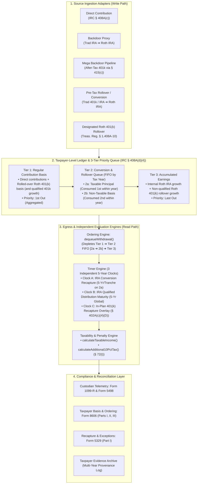

# PRD & Implementation Roadmap: Document 1 — The Roth IRA Accounting Engine

| Metadata Field | Specification |
| :--- | :--- |
| **Project / Series** | US Retirement Systems Engineering Blueprint (Document 1 of 2) |
| **Working Title** | *The Roth IRA Accounting Engine: A Systems Specification for Direct, Backdoor, and Mega Backdoor Mechanics* |
| **Target File** | `roth/roth.md` |
| **Scope** | 100% Pure US Statutory & Regulatory Mechanics (`IRC § 408A`, `§ 408(d)(2)`, `§ 402A`, `§ 415(c)`, `§ 72(t)`) |
| **Target Audience** | All software engineers in the US (H-1B, L-1, Green Card, US Citizens) + CPAs/Financial Systems Architects |
| **Status** | `LOCKED — In Progress (Sections 1 & 2 Completed)` |

---

## 1. Product Vision & Central Thesis

### 1.1 Problem Statement
Conventional personal finance literature, brokerage guides, and CPA blog posts explain the Roth IRA through disconnected lifecycle questions (*"What is a Backdoor Roth?"*, *"What is a Mega Backdoor Roth?"*, *"When can I withdraw?"*) using imprecise English prose where every transaction is casually labeled a *"Roth conversion."* This prose-first framing causes widespread architectural misunderstandings—even among major fintech platforms:
1. **The "5-Year Lock on Backdoor/Mega Backdoor Principal" Myth**: Falsely assuming that non-taxable Backdoor or Mega Backdoor conversions are subject to the 5-year conversion recapture penalty (`IRC § 408A(d)(3)(F)`), which statutorily applies *only* to conversions includible in gross income (`Treas. Reg. § 1.408A-6`, Q&A-5(b)).
2. **The "Pro-Rata Blocks Mega Backdoor" Myth**: Confusing the `IRC § 408(d)(2)` Traditional/SEP/SIMPLE IRA year-end aggregation rule with workplace `IRC § 401(a)` / `§ 401(k)` sub-account rules.
3. **The "Single 5-Year Rule" Myth**: Conflating three separate statutory 5-year timers (IRA Conversion Recapture, IRA Qualified Distribution Maturity, and Designated Roth 401(k) In-Plan Rollover Recapture).
4. **The "Per-Account Isolation" Myth**: Failing to realize that `IRC § 408A(d)(4)(A)` aggregates all Roth IRAs owned by a taxpayer into a single global ledger, causing older taxable conversions in one Roth IRA to head-of-line block newer non-taxable Mega Backdoor rollovers in another Roth IRA.

### 1.2 Central Thesis
> *"A Roth IRA is not simply a tax-free investment account. It is a taxpayer-level, tax-provenance-aware accounting system in which a three-tier priority queue and three independent statutory timers govern the tax and penalty treatment of every dollar."*

### 1.3 Design Guardrails (Synthesized from Gemini + ChatGPT Reviews)
- **Domain Model Over Gimmicks**: Avoid forced REST/HTTP status code metaphors (`403 Forbidden`, `409 Conflict`, "garbage collection", "LIFO stack"). Instead, model the actual statutory machinery: **Source Ingestion Adapters**, a **Taxpayer-Level Accounting Ledger**, a **3-Tier Priority Queue (with FIFO conversion tranches)**, and **Independent Evaluation Engines**.
- **TypeScript-First Formal Specification (With Interactive Web Vision)**: Express all state schemas (`RothTaxpayerLedger`, `ConversionTranche`, `InPlanRecaptureClock`) and evaluation logic (`dequeueWithdrawal`, `calculateTaxableIncome`, `calculateAdditional10PctTax`) in clean, self-documenting TypeScript, paired with visual ASCII/Markdown ledger state snapshots. This exact TypeScript engine will later power an interactive browser simulator in Docsify (`index.html`).
- **Explicit Separation of Statutory Truth vs. Conceptual Model vs. Tax Forms**: Clearly distinguish between the IRS statutory rules (`IRC` / `Treas. Reg.`), the conceptual software state model (`RothTaxpayerLedger`), and the paper reporting interface (`Form 8606`, `Form 1099-R`, `Form 5329`).
- **Concrete-First Narrative Ordering (`Write/Ingest ➔ Formal Domain Model & Interactive GUI ➔ Read/Dequeue & Clocks ➔ Traces`)**: First explain how capital enters the system via the 4 Ingestion Adapters (showing organically why different pipelines tag dollars differently), and *then* introduce the formal TypeScript Domain Model (`RothTaxpayerLedger`) and Interactive GUI Simulator to reason about the resulting state, followed by the Egress Ordering & Timer Engines.
- **Complete Independence of Document 1**: Keep Document 1 strictly scoped to US federal tax law. Cross-border residency transitions (`RNOR`, `ROR`, DTAA, Indian LTCG parity, and expatriation/exit strategies) belong exclusively in Document 2, which will import Document 1's verified state model.

---

## 2. Target System Architecture (The 4 Core Subsystems)

---

## 3. Document Structure & Outline (`roth/roth.md`)

### Section 1: Background & Motivation — The Roth Container (`IRC § 408A`) *(Completed)*
- **1.1 The Core Tax Contract: Post-Tax In, Tax-Free Growth Out**:
  - Comparing post-tax dollars in a standard taxable brokerage vs. a Roth container across dividend drag, short/long-term capital gains rebalancing friction, and federal/state tax immunity.
- **1.2 The Liquidity Asymmetry: Contribution Basis Is Liquid on Day 1**:
  - Why original contribution basis can be withdrawn at any age, for any reason, with `$0` tax and `$0` penalty.
- **1.3 The "Tagged Layers" Mental Model: Why Money Doesn't Blend**:
  - Contrasting a fungible "bucket of water" brokerage account against the 3 tagged layers of a Roth IRA (Contributions, Conversions, Earnings).
- **1.4 The High-Earner Paradox: The Front Door vs. The Backdoor**:
  - The 2026 direct contribution income phaseouts vs. the uncapped Backdoor (`$7,500/yr`) and Mega Backdoor (`~$35k–$45k+/yr`) pipelines.

### Section 2: The Mental Model Shift — Why Prose Fails & Why a Systems Spec Is Needed *(Completed)*
- **2.1 The Misinformation Fog**:
  - Deconstructing the top four myths repeated across retail finance blogs, forums, and brokerage FAQs.
- **2.2 Why Narrative Prose Fails**:
  - How calling every entry a *"Roth conversion"* hides Tax Provenance, Global State Side Effects, and Deterministic Queue Ordering.
- **2.3 The Systems Formulation**:
  - Central thesis and mapping table from financial concepts to systems specification equivalents.

### Section 3: The Source Ingestion Adapters (Write Path — How Capital Enters the System)
- **3.0 Mental Model Bridge & Common Parlance Mapping**:
  - Bridging from English prose to formal systems primitives: **Tiers** (storage classification), **The Queue** (withdrawal ordering), and **Timers** (recapture clocks).
  - Highlighting the critical fork in Layer 2: `Tier 2a` (taxable conversion principal) vs. `Tier 2b` (non-taxable conversion basis).
  - Common Parlance to Systems Model Table (mapping "Direct", "Backdoor", "Mega Backdoor 3A/3B", "Pre-Tax Conversions", and "Earnings" to their formal tiers and Day-1 liquidity rights).
  - Seamlessly integrating 2026 statutory execution parameters (`Rev. Proc. 2025-32`) contextually inside each adapter.
- **3.1 Adapter 1: Direct Contribution (`IRC § 408A(c)`) $\rightarrow$ Writes to `Tier 1`**:
  - 2026 limits ($7,500 base, $8,600 age 50+), MAGI phaseout curve ($153k–$168k Single, $242k–$252k MFJ, $0–$10k MFS), shared Traditional/Roth IRA limit, and excess contribution remediation (`IRC § 408(d)(4)` return of excess contribution vs. recharacterization).
- **3.2 Adapter 2: The Backdoor Roth Proxy (`Traditional IRA ➔ Roth IRA`) $\rightarrow$ Writes to `Tier 2b` (and `2a`)**:
  - Two-phase mechanics: non-deductible Traditional IRA contribution (`Form 8606` Part I) followed by Roth conversion (`Form 8606` Part II).
  - **Congressional Blessing & Debunking the "30-Day Wait" Myth**: Citing the **2017 TCJA Conference Report (H.R. Rep. No. 115-466, Footnote 268)** to show why the Step Transaction Doctrine does not invalidate immediate conversions, and why waiting 30 days merely generates nuisance taxable `Tier 2a` interest.
  - **The December 31 Pro-Rata Reconciliation (`IRC § 408(d)(2)`)**: How all Traditional, Rollover, SEP, and SIMPLE IRAs are aggregated on Dec 31 to compute the non-taxable ratio.
  - **The Mid-Year Job-Hop Bug (Retroactive Pro-Rata Pollution)**: Why rolling a pre-tax 401(k) into a Rollover IRA in October retroactively corrupts a clean Backdoor Roth executed in January of the same calendar year.
  - **Reverse Rollover Cleanup (`IRC § 408(d)(3)(A)(ii)`)**: Rolling pre-tax IRA dollars into an active employer 401(k) before Dec 31 to restore a `$0` year-end IRA balance (subject to employer plan acceptance of incoming rollovers).
- **3.3 Adapter 3: The Mega Backdoor Pipeline (`After-Tax 401(k)` via `IRC § 415(c)`)**:
  - **Dynamic Capacity Formula**: $\text{Capacity} = \min(100\% \text{ Compensation}, \$72,000) - \text{Elective Deferrals} - \text{Employer Match/Nonelective} - \text{Other Annual Additions}$ (subject to plan caps and ACP non-discrimination testing).
  - **Why `IRC § 408(d)(2)` IRA Pro-Rata Does Not Apply**: Complete namespace isolation between `IRC § 401(a)` workplace plans and `IRC § 408` IRAs.
  - **Sub-Account Pro-Rata & `IRS Notice 2014-54` Packet Splitting**: Clarifying that while a partial distribution from an After-Tax 401(k) sub-account pulls a proportionate slice of that sub-account's basis and pre-tax growth, `Notice 2014-54` allows allocating the pre-tax growth to a Traditional IRA and 100% of the after-tax basis to a Roth IRA (`Tier 2b`).
  - **The Standard Execution Pipeline (`After-Tax 401(k) ➔ In-Plan Roth 401(k) ➔ Rollover to Roth IRA`)**:
    - Stage 1: Automated daily in-plan conversion into Designated Roth 401(k); pro-rata lock while funds remain inside the 401(k) under `IRC § 402A(d)(4)`.
    - Stage 2: Rollover into Roth IRA breaking the pro-rata lock (`Treas. Reg. § 1.408A-10` Q&A-3):
      - Non-qualified rollover (`Age < 59½`, Q&A-3(b)): After-tax basis maps to **`Tier 1` (Regular Contributions)**—jumping ahead of `Tier 2` conversions—and growth maps to **`Tier 3` (Earnings)**.
      - Qualified rollover bonus (`Age >= 59½` + 5 years in plan, Q&A-3(a)): 100% of both basis and earnings maps to **`Tier 1`**!
    - Legacy plan edge case: Direct rollover of raw unconverted after-tax 401(k) funds to Roth IRA writing to `Tier 2b`.
- **3.4 Adapter 4: Pre-Tax Conversion / Rollover (`Traditional 401(k) / IRA ➔ Roth IRA`) $\rightarrow$ Writes to `Tier 2a`**:
  - Populating `Tier 2a` and initializing its per-tranche 5-year conversion recapture clock (`Clock A`).

### Section 4: The Formal Domain Model & Interactive Ledger (`RothTaxpayerLedger`)
- **4.1 Why Multi-Pipeline Ingestion Requires a Formal State Model**:
  - Synthesizing how the 4 ingestion adapters populate distinct buckets (`Tier 1`, `Tier 2a`, `Tier 2b`, `Tier 3`) with different timestamps and recapture clocks.
- **4.2 Taxpayer-Level Aggregation (`IRC § 408A(d)(4)(A)`)**:
  - Why the IRS evaluates all Roth IRAs under an individual's SSN as one unified logical ledger rather than isolated brokerage accounts.
- **4.3 Priority Queue vs. Pro-Rata Pools**:
  - Contrasting the three retirement account architectures:
    - `IRC § 408A` (Roth IRA) = Deterministic 3-Tier Priority Queue.
    - `IRC § 408(d)(2)` (Traditional / Rollover / SEP / SIMPLE IRA) = Blended Pro-Rata Pool across all non-Roth IRAs.
    - `IRC § 402A(d)(4)` (Designated Roth 401k) = Blended Pro-Rata Sub-Account within the employer plan.
- **4.4 Formal TypeScript Data Structures (`RothTaxpayerLedger`, `ConversionTranche`, `InPlanRecaptureClock`) & Interactive GUI Simulator**:
  - Defining the exact TypeScript interfaces that separate **ordering tier (`Tier 1`, `Tier 2 [2a/2b]`, `Tier 3`)** from **transactional provenance and timer overlays**.
  - Illustrative ASCII/Markdown ledger state dump + interactive simulator hook where readers can plug in their own contributions, conversions, and rollovers.

### Section 5: The Egress & Ordering Engine (Read Path — How Capital Leaves the Ledger)
- **5.1 The 3-Tier Deterministic Dequeue Algorithm (`IRC § 408A(d)(4)(B)` & `Treas. Reg. § 1.408A-6` Q&A-8)**:
  - **Step 1 (`Tier 1`)**: Drain all aggregated Regular Contributions and rolled-over Designated Roth 401(k) basis first.
  - **Step 2 (`Tier 2`)**: Drain Conversion & Rollover tranches strictly **FIFO by tax year** (oldest conversion year first). Within each tax year's tranche:
    - Drain **Subtype `2a` (`Taxable Principal`)** first.
    - Drain **Subtype `2b` (`Non-Taxable Basis`)** second.
  - **Step 3 (`Tier 3`)**: Drain Accumulated Earnings last.
- **5.2 Decoupling Ordering, Taxability, and Penalty Evaluation**:
  - Why `Taxable Income? (Yes/No)` and `10% Additional Tax? (Yes/No)` form an independent $2 \times 2$ matrix (all 4 combinations exist in statutory law).
  - TypeScript reference implementation of `dequeueWithdrawal()`, `calculateTaxableIncome()`, and `calculateAdditional10PctTax()` under `IRC § 72(t)`.

### Section 6: The Timer Engine — De-Confusing the Three 5-Year Clocks
- **6.1 Side-by-Side Comparison Matrix of Clocks A, B, and C**:
  - Scope, start date (`January 1` backdating rule), target tier, and failure consequence.
- **6.2 Clock A: Per-Tranche IRA Conversion Recapture Clock (`IRC § 408A(d)(3)(F)`)**:
  - 5-tax-year timer attached *exclusively* to `Tier 2a` taxable conversion principal to prevent bypassing the 10% early withdrawal penalty on pre-tax retirement funds.
  - Statutory proof (`Treas. Reg. § 1.408A-6` Q&A-5(b)) that `Tier 2b` non-taxable conversion basis has **0-day** recapture wait.
- **6.3 Clock B: Global Roth IRA Qualified Distribution Maturity Clock (`IRC § 408A(d)(2)(B)`)**:
  - Single taxpayer-level 5-tax-year timer starting Jan 1 of the earliest tax year for which a regular contribution, conversion, or rollover entered *any* Roth IRA owned by the taxpayer.
  - **Critical Non-Transferability Rule (`Treas. Reg. § 1.408A-10` Q&A-4)**: A Designated Roth 401(k)'s 5-year participation clock does *not* transfer to a Roth IRA. Rolling a 10-year-old Roth 401(k) into a brand-new Roth IRA starts Clock B fresh on Jan 1 of the rollover year.
  - Qualifying Events required alongside Clock B to unlock `Tier 3` earnings tax-free: `Age >= 59½`, death, disability (`IRC § 72(m)(7)`), or qualified first-time homebuyer purchase (`$10,000` lifetime cap).
- **6.4 Clock C: Designated Roth In-Plan Rollover Recapture Overlay (`IRC § 402A(c)(4)(D)`)**:
  - How a *taxable* in-plan 401(k) conversion carries its own 5-tax-year recapture timer, and why rolling that Designated Roth 401(k) into a Roth IRA preserves Clock C as an independent overlay even though the rolled-over basis sits in `Tier 1`.

### Section 7: Executable State Traces & Unit Test Suite (`GIVEN / WHEN / THEN`)
Six concrete, step-by-step traces showing before/after ledger state tables, TypeScript state transitions, ordering depletion, timer checks, and exact tax/penalty outputs:
- **Trace 1 (`Non-Taxable Principal Accessibility`)**: 3 years of Backdoor + Direct Mega Backdoor (`Tier 2b`), early withdrawal at age 35 $\rightarrow$ `$0` tax, `$0` penalty (proving no 5-year lock on `Tier 2b`).
- **Trace 2 (`Chronological Head-of-Line Blocking`)**: 2024 `$40,000` taxable conversion (`Tier 2a`) sitting ahead of a 2026 `$30,000` Direct Mega Backdoor (`Tier 2b`), followed by a `$30,000` withdrawal in 2026 at age 35 $\rightarrow$ `$0` income tax, `$3,000` (`10%`) recapture penalty.
- **Trace 3 (`December 31 Pro-Rata Reconciliation, Mid-Year Job-Hop Bug, & Reverse Rollover Fix`)**: Executing a January `$7,500` Backdoor Roth followed by an October `$92,500` 401(k)-to-Rollover-IRA rollover (retroactively turning 92.5% of the January conversion into taxable `Tier 2a`) vs. executing a pre-Dec 31 reverse rollover into an active employer 401(k) (100% `Tier 2b`).
- **Trace 4 (`The Designated Roth 401(k) Queue-Jump — Treas. Reg. § 1.408A-10 Q&A-3(b)`)**: Taxpayer holds a 2024 `$40,000` `Tier 2a` taxable conversion, then rolls over a non-qualified Designated Roth 401(k) (`$30,000` basis + `$5,000` earnings) in 2026 and withdraws `$30,000` at age 35 $\rightarrow$ dequeues from `Tier 1` with `$0` tax and `$0` penalty, jumping ahead of the 2024 `Tier 2a` block!
- **Trace 5 (`Active In-Plan Conversion Recapture Overlay — Clock C`)**: Rolling over a Designated Roth 401(k) that contains a recent *taxable* in-plan conversion (`IRC § 402A(c)(4)(D)`) and withdrawing within 5 years at age 35 $\rightarrow$ demonstrates how the independent Clock C overlay triggers the 10% recapture tax even when dequeued from `Tier 1`.
- **Trace 6 (`First Roth IRA Established via Roth 401(k) Rollover — Treas. Reg. § 1.408A-10 Q&A-3 & Q&A-4`)**: Taxpayer participates in a Roth 401(k) for 10 years (`2016–2026`, `$60,000` basis + `$40,000` growth), retires and rolls it into their **very first Roth IRA in 2026 at age 58** (non-qualified rollover: `$60k` to `Tier 1`, `$40k` to `Tier 3`; Clock B starts Jan 1, 2026), and then withdraws `$80,000` in **2028 at age 60** $\rightarrow$ `$60k` `Tier 1` is tax-free, but the `$20k` pulled from `Tier 3` earnings is **taxable as ordinary income** (with `$0` penalty due to age 60) because the Roth IRA's independent 5-year Clock B doesn't mature until 2031! *(Includes comparison Box showing how waiting until age 59½ to execute the rollover makes 100% of the `$100k` enter `Tier 1` under Q&A-3(a)).*

### Section 8: Summary & Series Context (Preview of Part 2)
- Synthesis of the domestic US Roth IRA Accounting Engine.
- Forward pointer to **Document 2 (*Cross-Border Roth Integration for US $\rightarrow$ India Returnees*)**: How this exact `RothTaxpayerLedger` state machine interacts with Indian residency transitions (`RNOR` $\rightarrow$ `ROR` $\rightarrow$ `Age 59½ Exit`), why `Tier 1` and `Tier 2b` basis can be extracted tax- and penalty-free without waiting 5 years, and how `Tier 3` earnings behave across borders.

### Appendix: Statutory Telemetry & IRS Reporting Cross-Reference
- **A.1 Architectural Separation Table**: Mapping responsibilities across `RothTaxpayerLedger` (conceptual truth), Custodian Reporting (`Form 1099-R`, `Form 5498`), `Form 8606` (Parts I, II, III), `Form 5329` (Part I), and the Taxpayer Evidence Archive.
- **A.2 Why Custodian `Form 1099-R` Codes (`J`, `T`, `Q`, `G`, `H`) Are "Dumb Telemetry"**: Why brokerages do not track cross-account basis, mark every under-59½ Roth IRA withdrawal as `Code J` with Box 2b (*Taxable amount not determined*) checked, and leave the burden of proof on the taxpayer via `Form 8606` Part III.
- **A.3 Conversion & Rollover Reporting (`Form 8606` Part II vs. `Form 1040` Line 5a/5b)**: Why Traditional IRA-to-Roth conversions flow through `Form 8606` Part II, whereas direct 401(k)-to-Roth-IRA rollovers are reported on `Form 1040` Lines 5a/5b in the rollover year and enter `Form 8606` Part III Line 24 upon withdrawal.

---

## 4. Implementation Checklist (Step-by-Step TODO)

- [x] **Step 1: Align on Clarifying Questions, Refine Architecture, & Lock PRD** *(Completed)*
  - Locked `Write (Ingest) ➔ Formal Domain Model & Interactive Ledger ➔ Read (Dequeue & Clocks) ➔ Traces` flow, TypeScript-first domain model, Trace 6 `Treas. Reg. § 1.408A-10` Q&A-3(a)/(b) & Q&A-4 precision, and Backdoor edge cases (retroactive Oct Rollover IRA bug + TCJA Footnote 268).
- [x] **Step 2: Author Sections 1 & 2 in `roth/roth.md`** *(Completed)*
  - Metadata block, legal disclaimer, Section 1 (Background, Core Tax Contract, Liquidity Asymmetry, Tagged Layers Mental Model, and High-Earner Paradox), and Section 2 (The 4 Myths, Why Prose Fails, and The Systems Formulation).
- [x] **Step 3: Author Section 3 (The Four Source Ingestion Adapters & 2026 Sandbox)** *(Completed)*
  - 2026 `Rev. Proc. 2025-32` configuration constants, Adapter 1 (Direct), Adapter 2 (Backdoor Proxy, TCJA Footnote 268, Dec 31 Pro-Rata math, Mid-Year Job-Hop bug, Reverse Rollover fix), Adapter 3 (Mega Backdoor dynamic `§ 415(c)` formula, `Notice 2014-54`, Path 3A vs. Path 3B queue-jump under `§ 1.408A-10` Q&A-3(a)/(b)), and Adapter 4 (Pre-Tax Conversions).
- [ ] **Step 4: Author Section 4 (The Formal Domain Model & Interactive Ledger)**
  - Taxpayer-level aggregation (`IRC § 408A(d)(4)(A)`), Priority Queue vs. Pro-Rata Pools, TypeScript `RothTaxpayerLedger` schema, ASCII state diagram, and interactive simulator hook.
- [ ] **Step 5: Author Sections 5 & 6 (The Egress Ordering Engine & The 3-Clock Timer Engine)**
  - Deterministic 3-Tier Dequeue algorithm, $2 \times 2$ Taxability vs. Penalty matrix, TypeScript evaluation functions (`dequeueWithdrawal`, `calculateTaxableIncome`, `calculateAdditional10PctTax`), and deep-dive into Clocks A, B, and C.
- [ ] **Step 6: Author Section 7 (The 6 Executable State Traces & Unit Test Suite)**
  - Write Traces 1–6 (`GIVEN / WHEN / THEN`) with TypeScript state objects, before/after ledger tables, and exact tax/penalty calculations.
- [ ] **Step 7: Author Section 8 & Appendix (Summary & Part 2 Preview + Statutory Telemetry Cross-Reference)**
  - Summary and Part 2 cross-border preview, plus Appendix for custodian `Form 1099-R` codes vs. `Form 8606` Parts I–III vs. `Form 1040` Lines 5a/5b vs. `Form 5329`.
- [ ] **Step 8: Verification & Quality Audit**
  - Verify all arithmetic across Traces 1–6, check TypeScript syntax and statutory citations, and mark all tasks complete in `roth/PRD.md`.
