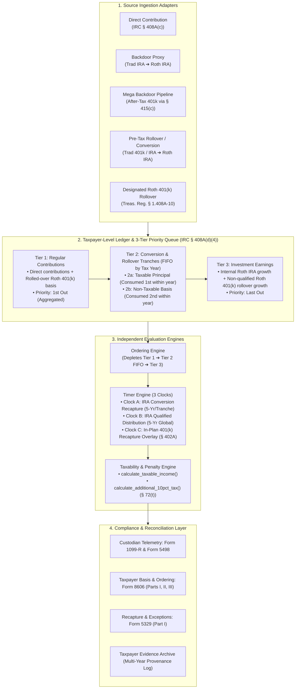

# PRD & Implementation Roadmap: Document 1 — The Roth IRA Accounting Engine

| Metadata Field | Specification |
| :--- | :--- |
| **Project / Series** | US Retirement Systems Engineering Blueprint (Document 1 of 2) |
| **Working Title** | *The Roth IRA Accounting Engine: A Systems Specification for Direct, Backdoor, and Mega Backdoor Mechanics* |
| **Target File** | `roth/ROTH_ACCOUNTING_ENGINE.md` |
| **Scope** | 100% Pure US Statutory & Regulatory Mechanics (`IRC § 408A`, `§ 408(d)(2)`, `§ 402A`, `§ 415(c)`, `§ 72(t)`) |
| **Target Audience** | All software engineers in the US (H-1B, L-1, Green Card, US Citizens) + CPAs/Financial Systems Architects |
| **Status** | `Approved Architecture — Ready for Implementation` |

---

## 1. Product Vision & Central Thesis

### 1.1 Problem Statement
Conventional personal finance literature, brokerage guides, and CPA blog posts explain the Roth IRA through disconnected lifecycle questions (*"What is a Backdoor Roth?"*, *"What is a Mega Backdoor Roth?"*, *"When can I withdraw?"*) using imprecise English prose where every transaction is casually labeled a *"Roth conversion."* This prose-first framing causes widespread architectural misunderstandings—even among major fintech platforms:
1. **The "5-Year Lock on Backdoor/Mega Backdoor Principal" Myth**: Falsely assuming that non-taxable Backdoor or Mega Backdoor conversions are subject to the 5-year conversion recapture penalty (`IRC § 408A(d)(3)(F)`), which statutorily applies *only* to conversions includible in gross income (`Treas. Reg. § 1.408A-6`, Q&A-5(b)).
2. **The "Pro-Rata Blocks Mega Backdoor" Myth**: Confusing the `IRC § 408(d)(2)` Traditional/SEP/SIMPLE IRA year-end aggregation rule with workplace `IRC § 401(a)` / `§ 401(k)` sub-account rules.
3. **The "Single 5-Year Rule" Myth**: Conflating three separate statutory 5-year timers (IRA Conversion Recapture, IRA Qualified Distribution Maturity, and Designated Roth 401(k) In-Plan Rollover Recapture).
4. **The "Per-Account Isolation" Myth**: Failing to realize that `IRC § 408A(d)(4)(A)` aggregates all Roth IRAs owned by a taxpayer into a single global ledger, causing older taxable conversions in one Roth IRA to head-of-line block newer non-taxable Mega Backdoor rollovers in another Roth IRA.

### 1.2 Central Thesis
> *"A Roth IRA is not simply a tax-free investment account. It is a taxpayer-level, tax-provenance-aware accounting system in which a three-tier priority queue and three independent statutory timers govern the tax and penalty treatment of every dollar."*

### 1.3 Design Guardrails (Synthesized from Gemini + ChatGPT Reviews)
- **Domain Model Over Gimmicks**: Avoid forced REST/HTTP status code metaphors (`403 Forbidden`, `409 Conflict`, "garbage collection", "LIFO stack"). Instead, model the actual statutory machinery: a **Taxpayer-Level Accounting Ledger**, a **3-Tier Priority Queue (with FIFO conversion tranches)**, **Independent Evaluation Engines**, and **Source Ingestion Adapters**.
- **Explicit Separation of Statutory Truth vs. Conceptual Model**: Clearly distinguish between the IRS statutory rules (`IRC` / `Treas. Reg.`), the conceptual software state model (`RothTaxpayerState` / `RothLedgerTranche`), and the paper reporting interface (`Form 8606`, `Form 1099-R`, `Form 5329`).
- **Tax-Year-Agnostic Core Architecture**: Isolate annual inflation-adjusted statutory constants (e.g., 2026 limits under `Rev. Proc. 2025-32`) in a dedicated `Configuration Parameters` block so the core specification remains timeless.
- **Complete Independence of Document 1**: Keep Document 1 strictly scoped to US federal tax law. Cross-border residency transitions (`RNOR`, `ROR`, DTAA, Indian LTCG parity, and expatriation/exit strategies) belong exclusively in Document 2, which will import Document 1's verified state model.

---

## 2. Target System Architecture (The 5 Core Subsystems)

---

## 3. Document Structure & Outline (`ROTH_ACCOUNTING_ENGINE.md`)

### Section 1: Executive Overview & Background — What is a Roth IRA and Why Care?
- **1.1 The Core Value Proposition**:
  - The fundamental tax contract of a Roth vehicle: **tax-paid capital entering $\rightarrow$ tax-free compounding $\rightarrow$ tax-free distributions**.
  - Comparing the three foundational investment wrappers:
    - *Taxable Brokerage*: Funded with post-tax dollars; suffers ongoing annual tax drag on dividends, interest, and portfolio rebalancing; taxed at capital gains rates on exit.
    - *Traditional (Pre-Tax) 401(k) / IRA*: Funded with pre-tax dollars; avoids current tax; grows tax-deferred; 100% of distributions taxed as ordinary income at withdrawal.
    - *Roth IRA*: Funded with post-tax dollars; immune to dividend tax drag and internal capital gains realizations; distributions of both basis and qualified earnings are **100% federal income tax-free**.
- **1.2 Why High-Income Engineers Care**:
  - Eliminating multi-decade dividend and rebalancing drag in high-tax jurisdictions (e.g., CA/NY where combined marginal rates exceed 40%–50%).
  - The unique liquidity feature: Unlike traditional retirement accounts where any early withdrawal triggers ordinary income tax plus a 10% penalty, a Roth IRA allows **return of original contribution basis at any time, for any reason, with \$0 tax and \$0 penalty**.
- **1.3 The High-Earner Irony**:
  - Congress designed direct Roth contributions with strict income phaseouts (Modified Adjusted Gross Income / MAGI limits).
  - Most software engineers exceed these phaseouts in their first or second year in industry.
  - This creates the perceived barrier: *"I earn too much to have a Roth IRA."*
  - The reality: The statutory code provides explicit ingestion pipelines—the **Backdoor Roth** and **Mega Backdoor Roth**—that legally route tens of thousands of dollars into the Roth container annually regardless of income.

### Section 2: The Mental Model Shift — Why Prose Fails & Why a Systems Spec is Needed
- **2.1 The Misinformation Fog**:
  - Deconstructing the top four myths repeated across retail finance blogs, reddit, and brokerage FAQs:
    1. *"Backdoor and Mega Backdoor contributions are locked for 5 years."*
    2. *"Holding a pre-tax Rollover IRA blocks me from doing a Mega Backdoor Roth."*
    3. *"Every Roth transaction follows the same single 5-year clock."*
    4. *"Opening multiple Roth IRAs at different brokerages lets me isolate taxable and non-taxable conversions."*
- **2.2 Why Narrative Prose Fails**:
  - In conversational English, rolling over a 401(k), depositing after-tax funds, and converting a Traditional IRA are all casually called a *"Roth conversion."*
  - Prose hides **state**, **tax provenance**, and **chronological ordering guarantees**.
- **2.3 The Systems Formulation**:
  - Treating `IRC § 408A` as an aggregated, taxpayer-level accounting ledger where dollars retain their tax provenance and distributions dequeue deterministically.

### Section 3: Statutory Execution Parameters (2026 Reference Sandbox)
- Isolating annual inflation-adjusted statutory thresholds (`Rev. Proc. 2025-32`) so the core specification remains evergreen:
  - IRA Contribution Limit (`IRC § 219(b)(5)`): `$7,500` (under age 50) / `$8,600` (age 50+), aggregated across Traditional and Roth IRAs.
  - Roth IRA Direct MAGI Phaseout Ranges (`IRC § 408A(c)(3)`):
    - Single / Head of Household: `$153,000 – $168,000`
    - Married Filing Jointly: `$242,000 – $252,000`
    - Married Filing Separately (living together): `$0 – $10,000`
  - Elective 401(k) Deferral Ceiling (`IRC § 402(g)`): `$24,500`
  - Defined Contribution Plan Total Additions Cap (`IRC § 415(c)`): `$72,000`

### Section 4: The Domain Model — Taxpayer-Level Aggregation & Provenance State
- **4.1 Taxpayer-Level Aggregation (`IRC § 408A(d)(4)(A)`)**:
  - Why the IRS evaluates all Roth IRAs owned by an individual as a single unified namespace rather than isolated brokerage accounts.
- **4.2 Priority Queue vs. Pro-Rata Pool**:
  - The fundamental architectural distinction:
    - `IRC § 408A` (Roth IRA) = Deterministic 3-Tier Priority Queue.
    - `IRC § 408(d)(2)` (Traditional IRA) = Blended Pro-Rata Pool.
    - `IRC § 402A(d)(4)` (Designated Roth 401k) = Blended Pro-Rata Sub-Account.
- **4.3 Data Structures (`RothTaxpayerState` & `RothLedgerTranche`)**:
  - Defining typed structures that separate **ordering tier** from **transaction provenance** (`sourceType`, `taxYear`, `originalAmount`, `remainingAmount`, `taxableAtIngestion`, `nontaxableBasis`, `orderingTier`, `recaptureClocks`).

### Section 5: The 3-Tier Ordering Engine & Independent Evaluation Functions
- **5.1 The 3-Tier Withdrawal Priority Queue (`IRC § 408A(d)(4)(B)` & `Treas. Reg. § 1.408A-6` Q&A-8)**:
  - **Tier 1 (`Regular Contributions`)**: Direct Roth IRA contributions + non-taxable investment-in-the-contract rolled over from a Designated Roth 401(k) (`Treas. Reg. § 1.408A-10` Q&A-3).
  - **Tier 2 (`Conversion & Rollover Queue`)**: Ordered chronologically (FIFO by tax year of conversion/rollover). Within each year's cohort:
    - **Subtype `2a` (`Taxable Principal`)**: Consumed first.
    - **Subtype `2b` (`Non-Taxable Basis`)**: Consumed second.
  - **Tier 3 (`Investment Earnings`)**: Internal Roth IRA growth + non-qualified earnings rolled over from a Designated Roth 401(k).
- **5.2 Decoupling Ordering, Taxability, and Penalty Evaluation**:
  - Showing why `Taxable? (Yes/No)` and `10% Additional Tax? (Yes/No)` form a $2 \times 2$ matrix (all 4 combinations exist in law).
  - Defining the two evaluation functions:
    1. `calculate_taxable_income(distribution, state, tax_year)`
    2. `calculate_additional_10pct_tax(distribution, state, age, qualifying_exceptions, tax_year)` under `IRC § 72(t)`.

### Section 6: The Timer Engine — De-Confusing the Three 5-Year Clocks
- **6.1 Clock A: Per-Tranche IRA Conversion Recapture Clock (`IRC § 408A(d)(3)(F)`)**:
  - 5-tax-year timer (starts Jan 1 of the conversion tax year) attached *exclusively* to `Tier 2a` taxable conversion principal.
  - Statutory proof (`Treas. Reg. § 1.408A-6` Q&A-5(b)) that `Tier 2b` non-taxable conversion basis has **zero** recapture wait.
- **6.2 Clock B: Global Roth IRA Qualified Distribution Clock (`IRC § 408A(d)(2)(B)`)**:
  - Single taxpayer-level 5-tax-year timer starting Jan 1 of the earliest tax year for which a regular contribution, conversion, or rollover entered *any* Roth IRA owned by the taxpayer.
  - **Critical Non-Transferability Rule (`Treas. Reg. § 1.408A-10` Q&A-4)**: A Designated Roth 401(k)'s 5-year participation clock does *not* transfer to a Roth IRA. Rolling a 10-year-old Roth 401(k) into a brand-new Roth IRA starts Clock B fresh on Jan 1 of the rollover year.
  - Qualifying Events required alongside Clock B to unlock `Tier 3` earnings tax-free: `Age >= 59½`, death, disability (`IRC § 72(m)(7)`), or qualified first-time homebuyer purchase (up to `$10,000` lifetime cap).
- **6.3 Clock C: Designated Roth In-Plan Rollover Recapture Overlay (`IRC § 402A(c)(4)(D)`)**:
  - Why an in-plan 401(k) conversion carries its own 5-year recapture timer on any taxable portion converted, and how that timer persists as an overlay if rolled into a Roth IRA within those 5 years.

### Section 7: The Source Ingestion Adapters (How Capital Enters the System)
- **7.1 Adapter 1: Direct Contribution (`IRC § 408A(c)`)**:
  - Shared `$7,500` capacity with Traditional IRAs, partial phaseout math inside the MAGI phaseout band, and excess contribution remediation (`IRC § 408(d)(4)` return of excess contribution vs. recharacterization).
- **7.2 Adapter 2: The Backdoor Roth Proxy (`Traditional IRA ➔ Roth IRA`)**:
  - Two-phase mechanics: non-deductible Traditional IRA contribution (`Form 8606` Part I) followed by Roth conversion (`Form 8606` Part II).
  - **The December 31 Pro-Rata Reconciliation (`IRC § 408(d)(2)`)**: How all Traditional, Rollover, SEP, and SIMPLE IRAs are aggregated at year-end, incorporating all distributions/conversions during the year to compute the non-taxable ratio.
  - **Reverse Rollover Cleanup (`IRC § 408(d)(3)(A)(ii)`)**: Rolling pre-tax IRA dollars into an active employer 401(k) before Dec 31 to isolate non-deductible basis (subject to employer plan document acceptance of incoming rollovers).
- **7.3 Adapter 3: The Mega Backdoor Pipeline (`After-Tax 401(k)` via `IRC § 415(c)`)**:
  - **Dynamic Capacity Formula**: $\text{Capacity} = \min(100\% \text{ Compensation}, \$72,000) - \text{Elective Deferrals} - \text{Employer Match/Nonelective} - \text{Other Annual Additions}$ (subject to ACP testing / plan caps).
  - **Why `IRC § 408(d)(2)` Pro-Rata Does Not Apply**: Complete namespace isolation between `IRC § 401(a)` workplace plans and `IRC § 408` IRAs.
  - **Sub-Account Pro-Rata & `IRS Notice 2014-54` Allocation**: Clarifying that while you cannot cherry-pick pure basis out of a single commingled sub-account without pulling proportionate pre-tax growth from that sub-account, `Notice 2014-54` allows allocating the pre-tax portion of a distribution to a Traditional IRA and the after-tax basis to a Roth IRA (`Tier 2b`).
  - **Routing Path 3A (`After-Tax 401k ➔ Direct In-Service Split Rollover to Roth IRA`)** vs. **Routing Path 3B (`After-Tax 401k ➔ In-Plan Designated Roth 401k ➔ Downstream Rollover to Roth IRA`)**:
    - Explaining the **"Queue-Jumping Discovery"** under `Treas. Reg. § 1.408A-10` Q&A-3: Path 3A puts basis into `Tier 2b` (behind older `Tier 2a` taxable conversions), whereas Path 3B puts rolled-over basis into `Tier 1` (jumping *ahead* of all `Tier 2` conversions!).
- **7.4 Adapter 4: Pre-Tax Conversion / Rollover (`Traditional 401(k) / IRA ➔ Roth IRA`)**:
  - Populating `Tier 2a` and initializing Clock A.

### Section 8: Executable State Traces & Unit Test Suite (`GIVEN / WHEN / THEN`)
Six comprehensive, step-by-step traces showing before/after ledger tables, ordering depletion, timer evaluation, and exact tax/penalty outputs:
- **Trace 1 (`Non-Taxable Principal Accessibility`)**: 3 years of Backdoor + Mega Backdoor (`Tier 2b`), early withdrawal at age 35 $\rightarrow$ `$0` tax, `$0` penalty.
- **Trace 2 (`Chronological Head-of-Line Blocking`)**: 2024 `$40,000` taxable conversion (`Tier 2a`) sitting ahead of a 2026 `$30,000` Direct Mega Backdoor (`Tier 2b`), followed by a `$30,000` withdrawal in 2026 at age 35 $\rightarrow$ `$0` income tax, `$3,000` (`10%`) recapture penalty.
- **Trace 3 (`December 31 Pro-Rata Reconciliation & Reverse Rollover Fix`)**: Executing a `$7,500` Backdoor Roth with a `$92,500` Rollover IRA on Dec 31 (92.5% taxable `Tier 2a` / 7.5% `Tier 2b`) vs. executing a pre-Dec 31 reverse rollover into an employer 401(k) (100% `Tier 2b`).
- **Trace 4 (`The Designated Roth 401(k) Queue-Jump — Treas. Reg. § 1.408A-10 Q&A-3`)**: Taxpayer holds a 2024 `$40,000` `Tier 2a` taxable conversion, then rolls over a non-qualified Designated Roth 401(k) (`$30,000` basis + `$5,000` earnings) in 2026 and withdraws `$30,000` at age 35 $\rightarrow$ dequeues from `Tier 1` with `$0` tax and `$0` penalty, bypassing the 2024 `Tier 2a` block!
- **Trace 5 (`Active In-Plan Conversion Recapture Overlay — Clock C`)**: Rolling over a Designated Roth 401(k) that contains a recent *taxable* in-plan conversion (`IRC § 402A(c)(4)(D)`) and withdrawing within 5 years $\rightarrow$ demonstrates how the independent Clock C overlay triggers recapture even when dequeued from `Tier 1`.
- **Trace 6 (`First Roth IRA Established via Roth 401(k) Rollover — Treas. Reg. § 1.408A-10 Q&A-4`)**: Taxpayer participates in a Roth 401(k) for 10 years (2016–2026), rolls it into their very first Roth IRA in 2026 at age 60, and withdraws earnings in 2027 $\rightarrow$ demonstrates why Clock B started in 2026 (not 2016) and why earnings are non-qualified until 2031 (`$0` penalty due to age 60, but ordinary income tax applies on `Tier 3` earnings!).

### Section 9: Compliance Telemetry & Reconciliation Interface
- **9.1 Architectural Separation Table**: Mapping responsibilities across Taxpayer Ledger, Custodian Reporting (`1099-R`, `5498`), `Form 8606`, `Form 5329`, and Taxpayer Evidence Archive.
- **9.2 Why Custodian `Form 1099-R` Codes (`J`, `T`, `Q`, `G`, `H`) Are "Dumb Telemetry"**: Why your brokerage marks every early withdrawal as `Code J` (*Early distribution, no known exception*) and leaves Box 2a (*Taxable amount not determined*) unchecked—forcing the taxpayer to prove basis on `Form 8606` Part III.
- **9.3 Reporting Nuance (`Form 8606` Part II vs. `Form 1040` Line 5a/5b)**: Why Traditional IRA-to-Roth conversions pass through `Form 8606` Part II, whereas direct 401(k)-to-Roth-IRA rollovers are reported on `Form 1040` Line 5a/5b in the rollover year and tracked into `Form 8606` Part III Line 24 upon withdrawal.

### Section 10: Summary & Series Context (Preview of Part 2)
- Core recap of the domestic US accounting engine.
- Handoff note to Document 2: How this exact state ledger behaves when passing across the US $\rightarrow$ India residency border (`RNOR`, `ROR`, `DTAA`, and `Age 59½ Exit`).

---

## 4. Implementation Checklist (Step-by-Step TODO)

- [x] **Step 1: Align on Clarifying Questions & Finalize PRD** *(Completed)*
  - **Queue Terminology**: Use `Tier 1 / Tier 2 (2a, 2b) / Tier 3` as in the pitch & ChatGPT review.
  - **Code & Diagram Balance**: TypeScript-first formal domain model (`RothTaxpayerLedger`, `ConversionTranche`, `WithdrawalEvaluationResult`) + clean evaluation pseudocode + Markdown/ASCII ledger dumps.
  - **Interactive Vision**: The TypeScript domain model is designed for dual use: formal specification in the markdown document, and compilation into an interactive web simulator / queue visualizer in Docsify (`index.html`).
  - **Series Positioning**: Pure US statutory spec in the main body, with a short "Series Context / Preview of Part 2 (US-to-India)" callout at the very end.
  - **Target Artifact Filename**: `roth/ROTH_ACCOUNTING_ENGINE.md`.
- [ ] **Step 2: Author Sections 1, 2, & 3 (Background/Motivation, The Myth Fog, & 2026 Sandbox)**
  - Core value proposition: Taxable vs. Traditional vs. Roth.
  - Why high earners care (dividend drag, liquidity of basis) and the high-earner MAGI trap.
  - Deconstructing the top 4 myths and explaining why narrative prose fails.
  - 2026 inflation parameters (`Rev. Proc. 2025-32`) as an isolated sandbox table.
- [ ] **Step 3: Author Sections 4, 5, & 6 (Domain Model, Ordering Engine, & 3-Clock Timer Engine)**
  - Taxpayer-level aggregation (`IRC § 408A(d)(4)(A)`) vs. pro-rata pools.
  - Formal data structures (`RothTaxpayerState`, `RothLedgerTranche`).
  - 3-Tier Priority Queue diagram + decoupled taxability vs. 10% penalty evaluation ($2 \times 2$ matrix).
  - Deep-dive into Clocks A, B, and C (including the non-transferability rule under `Treas. Reg. § 1.408A-10` Q&A-4).
- [ ] **Step 4: Author Section 7 (The Four Ingestion Pipelines / Source Adapters)**
  - Direct contribution & MAGI phaseout curve.
  - Backdoor proxy (`Form 8606` Part I/II) + Dec 31 pro-rata aggregation (`IRC § 408(d)(2)`) & reverse rollover fix.
  - Mega Backdoor pipeline (`IRC § 415(c)` formula, `Notice 2014-54`, and Path 3A vs. Path 3B `Tier 1` queue-jumping under `Treas. Reg. § 1.408A-10` Q&A-3).
  - Pre-Tax conversions and Clock A initialization.
- [ ] **Step 5: Author Section 8 (The 6 Executable State Traces & Unit Test Suite)**
  - Traces 1–6 with explicit before/after ledger tables, ordering depletion, and exact tax/penalty outputs.
- [ ] **Step 6: Author Sections 9 & 10 (Compliance Telemetry, IRS Reporting, & Part 2 Preview)**
  - Form 1099-R `Code J` "dumb telemetry" vs. Form 8606 Part III taxpayer burden of proof.
  - Form 8606 Part II vs. Form 1040 Lines 5a/5b reporting mechanics.
  - Synthesis and preview of Part 2 cross-border integration.
- [ ] **Step 7: Verification, Code Checking & Polish**
  - Run mathematical checks on all trace calculations and verify legal citations (`IRC`, `Treas. Reg.`, `IRS Pub 590-B`, `Notice 2014-54`).
