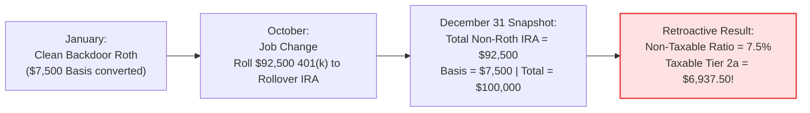

# The Roth IRA Accounting Engine: A Systems Specification for Direct, Backdoor, and Mega Backdoor Mechanics

| Metadata Field                   | Specification                                                                                                                     |
| :------------------------------- | :-------------------------------------------------------------------------------------------------------------------------------- |
| **Self Link**              | [github.com/mradityagoyal/us-india-401k-blueprint](https://github.com/mradityagoyal/us-india-401k-blueprint)                       |
| **Web Version**            | [mradityagoyal.github.io/us-india-401k-blueprint/#/roth/roth](https://mradityagoyal.github.io/us-india-401k-blueprint/#/roth/roth) |
| **Visibility**             | Public (US Tech & Engineering Community)                                                                                          |
| **Status**                 | Working Draft `v0.1` (Community Review / Open-Source RFC)                                                                       |
| **Author**                 | [Aditya Goyal](https://www.linkedin.com/in/mradityagoyal/)                                                                         |
| **Methodology & Research** | Manual research, Automated Statutory Research & Financial Systems Engineering Modeling                                            |
| **Adversarial Audit**      | Multi-Model LLM Testing (Claude Opus 5.5, Gemini Pro 3.8) & Primary Statutory Code Verification                                   |
| **Community Call**         | I actively solicit formal review and critique from licensed US CPAs, Enrolled Agents (EAs), and financial systems developers.     |
| **Last Major Revision**    | 2026-11-02                                                                                                                        |

---

> [!CAUTION]
> **Legal & Tax Disclaimer**: This document is an engineering systems analysis written strictly for educational, informational, and architectural evaluation under the US Internal Revenue Code. It does not constitute formal tax, legal, or investment advice. Tax administration involves strict statutory elections, procedural deadlines, and individualized facts. Consult a licensed Certified Public Accountant (CPA) or tax attorney before executing retirement contributions, conversions, rollovers, or early distributions.

---

## 1. Background & Motivation: The Roth Container (`IRC § 408A`)

### 1.1 The Core Tax Contract: Post-Tax In, Tax-Free Growth Out

Unlike a stock or an ETF, a **Roth IRA** (`IRC § 408A`) is not an investment product—it is a **tax-advantaged storage container**. Inside it, you hold the exact same index funds, equities, or bonds traded in a standard taxable brokerage account (e.g., Schwab, Fidelity, Vanguard, Robinhood).

Both accounts (Roth IRA and a standard brokerage account) are funded with **post-tax dollars**—contributing to a Roth IRA does not provide an upfront tax deduction to reduce your current-year income, unlike a pre-tax Traditional 401(k) or Traditional IRA.

Where a Roth container diverges completely from a standard brokerage account is how capital is treated **while inside and on the way out**. In a taxable brokerage, you surrender a cut of your returns every year to dividend taxes, pay capital gains taxes whenever you rebalance, and pay capital gains taxes again when you liquidate your gains. Inside a Roth container, the Internal Revenue Code—and every US state with an income tax (including California and New York)—grants permanent tax immunity across three distinct dimensions:

1. **Zero Dividend & Interest Drag**: In a taxable brokerage, dividends and interest are taxed in the year distributed, even when auto-reinvested. Inside a Roth container, 100% of yield compounds at **$0 federal and state tax**.
2. **Zero Capital Gains Friction on Trades & Rebalancing**: In a taxable brokerage, selling an appreciated position triggers either **Long-Term or Short Term Capital Gains**. Inside a Roth container, short-term trades, swing trades, and multi-year portfolio rebalancing execute with **$0 federal and state tax liability** as long as capital remains inside the container.
3. **Tax-Free Qualified Exit**: Once the account satisfies statutory maturity (`Age >= 59½` and the 5-tax-year holding period), 100% of accumulated earnings exit at **$0 federal and state tax**.

---

### 1.2 The Liquidity Asymmetry: Contribution Basis Is Liquid on Day 1

The primary objection engineers raise against retirement accounts is multi-decade illiquidity—locking capital until age 59½ when it may be needed earlier for a home purchase, a startup, or an emergency.

While early withdrawals from a Traditional 401(k) or Traditional IRA trigger ordinary income tax plus a `10%` early distribution penalty (`IRC § 72(t)`), **a Roth IRA does not lock up contribution principal.**

Under `IRC § 408A(d)(4)`, Roth IRA withdrawals follow a deterministic **First-In, First-Out (FIFO) priority ordering rule**. The very first dollars withdrawn are always classified as a return of your **original direct contributions**:

- Because tax was already paid prior to deposit, **100% of direct contribution basis can be withdrawn at any time, at any age, and for any reason with $0 income tax and $0 penalty.**
- *Example*: If an engineer contributes \$7,500/year for 4 years (\$30,000 basis) and the account grows to \$42,000, the entire **\$30,000 principal can be wired back to a checking account immediately** with zero tax or penalty; only the \$12,000 of investment growth remains restricted until age 59½.

---

### 1.3 The "Tagged Layers" Mental Model: Why Money Doesn't Blend

To understand why your contributions remain liquid, you have to unlearn how standard investment accounts work.

In a normal bank or taxable brokerage account, money behaves like water poured into a bucket: once inside, every dollar blends together. If you deposit $40,000 and earn $10,000, you simply hold a $50,000 pool of fungible cash. When you pull out $10,000, you are just taking dollars from the bucket.

A Roth IRA does not work like a blended bucket. Under federal tax law, the IRS views your Roth account as a container storing **tagged layers of capital**:

1. **Layer 1: Original Contributions** (the cash you deposited directly).
2. **Layer 2: Converted Capital** (funds moved over from traditional accounts or workplace plans).
3. **Layer 3: Investment Earnings** (the dividends, interest, and capital gains generated inside the account).

When you make a withdrawal, you cannot cherry-pick which dollars you want, nor does the IRS take a proportionate slice across all three. Instead, the tax code enforces a strict, top-down sequence: your contributions come out first, your converted funds come out second, and your investment earnings come out last.

Because each layer carries completely different tax and penalty rules, the tax consequences of any withdrawal are entirely determined by which layer the IRS considers you to be tapping.

---

### 1.4 The High-Earner Paradox: The Front Door vs. The Backdoor

To prevent high earners from sheltering unlimited capital, the IRS sets income limits on who can contribute directly to a Roth IRA. For 2026, direct eligibility phases out between **$153,000 and $168,000** for single filers, and between **$242,000 and $252,000** for married couples.

Because total compensation for many software engineers (base salary + bonus + RSUs) comfortably exceeds these ceilings, many assume:

> *"I make too much money. I can't have a Roth IRA."*

**That assumption confuses a single blocked front door with the container itself.**

While the IRS closed the front door on direct contributions, the tax code explicitly leaves open two high-capacity pipelines with **zero income limits**:

1. **The Backdoor Roth IRA ($7,500/year in 2026)**: You contribute post-tax money to a standard Traditional IRA (which has no income limit) and immediately convert that balance into a Roth IRA (which also has no income limit on conversions).
2. **The Mega Backdoor Roth (~$35,000–$45,000+/year)**: You contribute post-tax dollars into your workplace 401(k)'s "After-Tax" sub-account up to the total annual additions ceiling ($72,000 in 2026) and convert those funds into a Roth 401(k) or external Roth IRA.

Executing these pipelines cleanly—without triggering accidental year-end tax bills or early withdrawal penalties—requires moving past casual financial tips and understanding how the Roth accounting engine operates under the hood.

---

## 2. The Mental Model Shift: Why Prose Fails & Why a Systems Spec Is Needed

When you interact with a Roth IRA, you are not simply depositing money into a savings bucket; you are writing transactions to a stateful ledger.

Because withdrawals must navigate a strict hierarchy—where direct contributions, distinct annual conversion tranches, and accumulated earnings are consumed in a mandatory sequence—knowing whether a dollar leaves the account tax-free or penalized requires tracking the **history, tax provenance, and timing** of every transaction you have ever executed.

In theory, this rule-based sequence is deterministic. In practice, however, the personal finance internet explains it through conversational prose and informal advice. That gap between a deterministic statutory system and fuzzy narrative explanations creates an overwhelming fog of myths, half-truths, and expensive mistakes.

### 2.1 The Misinformation Fog

Ask a room of senior software engineers—or read popular brokerage guides and financial forums—about how Backdoor and Mega Backdoor Roth accounts behave after money goes in, and you will encounter four persistent myths:

| Common Myth                                                                                                                                                                                   | The Actual Statutory Reality                                                                                                                                                                                                                                                                                                                                                                                 |
| :-------------------------------------------------------------------------------------------------------------------------------------------------------------------------------------------- | :----------------------------------------------------------------------------------------------------------------------------------------------------------------------------------------------------------------------------------------------------------------------------------------------------------------------------------------------------------------------------------------------------------- |
| **Myth 1: "Backdoor and Mega Backdoor principal is locked for 5 years."***(Even major fintech blogs repeat that all converted funds face a 10% penalty if withdrawn within 5 years).* | **False.** The 5-year conversion recapture penalty (`10%`) applies **only to the taxable portion** of a conversion. Because a clean Backdoor or Mega Backdoor conversion moves *already-taxed basis* (`$0` taxable income), the principal has a **0-day penalty wait** and can be withdrawn immediately—unless trapped behind an older, unseasoned taxable conversion in the queue. |
| **Myth 2: "Having a pre-tax Rollover IRA blocks me from doing a Mega Backdoor Roth."**                                                                                                  | **False.** The IRS year-end Pro-Rata aggregation rule only pools Traditional, Rollover, SEP, and SIMPLE IRAs. Workplace `401(k)` plans live in a separate statutory namespace; you can execute a `$40,000` Mega Backdoor Roth even while holding a `$500,000` Rollover IRA.                                                                                                                      |
| **Myth 3: "Every Roth transaction follows the same single 5-year rule."**                                                                                                               | **False.** There are **three independent 5-year clocks** in the tax code—one per-tranche clock for taxable IRA conversions, one global clock for tax-free earnings maturity, and one overlay clock for taxable in-plan 401(k) rollovers.                                                                                                                                                        |
| **Myth 4: "Opening a second Roth IRA at another brokerage lets me isolate my conversions."**                                                                                            | **False.** The IRS evaluates all Roth IRAs under your Social Security Number as **one aggregated taxpayer-level ledger**. An older taxable conversion at Fidelity will still head-of-line block a newer non-taxable Mega Backdoor withdrawal at Schwab.                                                                                                                                          |

---

### 2.2 Why Narrative Prose Fails

Why do financial writers, brokerage FAQs, and even retail CPAs frequently get these interactions wrong?

Because personal finance literature explains the Roth IRA in conversational English prose. In English prose, rolling a pre-tax 401(k) into a Roth IRA, executing a Backdoor Roth via a Traditional IRA, and sweeping after-tax 401(k) contributions into a Roth account are all casually called a **"Roth conversion."**

When three fundamentally different transactions share the same English label, prose hides three properties that engineers care about most:

1. **Tax Provenance**: Whether a dollar was taxed *before* the conversion (non-taxable basis) or taxed *by* the conversion (taxable principal).
2. **Global State Side Effects**: How a transaction in October (like rolling an old 401(k) into a Rollover IRA) can retroactively corrupt a Backdoor Roth executed in January of the same calendar year.
3. **Deterministic Queue Ordering**: How the chronological order of past transactions dictates whether a withdrawal today is 100% penalty-free or hit with a 10% recapture tax.

---

### 2.3 The Systems Formulation

When we strip away conversational prose and model the underlying statute as a formal accounting system, the complexity resolves into a single core thesis:

> **Central Thesis**: *A Roth IRA is not simply a tax-free investment account. It is a taxpayer-level, tax-provenance-aware accounting ledger in which a three-tier priority queue and three independent statutory timers govern the tax and penalty treatment of every dollar.*

Instead of treating Direct Roths, Backdoor Roths, Mega Backdoor Roths, and Pre-Tax Conversions as separate financial hacks, we model them as **four source ingestion adapters** writing typed capital into the **same underlying taxpayer ledger**:

| Financial Concept                                           | Systems Specification Equivalent                                                                                  |
| :---------------------------------------------------------- | :---------------------------------------------------------------------------------------------------------------- |
| **All Roth IRAs owned by an individual**              | **Single Taxpayer-Level Ledger** (aggregated by SSN across all custodians)                                  |
| **Direct, Backdoor, Mega Backdoor, Pre-Tax Rollover** | **Source Ingestion Adapters** (writing capital tagged with tax provenance into specific tiers)              |
| **Roth IRA Withdrawal (`IRC § 408A(d)(4)`)**       | **Deterministic 3-Tier Priority Queue Dequeue** (`Tier 1 ➔ Tier 2 FIFO ➔ Tier 3`)                       |
| **The Three "5-Year Rules"**                          | **Timer Engine** (`Clock A` per-tranche recapture, `Clock B` global maturity, `Clock C` 401k overlay) |
| **December 31 Traditional IRA Balance**               | **Year-End Pro-Rata Reconciliation Snapshot** across all non-Roth IRAs                                      |
| **Forms 1099-R, 5498, 8606, and 5329**                | **Compliance Telemetry & Reconciliation Layer** (reconciling custodian reports against taxpayer state)      |

With this framing in place, we can first trace the **four ingestion pipelines** to see how capital enters the Roth container with different tax-provenance tags, and then formalize the **domain model, priority queue, and timer engines** that govern how every dollar is tracked and withdrawn.

---

## 3. The Source Ingestion Adapters: How Capital Enters the System (The Write Path)

When you deposit money into a standard commercial checking or taxable brokerage account, the mechanism of deposit is legally irrelevant. Whether funds arrive via ACH transfer, incoming wire, mobile check deposit, or cash at an ATM, every dollar is immediately identical, fungible, and unencumbered. You can withdraw the full balance tomorrow without consulting the tax code.

**In a Roth IRA, how money enters the account permanently dictates how and when it can leave.**

In everyday personal finance discussions, people casually say *"I put money into my Roth"*, *"I did a Backdoor Roth"*, or *"I maxed out my Mega Backdoor."* But as established in the previous section, conversational English lumps fundamentally different statutory transactions under the same informal labels, obscuring how the IRS actually tracks your dollars.

To demystify these mechanics, we must replace fuzzy narrative terms with three formal systems primitives:

1. **The Tiers (Storage Classification)**: In Section 1.3, we established that a Roth IRA does not blend money like a bucket, but stacks it into tagged layers. In statutory accounting, these layers become distinct ledger **Tiers**:
   - **`Tier 1: Regular Contribution Basis`**: Pure post-tax deposits made directly or rolled over from a Designated Roth 401(k).
   - **`Tier 2: Converted Capital & Rollovers`**: Capital moved from other retirement accounts. Crucially, this tier splits into two fundamentally different sub-types:
     - **`Subtype 2a (Taxable Conversion Principal)`**: Dollars that were taxed *by* the act of converting (such as converting pre-tax 401(k) balances or pre-tax Traditional IRAs).
     - **`Subtype 2b (Non-Taxable Conversion Basis)`**: Dollars that were already taxed *before* converting (such as a clean **Backdoor Roth** or **Mega Backdoor Roth** after-tax basis).
   - **`Tier 3: Accumulated Earnings`**: Dividends, interest, and capital growth generated inside the account.
2. **The Queue (Withdrawal Ordering)**: When you withdraw money, you cannot choose which layer to tap. The tax code enforces a strict **Priority Queue**: `Tier 1` drains first, then `Tier 2` (FIFO by calendar year, with `2a` drained before `2b`), and `Tier 3` drains last.
3. **The Timers (Recapture Clocks)**: Certain deposits arm statutory countdown timers. Specifically, each `Tier 2a` taxable conversion starts an independent 5-tax-year recapture clock that imposes a 10% penalty if touched prematurely.

### Connecting Common Parlance to the Systems Model

To bridge the gap between everyday financial advice and statutory reality, the table below maps common retail strategies to their formal systems adapters, destination tiers, and day-1 liquidity rights:

| Common Retail Strategy                                         | Formal Systems Adapter                       | Destination Ledger Tier                                | Day-1 Early Liquidity Status                                                                      |
| :------------------------------------------------------------- | :------------------------------------------- | :----------------------------------------------------- | :------------------------------------------------------------------------------------------------ |
| **"Direct Roth Contribution"**                           | **Adapter 1: Direct Ingestion**        | **`Tier 1` (Regular Contribution Basis)**      | **100% Liquid** ($0 tax, $0 penalty at any time, age, or reason)                            |
| **"Backdoor Roth IRA"**                                  | **Adapter 2: Non-Deductible Proxy**    | **`Tier 2b` (Non-Taxable Conversion Basis)**   | **100% Liquid** (0-day wait per Q&A-5b; no 5-year lock unless blocked by older `Tier 2a`) |
| **"Mega Backdoor Roth" (Direct Rollover)**               | **Adapter 3A: After-Tax 401(k) Split** | **`Tier 2b` (Non-Taxable Conversion Tranche)** | **100% Liquid** (0-day wait per Q&A-5b; no 5-year lock unless blocked by older `Tier 2a`) |
| **"Mega Backdoor Roth" (In-Plan Conversion + Rollover)** | **Adapter 3B: Designated Roth 401(k)** | **`Tier 1` (Regular Contribution Basis!)**     | **100% Liquid** (Queue-jumps ahead of `Tier 2` under `Treas. Reg. § 1.408A-10` Q&A-3b) |
| **"Pre-Tax Conversion" / "Roth Conversion Ladder"**      | **Adapter 4: Taxable Rollover**        | **`Tier 2a` (Taxable Conversion Principal)**   | **Locked for 5 Tax Years** (10% penalty if touched early before age 59½)                   |
| **"Roth Investment Growth / Gains"**                     | *Internal Compounding (Not an adapter)*    | **`Tier 3` (Accumulated Earnings)**            | **Locked until Qualified Maturity** (Age 59½ + 5-year `Clock B`)                         |

Every time capital enters the account—**the Write Path**—the specific statutory doorway stamps that dollar with an immutable tag determining **which Tier it lands in** and **whether a Timer is armed**.

Before examining the step-by-step mechanics and edge cases of each adapter, we must examine the annual capacity ceilings set by the IRS that govern how much capital each pipeline can ingest.

---

### 3.0 The Operating Parameters: 2026 Statutory Sandbox Rules

The IRS indexes retirement contribution and addition limits annually for inflation. For tax year **2026** (IRS Revenue Procedure `2025-32` / Notice `2025-67`), the legal parameters governing each ingestion adapter are:

| Parameter                                    | 2026 Statutory Limit                                                                                           | Governing Statute       | System Implication                                                                                                 |
| :------------------------------------------- | :------------------------------------------------------------------------------------------------------------- | :---------------------- | :----------------------------------------------------------------------------------------------------------------- |
| **IRA Base Contribution Limit**        | **$7,500** (`< age 50`)**$8,600** (`age 50+`)                                                  | `IRC § 219(b)(5)`    | Shared aggregate limit across all Traditional and Roth IRAs owned by the individual.                               |
| **Direct Roth MAGI Phaseout (Single)** | **$153,000 – $168,000**                                                                                 | `IRC § 408A(c)(3)`   | Full direct eligibility below $153k; pro-rated reduction; $0 direct contribution capacity above $168k.             |
| **Direct Roth MAGI Phaseout (MFJ)**    | **$242,000 – $252,000**                                                                                 | `IRC § 408A(c)(3)`   | Married Filing Jointly phaseout corridor; $0 direct capacity above $252k.                                          |
| **Direct Roth MAGI Phaseout (MFS)**    | **$0 – $10,000**                                                                                        | `IRC § 408A(c)(3)`   | Married Filing Separately (if living together); effectively blocks the front door entirely.                        |
| **401(k) Employee Elective Deferral**  | **$24,500** (`< age 50`)**$32,000** (`age 50–59` / `64+`)**$35,750** (`age 60–63`) | `IRC § 402(g)`       | Pre-tax and Designated Roth elective deferrals; shares the primary employee salary deferral limit.                 |
| **401(k) Annual Additions Cap**        | **$72,000** (`< age 50`)                                                                               | `IRC § 415(c)(1)(A)` | Total defined contribution limit from all sources (employee deferrals + employer match + after-tax contributions). |

With these parameters defined, we can trace how each adapter ingests capital, handles edge cases, and tags incoming dollars.

---

### 3.1 Adapter 1: Direct Contribution (The Front Door $\rightarrow$ Tier 1)

The most straightforward way to fund a Roth IRA is an ordinary direct deposit from a checking account.

#### Ingestion Mechanics

If a taxpayer's Modified Adjusted Gross Income (MAGI) falls below the statutory phaseout threshold, they simply wire up to **$7,500** directly into their Roth IRA.

```
[ Taxpayer Checking Account ] ──( Cash Deposit <= $7,500 )──> [ Roth IRA: Tier 1 Basis ]
```

#### The Ingestion Tag & Exit Rights

Direct contributions write directly to **`Tier 1: Regular Contribution Basis`**.

- **Exit Treatment**: Complete, unconditional liquidity. Under `IRC § 408A(d)(4)`, `Tier 1` basis is always the very first capital dequeued on withdrawal.
- **Taxes & Penalties**: **$0 federal tax, $0 state tax, and $0 penalty**, at any age, at any time, for any reason.
- **Timers**: Direct contributions do **not** trigger any 5-year recapture penalty clock (`Clock A`). They do, however, set the timestamp for the taxpayer's single global maturity clock (`Clock B`), which begins backdated to January 1 of that tax year.

#### Structural Bottlenecks & Edge Cases

1. **The Shared IRA Cap (`IRC § 219(b)(5)`)**: The $7,500 ceiling applies across *all* IRAs. If an engineer contributes $3,000 to a Traditional IRA, their remaining direct Roth IRA capacity for that calendar year is strictly $4,500.
2. **The High-Earner Lockout**: Because base salary, annual bonuses, and RSU vesting routinely push tech professionals well past the MAGI phaseout ceiling ($168k Single / $252k MFJ), this front door is completely closed to senior engineers.
3. **Excess Contribution Traps (`IRC § 4973`)**: If a taxpayer contributes $7,500 in January assuming their income will remain below the phaseout, but a mid-year promotion, signing bonus, or stock spike pushes their MAGI above the ceiling, that contribution becomes an **excess contribution**:
   - Leaving an excess contribution in the account triggers a **6% excise tax every single year** it remains uncorrected.
   - *Remediation Route A (Return of Excess)*: Under `IRC § 408(d)(4)`, the taxpayer must withdraw the excess contribution plus the **Net Income Attributable (NIA)** earned by that money before the tax filing deadline (including extensions). The earnings are taxed as ordinary income in the year contributed.
   - *Remediation Route B (Recharacterization)*: Under `IRC § 408A(d)(6)`, the taxpayer instructs the custodian to recharacterize the contribution as a non-deductible Traditional IRA contribution before the filing deadline, setting up the Backdoor Roth proxy described next.

---

### 3.2 Adapter 2: The Backdoor Roth Proxy (Traditional IRA $\rightarrow$ Roth IRA)

When the front door is closed due to income phaseouts, high earners route capital through a two-step proxy known as the **Backdoor Roth IRA**.

#### The Core Statutory Insight

While `IRC § 408A(c)(3)` places strict income ceilings on *direct contributions*, the tax code—since the Tax Increase Prevention and Reconciliation Act (TIPRA) of 2005 took effect in 2010—places **zero income ceilings on conversions** from a Traditional IRA to a Roth IRA (`IRC § 408A(d)(3)`).

Anyone, at any income level, is legally permitted to convert a Traditional IRA balance to a Roth IRA.

#### The Two-Step Ingestion Protocol

```
Step 1: Non-Deductible Contribution               Step 2: Immediate Roth Conversion
[ Post-Tax Checking ]                             [ Traditional IRA ]
        │                                                  │
        ▼ ($7,500 Cash)                                    ▼ ($7,500 Balance)
[ Traditional IRA ] ──(Reported: Form 8606 Part I)──> [ Roth IRA: Tier 2b Basis ]
                                                      (Reported: Form 8606 Part II)
```

1. **Step 1 (Non-Deductible Contribution)**: The taxpayer deposits up to $7,500 post-tax cash into a standard Traditional IRA. Because income exceeds deduction limits, no tax deduction is claimed. The taxpayer files **IRS Form 8606 (Part I)** with their tax return to establish **$7,500 of post-tax IRA basis**.
2. **Step 2 (Conversion)**: The taxpayer immediately converts the entire Traditional IRA balance into their Roth IRA. The conversion is reported on **IRS Form 8606 (Part II)**.

#### The Ingestion Tag & Exit Rights

If executed cleanly (with zero pre-tax dollars in any IRA), the entire conversion consists of post-tax basis:

- **Ledger Tier**: Writes to **`Tier 2b: Non-Taxable Conversion Basis`**.
- **Exit Treatment**: Because this capital was already taxed prior to deposit, it exits with **$0 federal and state income tax**.
- **The Recapture Penalty Wait**: Under `Treas. Reg. § 1.408A-6` Q&A-5(b), the 5-year early withdrawal recapture penalty (`IRC § 408A(d)(3)(F)`) applies **only to taxable conversion principal (`Tier 2a`)**. Because a clean Backdoor Roth contains `$0` taxable amount, `Tier 2b` conversion basis has a **0-day penalty wait**. It can be withdrawn immediately at any time without penalty—provided it is not blocked behind an older taxable conversion in the FIFO queue.

#### Debunking the "Wait 30 Days" Step-Transaction Myth

A pervasive myth repeated across retail financial forums and blogs claims that taxpayers must wait 30 days between Step 1 and Step 2 so the IRS does not invalidate the maneuver under the **Step Transaction Doctrine**.

**This myth is legally false and practically harmful:**

1. **Congressional Blessing**: In the 2017 Tax Cuts and Jobs Act (TCJA) Conference Report (**H.R. Rep. No. 115-466, Footnote 268**), Congress explicitly reviewed the Backdoor Roth mechanism and affirmed:
   > *"Although an individual with [income above the limits] may not make a contribution directly to a Roth IRA, the individual may make a contribution to a traditional IRA and then convert the traditional IRA to a Roth IRA."*
   > Because Congress expressly recognized and affirmed the multi-step transaction, the IRS cannot apply judicial anti-abuse doctrines to override statutory intent.
   >
2. **The Cost of Waiting**: Waiting 30 days leaves cash sitting in a settlement fund or money market account, generating interest (e.g., $25 of yield). That yield is pre-tax growth. When converted, that $25 creates taxable `Tier 2a` principal, triggering unnecessary tax liability and messy reporting.
3. **Engineering Best Practice**: Execute the conversion as soon as the initial deposit clears the custodian's settlement ledger (typically 1 to 2 business days).

#### The Trap: The December 31 Pro-Rata Aggregation Rule (`IRC § 408(d)(2)`)

The single biggest pitfall in executing a Backdoor Roth is the IRS **Pro-Rata Rule**.

Under `IRC § 408(d)(2)`, you cannot choose to convert *only* your non-deductible basis. For tax purposes, the IRS treats **all non-Roth IRAs owned by the taxpayer as a single aggregated pool**:

- Traditional IRAs
- Rollover IRAs (from previous employer 401k rollovers)
- SEP IRAs
- SIMPLE IRAs

When you convert any amount from a Traditional IRA, the IRS calculates the non-taxable percentage of the conversion using your balances on **December 31 of the year the conversion occurs**:

$$
\text{Non-Taxable Ratio} = \frac{\text{Total Non-Deductible Basis}}{\text{Total Non-Roth IRA Balances (as of Dec 31)} + \text{Total Conversions in Year} + \text{Total Distributions in Year}}
$$

#### The Mid-Year Job-Hop Bug (Retroactive Pro-Rata Pollution)

Because the pro-rata formula snapshots your balances on **December 31**, an action taken months *after* a clean Backdoor Roth can retroactively corrupt the transaction.



- **January**: You execute a flawless $7,500 Backdoor Roth with $0 pre-tax IRA balance.
- **October**: You leave your tech employer. Instead of keeping your old 401(k) where it is, you roll $92,500 into a Vanguard Rollover IRA.
- **December 31**: Your total non-Roth IRA balance is now $92,500. Total IRA capital evaluated is $100,000 ($92,500 remaining balance + $7,500 converted).
- **The Calculation**: Your non-taxable ratio is $\frac{\$7,500}{\$100,000} = 7.5\%$.
- **The Outcome**: On your tax return, only **$562.50** (7.5%) of your January conversion is treated as tax-free `Tier 2b` basis. The remaining **$6,937.50** (92.5%) is treated as **taxable ordinary income (`Tier 2a`)**, triggering an unexpected tax bill on dollars you already paid taxes on when you deposited them!

#### The Escape Hatch: The Reverse Rollover (`IRC § 408(d)(3)(A)(ii)`)

If you find yourself holding pre-tax IRA balances during a year you executed a Backdoor Roth, you can completely neutralize the Pro-Rata rule through a **Reverse Rollover**:

- Under `IRC § 408(d)(3)(A)(ii)`, you roll 100% of your pre-tax IRA balances into an active employer 401(k) plan that accepts incoming rollovers.
- Because workplace 401(k) plans are **excluded** from the December 31 IRA aggregation calculation, completing this rollover before December 31 zeroes out your non-Roth IRA balance, restoring your non-taxable ratio to **100%**.

---

### 3.3 Adapter 3: The Mega Backdoor Pipeline (After-Tax 401(k) $\rightarrow$ Roth)

While the Backdoor Roth provides a valuable $7,500 annual ingestion pipeline, the **Mega Backdoor Roth** operates at an order-of-magnitude larger scale, allowing tech professionals to funnel an additional **$35,000 to $45,000+ per year** into a Roth container.

#### The Statutory Basis: The `IRC § 415(c)` Annual Additions Cap

Retirement plans feature two independent statutory caps:

1. **The Elective Deferral Limit (`IRC § 402(g)`)**: Caps employee salary deferrals (Pre-Tax or Designated Roth 401k) at **$24,500** (for 2026).
2. **The Defined Contribution Annual Additions Cap (`IRC § 415(c)(1)(A)`)**: Caps the *total combined contributions* from all sources into a workplace plan at **$72,000** (for 2026) or 100% of compensation.

The spread between what you and your employer contribute and the $72,000 ceiling represents your **After-Tax 401(k) capacity**:

$$
\text{Mega Backdoor Capacity} = \min(100\% \text{ Comp}, \$72,000) - \text{Employee Elective Deferrals} - \text{Employer Match / Nonelective Contributions}
$$

*Example*: If an engineer defers the maximum $24,500 into their pre-tax 401(k) and their company provides an $10,500 match, total additions equal $35,000. The engineer has:

$$
\$72,000 - \$35,000 = \mathbf{\$37,000}
$$

of available after-tax contribution space.

#### Why the IRA Pro-Rata Rule Does NOT Apply

The IRA Pro-Rata aggregation rule (`IRC § 408(d)(2)`) applies strictly to IRAs.

Workplace qualified retirement plans governed by `IRC § 401(a)` operate in a **completely isolated statutory namespace**. Holding $500,000 in a Traditional Rollover IRA has **zero impact** on an After-Tax 401(k) contribution or conversion.

#### Sub-Account Pro-Rata & `IRS Notice 2014-54` Packet Splitting

Inside an employer 401(k), after-tax dollars are segregated into an **After-Tax sub-account**. If dollars sit in this sub-account before being converted, any dividends or capital gains generated are pre-tax growth.

Under `IRC § 72(e)(8)`, distributions from this sub-account carry a proportional mix of after-tax basis and pre-tax earnings. Historically, this caused tax friction.

In 2014, the IRS resolved this through **IRS Notice 2014-54**, which established that when an employee takes a distribution from a plan containing both pre-tax and after-tax amounts, they can split the distribution simultaneously:

- **100% of After-Tax Basis** is routed directly to a Roth IRA (or Designated Roth 401k).
- **100% of Pre-Tax Earnings** are routed directly to a Traditional IRA (or back into the pre-tax 401k).

This eliminates tax friction: basis enters the Roth container cleanly, and earnings remain deferred in pre-tax storage.

#### The Two Routing Architectures: Path 3A vs. Path 3B

How your employer plan implements the Mega Backdoor dictates the exact tier and queue priority your dollars receive:

```
[ After-Tax 401(k) Contribution ]
               │
       ┌───────┴────────────────────────────────────────┐
       ▼                                                ▼
[ Path 3A: Direct In-Service Rollover ]   [ Path 3B: In-Plan Roth Conversion ]
       │                                                │
       ▼                                                ▼
[ External Roth IRA ]                    [ Designated Roth 401(k) Sub-Account ]
       │                                                │
       ▼                                                ▼ (Later Job Departure Rollover)
  Writes to: Tier 2b                       [ External Roth IRA ]
  (Non-Taxable Conversion Tranche)                      │
                                                        ▼
                                                  Writes to: Tier 1 Basis!
                                                  (Treas. Reg. § 1.408A-10 Q&A-3)
```

##### Path 3A: Direct In-Service Split Rollover to Roth IRA

- The plan allows in-service distributions directly to an external IRA. The custodian cuts a check or sends a direct wire for the after-tax basis to your external Roth IRA.
- **Ledger Ingestion**: Writes to **`Tier 2b: Non-Taxable Conversion Tranche`**.
- **Queue Position**: In the Roth IRA withdrawal queue, it sits in `Tier 2`, behind any older `Tier 2a` taxable conversions in your ledger.

##### Path 3B: In-Plan Conversion to Designated Roth 401(k) $\rightarrow$ Downstream Rollover

- Major tech employers (such as Google, Meta, Microsoft, and Apple) provide automated daily in-plan conversions. Each after-tax dollar is converted automatically within the 401(k) into a **Designated Roth 401(k)** sub-account.
- When you eventually leave the company, you roll that Designated Roth 401(k) into your personal Roth IRA.

##### The "Queue-Jumping" Discovery (`Treas. Reg. § 1.408A-10` Q&A-3)

The Treasury Regulations reveal a dramatic structural divergence between Path 3A and Path 3B:

1. **Non-Qualified Roth 401(k) Rollover (`Q&A-3(b)`)**: When you roll over a Designated Roth 401(k) before it satisfies qualified status (`Age < 59½`), the 401(k) administrator must report your basis ("investment in the contract") and earnings separately. Under `Treas. Reg. § 1.408A-10` Q&A-3(b):
   - The 401(k) after-tax basis maps into **`Tier 1: Regular Contribution Basis`** in the Roth IRA!
   - The 401(k) growth maps into **`Tier 3: Accumulated Earnings`**.
   - **The Architectural Consequence**: By routing after-tax money through Path 3B rather than Path 3A, your after-tax capital enters your Roth IRA as **Tier 1 basis**—jumping *ahead* of older `Tier 2` taxable conversions in your withdrawal queue!
2. **Qualified Roth 401(k) Rollover Bonus (`Q&A-3(a)`)**: If you execute the rollover after the Designated Roth 401(k) is already qualified (`Age >= 59½` and 5 years of plan participation):
   - **100% of the rollover (both after-tax basis AND all accumulated 401(k) investment earnings) enters the Roth IRA as `Tier 1: Regular Contribution Basis`!**
   - The entire balance becomes permanently classified as contribution basis on day one in the Roth IRA ledger.

---

### 3.4 Adapter 4: Pre-Tax Conversions & Rollovers (Traditional Pre-Tax $\rightarrow$ Tier 2a)

The fourth ingestion adapter is the intentional conversion of pre-tax retirement capital—such as traditional 401(k) balances or pre-tax Traditional IRAs—into a Roth IRA.

#### Ingestion Mechanics

This adapter is typically triggered during deliberate tax-bracket optimization windows:

- Early retirement or career sabbaticals (low-income years).
- Moving from high-tax states (California, New York) to zero-tax states (Washington, Texas, Florida).
- Executing a "Roth Conversion Ladder" for early retirement living expenses.

```
[ Pre-Tax 401(k) / Traditional IRA ] ──( 100% Taxable Conversion )──> [ Roth IRA: Tier 2a Principal ]
```

#### The Ingestion Tag & The Recapture Bomb

When pre-tax funds are converted:

- **Tax Event at Ingestion**: 100% of the converted amount is added to your taxable income for that calendar year and taxed at **ordinary income tax rates**.
- **Ledger Tier**: Writes to **`Tier 2a: Taxable Conversion Principal`**.
- **Arming the Recapture Clock (`Clock A`)**: Under `IRC § 408A(d)(3)(F)`, every annual taxable conversion tranche arms an independent **5-tax-year recapture clock**:
  - The purpose of this rule is to prevent taxpayers from bypassing the `10%` early withdrawal penalty on pre-tax retirement accounts by converting to a Roth IRA and immediately withdrawing the cash.
  - If a taxpayer withdraws `Tier 2a` principal before that specific tranche has aged for 5 full tax years (unless an exception like reaching age 59½ applies), the withdrawal triggers a **10% early distribution penalty**.

#### Head-of-Line Blocking in the Priority Queue

Under the statutory withdrawal ordering rules (`Treas. Reg. § 1.408A-6` Q&A-8), within each conversion tax year, the IRS mandates that:

$$
\text{Taxable Conversion Principal (Subtype 2a) is dequeued BEFORE Non-Taxable Basis (Subtype 2b)}
$$

If you execute a $50,000 pre-tax conversion in 2024 (`Tier 2a`), and subsequently execute a $35,000 Mega Backdoor conversion in 2026 (`Tier 2b`), you cannot pull out your 2026 basis without first draining the unseasoned 2024 taxable conversion—triggering a 10% penalty on the older tranche. This phenomenon is known as **Head-of-Line Blocking**.

---

### 3.5 Synthesis: The Ingestion Tagging Matrix

Every dollar entering a Roth IRA is stamped with metadata that determines its destination tier, tax liability, and penalty conditions:

| Ingestion Adapter                                                | Source Account Type                    | Statutory Authority                              | Destination Ledger Tier                            | Tax Event at Ingestion?                    | Recapture Clock Armed?                         | Day-1 Unconditional Liquidity?                  |
| :--------------------------------------------------------------- | :------------------------------------- | :----------------------------------------------- | :------------------------------------------------- | :----------------------------------------- | :--------------------------------------------- | :---------------------------------------------- |
| **Adapter 1: Direct Contribution**                         | Cash / Checking                        | `IRC § 408A(c)`                               | **Tier 1** (Contribution Basis)              | **No** (Funded with post-tax income) | **None**                                 | **Yes** ($0 tax, $0 penalty)              |
| **Adapter 2: Clean Backdoor Proxy**                        | Traditional IRA (Zero pre-tax balance) | `IRC § 408A(d)(3)Form 8606`                   | **Tier 2b** (Non-Taxable Conversion Basis)   | **No** (Basis already taxed)         | **None** (0-day wait per Q&A-5b)         | **Yes** (unless blocked by older Tier 2a) |
| **Adapter 3A: Mega Backdoor (Direct Rollover)**            | After-Tax 401(k) Sub-Account           | `IRC § 415(c)Notice 2014-54`                  | **Tier 2b** (Non-Taxable Conversion Tranche) | **No** (Basis already taxed)         | **None** (0-day wait per Q&A-5b)         | **Yes** (unless blocked by older Tier 2a) |
| **Adapter 3B: Mega Backdoor (In-Plan Roth 401k Rollover)** | Designated Roth 401(k)                 | `IRC § 402ATreas. Reg. § 1.408A-10` Q&A-3(b) | **Tier 1** (Contribution Basis!)             | **No** (Basis already taxed)         | **None**                                 | **Yes** (Jumps ahead of Tier 2 in queue!) |
| **Adapter 4: Pre-Tax Conversion**                          | Pre-Tax 401(k) or Traditional IRA      | `IRC § 408A(d)(3)`                            | **Tier 2a** (Taxable Conversion Principal)   | **Yes** (100% ordinary income tax)   | **Clock A** (5-tax-year recapture timer) | **No** (10% penalty if withdrawn < 5 yrs) |

Because different pipelines produce different ledger tiers, multiple conversion years, and varying timer states, tracking your balance requires a formal domain model. In the next section, we define the exact data structures and state machine of the **Roth Taxpayer Ledger**.
